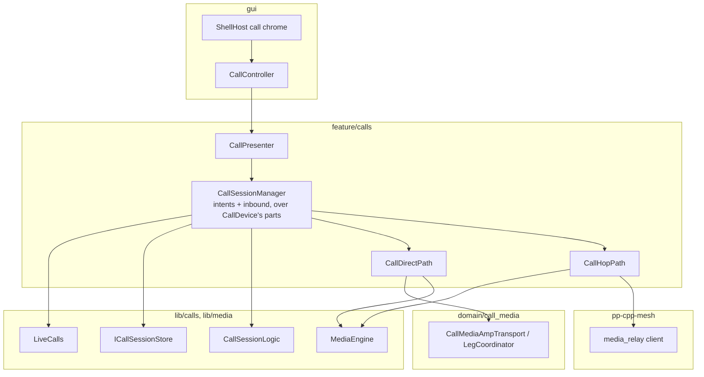
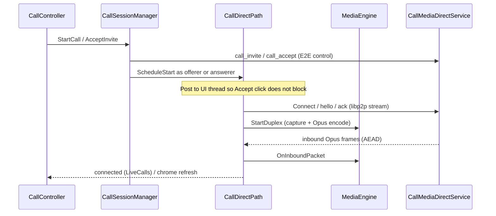

# Call domain architecture

**Tier:** architecture

**Product north star:** [NETWORKING.md](NETWORKING.md) — **HTTP + peer mesh**. Call media → **AMP** ([projects/adp](../../projects/adp/) D10 hard-require); libp2p retained for PeerId/crypto only. Wire-compat `call_sdp` / `call_ice` are ignored inbound; product does not send them.

**The designed call domain** — planes, layer ownership, topology rules, who owns a call's state. History (what landed when, extraction steps, device findings) lives in [`projects/p2p-av-calls/`](../../projects/p2p-av-calls/).

**Open delivery work:** [`projects/p2p-av-calls/`](../../projects/p2p-av-calls/).  
**Product ADRs:** [DECISIONS.md](../../projects/p2p-av-calls/DECISIONS.md) (through **V049** — V038 N=2 circuit for NAT, SoftMigrate N≥3 only; V049 simultaneous dial on Accept).  
**Host receive / QoS matrix:** [HOST_RECEIVE_POLICY.md](../../projects/p2p-av-calls/HOST_RECEIVE_POLICY.md) (V032 + V034 video frames / hop audio-priority drop).  
**Transport session machines:** [SESSION_MACHINES.md](../../projects/p2p-av-calls/SESSION_MACHINES.md) (V033) · [MEDIA_RELAY_ATTACH.md](../../projects/p2p-mesh/MEDIA_RELAY_ATTACH.md) (N026).  
**Wire controls:** [`contracts/WIRE_SCHEMAS.md`](../contracts/WIRE_SCHEMAS.md).  
**Messaging carrier:** [`P2P_MESSAGING.md`](P2P_MESSAGING.md).  
**SFU / mesh hop:** [`projects/p2p-mesh/`](../../projects/p2p-mesh/) (`media_relay`).  
**Hop dialability:** [`projects/media-hop-reachability/`](../../projects/media-hop-reachability/).

Do **not** restate the full product decision table here — link DECISIONS. Promote wire/disk shapes to `contracts/` when they harden. Dogfood “what works this week” lives only in project [CURRENT_STATE.md](../../projects/p2p-av-calls/CURRENT_STATE.md).

---

## Call lifecycle

What the device shows about calls is a **projection of its calls** ([`LiveCalls`](../../capabilities/calls/src/lib/calls/LiveCall.h)), not a separate state machine. Each `LiveCall` has a call state (Calling / Ringing / Accepting / Joined / Ended, driven by the session workflow) and its own media progress (the V037 Status, plus "live since the last failure" and "waiting for the key"). `LiveCall::Phase()` projects them to the `CallPhase` the chrome paints (`Idle`, `Ringing`, `Accepting`, `OutboundCalling`, `JoinedLocal`, `MediaPending`, `MediaConnecting`, `InCall`, `ConnectFailed`); `LiveCalls::Phase()` is the shown call's (the active call, else the ring). The UI's events go to `CallSessionManager::Apply(event)` (the ring seen or lost, accept / decline / leave / retry); the media paths report their progress to `LiveCalls` themselves (`Note*` through their arming ports), and the peer's reconnect for a failed call resumes it the same way. Heavy media logic stays in Bridge / Topology planners (V039).

| Owner | Responsibility |
|-------|----------------|
| **LiveCall / LiveCalls** | Per call: call state + media Status / progress; projection (`Phase`, `Status`, `Shown`); path gates (`AllowsDirectPath` / `AllowsHopPath` / `SoftMigrateMayArm`, armed planner); media cancel generation; change hook |
| **CallSessionManager** | UI intents (`Apply`: Accept dedupe, Decline, Leave, Retry; start / accept / decline / leave, mic / camera) and inbound call control (`ApplyInboundControl`: who may send what, then the workflow and the call's media); owns nothing — it drives the device's parts |
| **CallDevice** | the parts and their wiring: the workflow, `LiveCalls` and each call's media (building its paths), the seat, the hop service, the doorway, the control client, the media keys, billing, reach signals; the answerer kick after accept and the peer-reconnect restart; routes the parts' events; what the device shows (published by the stack) |
| **CallStack** | Publishes the projection in `CallUiState`; on a change refreshes chrome (UI) and wakes N025 listen when `WantEphemeralListen` (a call is shown) flips |
| **CallPresenter** | What the call surface shows and what its buttons do, headless: `CallScreen` (ring / answering / in call / none, conflict, pricing, roster, the status line from `DecideInCallStatus`) + one-shot `CallNotice`s; the buttons (start / join / picker, accept, decline, leave, retry, mute, camera, speaker, add people) → `Apply(event)`; the auto camera of video calls; "Make a group…" on a call with no group and 3+ in it, and the banner of a group someone in the call made (group-chat G022: Join / Not now; the call stays as it is). pp-app-probe drives the same presenter |
| **CallController** | Renders `CallScreen` (words, avatars, video, chrome modes) and owns the devices around it (ringtone, ringback, levels, metrics); Rml clicks → `CallPresenter`; chrome via `apply_chrome_update` → ShellHost Remount / DirtyCallChrome |
| **CallDirectPath** | Media-key defer, channel connect/retry; reports progress, connected, handed to a hop, failed, gave up, peer reconnected, deferred and key ready as `DirectReport` events on the calls owner's queue — the device moves `LiveCalls` on them, and starts the deferred answerer itself once its key is ready |
| **CallMediaConnectCoordinator** | The outbound 1:1 bundle: per attempt reach a link then open the bundle; watchdog (B42), 5 retries, fresh-link feedback (B39) |
| **CallMediaDoorway** | Device level (V056): owns the call-media transport's inbound handler — a hello is an event on the calls owner, parked until its epoch key is available, then handed to the call's 1:1 path (`CallMediaInboundPorts::on_accepted`) |
| **PeerReachCoordinator** | Call-agnostic link establishment to one peer (dial → circuit → punch, seed park); `Reach` / `Await` modes |
| **ICallMediaTransport** | 1:1 `/pp/realtime/1.0.0` — Amp `CallMediaAmpTransport` / `CallMediaLegCoordinator` ([A020](../../projects/adp/DECISIONS.md#a020--single-transport-entry-per-protocol) / D10) |
| **ConversationsHub** | N025 listen + mDNS as **call-driven** commands (`WantEphemeralListen`), not tick side effects |

The projection, per call (first match wins for a Calling / Joined call):

| Call state | Media progress | Phase |
|------------|----------------|-------|
| Ringing / Accepting / Ended | — | `Ringing` / `Accepting` / `Idle` |
| Calling / Joined | Status `Failed` | `ConnectFailed` (the call stays open: Retry / the peer's reconnect resumes it) |
| Calling / Joined | live since the last failure | `InCall` (Reconnecting / Migrating / DegradedTxOnly keep it) |
| Calling | — | `OutboundCalling` (nobody answered yet) |
| Joined | waiting for the key | `MediaPending` |
| Joined | a connecting Status, or we placed the call | `MediaConnecting` |
| Joined | — | `JoinedLocal` (our accept landed; Status `Deciding`) |

### Ringing handling

Ring chrome is the **ring `LiveCall`** (the newest Ringing / Accepting call), not a free-standing UI poll of `TopPendingInvite`. The controller may observe pending invites to paint labels, but phase / listen / Accept sequencing follow the calls.

```mermaid
sequenceDiagram
  participant WF as CallSessionWorkflow
  participant CSM as CallSessionManager
  participant Stack as CallStack
  participant Hub as ConversationsHub
  participant Ctrl as CallController
  participant UI as Shell_RemountCallChrome

  WF->>WF: inbound invite → LiveCalls AdmitInvited (Ringing)
  WF-->>Stack: calls changed
  Stack->>Hub: WantEphemeralListen=1 (IO only)
  Stack->>Ctrl: chrome refresh (UI)
  Ctrl->>UI: RemountCallChrome (mount only)
  Note over Ctrl,UI: Never full SyncLayout for ring/Accept overlays
  UI->>Ctrl: Accept / Decline click
  Ctrl->>CSM: Apply(AcceptClicked / DeclineClicked) on the calls owner
  alt Accept
    CSM->>WF: AcceptInvite (LiveCall Accepting; the seed park is asked for, not waited on)
    Stack->>Ctrl: chrome refresh (ring suppressed)
  else Decline or expire
    CSM->>WF: DeclineInvite → LiveCall Ended → Idle
  end
```

| Rule | Why |
|------|-----|
| An admitted invite → `Ringing` | The ring is the LiveCall's; arms N025 via `WantEphemeralListen` |
| Chrome layer = `RemountCallChrome` | Mount into `#shell-call-*-mount` only. Full-shell `SyncLayout` breaks Samsung hit-testing. Always-mounted `data-if` + Dirty alone failed to reveal Accept despite idle Present |
| Labels/pulse/icons = `DirtyCallChrome` | Via `apply_chrome_update(DirtyOnly)` while layer already mounted; does not create the overlay |
| The call surface's state steps live in the calls layer | `CallUiBackend::Settle` takes them on every surface refresh (invite seen / cleared, the orphan leave after a restart, the connect-health poll) and returns what to show (none / ringing / answering / in call); the GUI only renders it, and a headless driver (`pp-app-probe`) runs the same steps |
| Accept on the calls owner, never the click thread | The click only posts; the ring is suppressed from the click (`accepting_call_id`) until the accept answers |
| Accept starts the seed park and does not wait for it | The park makes us reachable for the caller's circuit, which is tried only after our `call_accept` reaches the caller. The accept names the relays we hold a reservation on then (`circuit_parked`, [H013](../../projects/media-hop-reachability/DECISIONS.md#h013--the-callee-advertises-where-it-is-parked)) and the caller's circuit tries those first; a relay waits about 3 s per StartBridge for our link, so a park landing a moment later still serves it. Waiting for it would hold every answer for as long as a silently-gone seed takes to time out. Only seeds a reachability probe *failed* to dial are left out of the park and the rendezvous surface — a device that never probed (client role: every phone) has not learned they are unreachable. The park redials a lost seed dial and gives up early when no seed can land (pp-cpp-mesh v1.1.0) |
| A second Accept click while one is in flight is not a second accept | Dedupe on the in-flight call id |
| Accept fail → back to `Ringing` | The workflow puts the call back to Ringing; `last_error` for the GUI |
| Decline / TTL expire / `call_ended` → `Idle` | The call closes; listen stops when nothing is shown |
| Conflict (2nd invite while outbound/in-call) | Conflict copy (`End & accept` / `Ignore`) that says who is calling and which call answering ends — "Carol is calling" / "Accepting ends your call with Bob." (a group's call: "…your call in {group}."; `MakeCallConflictCopy`, the screen's `ending`, [V064](../../projects/p2p-av-calls/DECISIONS.md#v064--call-waiting-hold--accept-not-now)); in the background the app's alert says the same, and the ring never goes to the phone's call screen. Accept implies leave-other-except; single active call — no Hold & Accept (V064). The active call stays shown over a second ring. Once the call taken is over and no other call is up, a 1:1 call it ended is offered back once: "Call Bob back?" → Call back calls from that chat, voice or video as it was (`CallBackOffer`; not for a group's call, whose chat offers Join, nor when the caller was that call's peer). It calls as the chat's call button and a tapped call record (#164) do — one path, `CallPresenter::CallFromChat`: a call that goes on in the chat is joined as it is, video this device cannot send goes voice, else `StartCall` as asked |
| Calling each other at once (1:1 invite from the peer our own unanswered call goes to) | No ring: both sides keep the call with the lower call id (same choice on each side, no message). The side whose call lost answers the winner as its own was placed (voice / video) and leaves its own with `LiveCallEndReason::Merged` (no history entry); the winner's side swallows the losing invite (stored Ended, so a redelivery is ignored) — `CallSessionWorkflow::CrossedCall`. The losing invite may land only after the loser already answered (a relay delivers it late): within 10 s of our call's start, an invite with a higher call id from the peer our answered 1:1 call goes to (for a group's invite: our call of that group someone joined, V053) is swallowed too and never rings over the call (`CrossedAnsweredCall`) — answering it ended the call both were in and joined one the peer had left (app lab `calling_each_other_at_once`, 2026-11-11) |
| Calling someone whose call rings here | Is answering it (`CallSessionManager::StartCall`) — not "decline the incoming call first" |
| Same-call duplicate pending | Keep in-call chrome; do not flip back to ring |
| Wire before durable Joined/pending (V045) | `CallInvite` / `CallAccept` / `CallDecline` succeed on the wire before Upsert Joined/Ringing/pending or planner arm; local Decline `EndCallLocal` like expire |

Instrument: INFO `[LiveCall] status=… phase=… reason=…` (and `admit` / `accepting` / `joined` / `close`) and `WantEphemeralListen=` so “no AcceptIncoming” vs “Accept ok, media stuck” is obvious on Android (release emit floor promotes INFO → WARNING for `adb logcat -s pp-browser:W`).

**State + Status ([V037](../../projects/p2p-av-calls/DECISIONS.md#v037--calllifecycle-state--status-one-planner-armed)):** `CallPhase` is the chrome/shell State, projected from the call; `CallMediaStatus` is the call's own and arms exactly one media planner (Bridge vs Topology). JoinedLocal / MediaPending / MediaConnecting are **Calling-like** for arming. SoftMigrate is Status `Migrating`, not a side flag. A new path decision (`Deciding`) or a call closing bumps the media cancel generation late path work compares.

Invite TTL / cancel (wire ageing, `call_ended` to Ringing peers) lives under [Two planes](#two-planes).

### The phone's own call screen (Android's call notification)

`CallSystemUiBridge` keeps the phone's call screen (`ICallSystemUi`: Android's incoming-call notification, P014) in step with the presenter's screen. iPhone has none (`Available()` is false): see [The iPhone's call alert](#the-iphones-call-alert).

- **Where a ring goes:** the app on screen rings itself; in the background, or while a push's call is waiting, the system screen rings it. "On screen" is `AppLifecycle::IsVisible()` — cleared only by going to the background proper (SDL's `DID_ENTER_BACKGROUND`). Meanwhile the app's own ring dialog and ringtone stay off (`SystemRings`): one ring.
- **A ring over a call never goes there** ([V064](../../projects/p2p-av-calls/DECISIONS.md#v064--call-waiting-hold--accept-not-now)): answering it ends the call this device is in, which the system screen's Answer does not say (the call in the app is not on it, so Android's notification does not know of it). The app rings it — its conflict ring, and in the background its alert ("Carol is calling" / "Accepting ends your call with Bob.") — and the push's call waiting for it is ended (diag `pending_over_call`); an Answer given on that push's call is not applied (`answer_over_call`: the app's ring asks), a Decline still is. A call answered on the notification stays there while a second rings in the app; End & accept ends it there too.
- **Answered there, it stays there until the call ends.** Accept's click frame already shows the call answering (`CallPresenter::Accept` → `AnsweringFrom`), and the bridge keeps a call answered there while the app takes it (until a frame shows it answering or in the call, at most `kAnswerSettleMs`, 5 s): Accept redraws at once, re-entering `Sync` inside the system screen's answer, and a frame in between must not end the call just answered (it did: the bridge forgot the call the instant it was answered, so a later hang-up from there reached nothing). The presenter accepts the call the system screen names.
- **A push's call** (`call_wake`, before the invite is read) is filled in with its ring: the ring found next. The push names no call (the relay's FCM data is only `{type}`), so the first ring takes it; an answer or decline on it comes with no call id, and one naming a call the notification does not show is dropped. A change of the push's call refreshes the call screen at once, so an Answer made before the ring was known applies as soon as the ring shows. Its waits: 75 s unanswered while the app cannot find rings (locked, PIN), 20 s (45 s answered) once it can, never more than 3 min; the choice is good for 60 s from the later of it and the unlock.
- **Asking costs nothing per frame.** A call redraws every tick, and each frame's `Sync` reads `Available()` and `HasPendingPushCall()`. `AndroidCallSystemUi` keeps both: availability (notifications allowed, the calls channel on — binder calls on Java's side) is asked again for each new ring (`RecheckAvailable`, from the bridge) and when the app comes back to the foreground; the pending flag comes with each change of it (`nativeOnPendingChanged(pending)`, under `PpCallNotifications`' lock), read from Java once before the first. The activity's class and method ids are looked up once.
- **Missed calls** are the 1:1 caller's history (`call_summary`, a chat message): a call the caller gave up on reads "Missed voice call" in the chat whether or not its invite ever rang here; a group's call invite too late to ring is recorded as missed by this device (V053). Neither needs the invite to ring.

### The iPhone's call alert

An iPhone has no PushKit and no CallKit ([P019](../../projects/push-notifications/DECISIONS.md#p019--ios-calls-ring-by-a-time-sensitive-alert-again-pushkit-and-callkit-are-removed)): with the PIN lock the background has no keys, so a VoIP push could not be turned into a ring. The relay sends a call as a Time Sensitive alert (`type: call_wake`, `wake_hint` = the call id).

- **App in front and unlocked:** the alert is not presented; the call wake sync finds the invite and the app rings itself (`CallController`).
- **Tap:** the app activates, asks for the PIN if locked (the PIN screen reads the call text while the tap is fresh, 90 s), syncs, and the ring of the tapped call id rings in the app and opens its chat (`PendingNotificationTap::TakeCallRoute`); answer with voice or video there. The call's audio starts in the app (`AudioSession::ActivateForVoip`).
- **Invite already expired** (about 65 s, `ShouldDropStaleInvite`): nothing rings; the caller's `call_summary` ("Missed voice call") synced and the tap's `wake_hint` finds it and opens the caller's chat (`TakeHintedRoute`).
- **No system call screen:** the ring is the notification's sound (`call.caf`, 29 s, bundled at the `Resources` root; the local call notification and the relay's `call_wake` `aps.sound` both name it, and a build without the file falls back to the default sound), which the silent switch silences; no AirPods or CarPlay answer.

### Thread policy

| Work | Thread | Why |
|------|--------|-----|
| Rml click / `DirtyCallChrome` / `RemountCallChrome` | UI only | Return immediately; **never** full-shell `SyncLayout` for call overlays (Samsung hit-test) |
| `AcceptInvite` / `DeclineInvite` / `LeaveCall` / send prep | Worker Critical/Normal | Posted by lifecycle; Leave uses Critical |
| Prefetch / circuit / dial wait / `Connect` | Worker | Seconds-scale waits; aborted via `connect_generation_` on Leave |
| N025 `ListenOn` / Wire / mDNS | Worker → asio | Driven by lifecycle `WantEphemeralListen`, not inventing policy from tick alone |
| `MediaEngine::StartDuplex` / `Stop` | **Calls owner** | Stop is called from the calls owner (`kMediaSessionsOwner`); it returns at once, and the session's capture/playout threads, devices and codecs are released on the session's own retirement thread (`FinishRetired`), so a hung device or hardware codec never holds the owner (L016) |
| Hub / process shutdown | UI | Stop+join ringtone → Abort circuit → Detach media_relay → `LeaveCall` (CallEnded) → `PrepareForTeardown`; Detach **before** `MediaEngine::Stop` so SFU `BlockingWrite` cannot hang quit. Ringtone join must precede `Backend::Shutdown` / `SDL_Quit` (accept-dialog quit hang). |
| Chrome refresh (`RefreshPendingRing` / `SyncShellState` / ringtone) | **Always hop to UI** + `apply_chrome_update` (Remount / DirtyCallChrome) + `RequestForceFrame` | Safe from worker **and coordinator**; Present depends on [THREADING.md UI delivery](THREADING.md#ui-delivery-pipeline) (mailbox liveness), not user input. Ringtone: `CallRingtone` loops `assets/sounds/call_ring.wav` on desktop **and** mobile; UI/Accept `Stop` is async (joinable reaper, never bare `.detach()`); `StopAndJoin` only on app shutdown. The speaker is a shared `MediaDeviceArbiter` lease, so ringing a second invite mixes over call audio; opens / closes are serialized on the arbiter's device thread (no ringtone-close vs call-open race). Caller ringback (`Tone::OutgoingRingback`, 450 Hz 1 s / 4 s, earpiece on phones) plays while `OutboundCalling`; its worker owns the phone audio-session activate / release per generation (fast cancel-redial safe), and call media waits for `CallRingtone::WaitUntilRingbackSessionReleased` before activating its own session. |

### Scenario matrix (v1)

| Scenario | Behavior |
|----------|----------|
| Incoming ring | `InviteSeen` → `Ringing`; Dirty-only chrome; listen desire on |
| Accept | Immediate `Accepting` + dismiss ring chrome + Connecting bar; worker AcceptInvite; suppress ring for accepting id |
| Decline / expire | Idle; listen desire off when no call |
| Outbound unanswered | Offerer `OutboundCalling` with no media past invite TTL (`kDefaultCallInviteTtlMs`) → auto-Leave; clears sticky Calling bar |
| Conflict (2nd invite) | Conflict copy (who is calling, which call ends); Accept leaves other local call first; single active call; "Call {name} back?" once the call taken is over (V064) |
| Leave / remote end | Idle; `StopCallMedia` (Detach SFU then SDL Stop) on UI; LeaveCall on Critical. Every end names its reason at the source (`LiveCallEndReason` on the call's `LiveCall`). When the peer ended or declined a call this side had placed or was in (not a ring it withdrew), the UI shows it once: "*name* ended the call" / "*name* declined the call" |
| Answerer before key | Media deferred → `MediaPending` until the key is ready |
| Connect fails (either role) | `ConnectFailed` — the call stays **open** (failed ≠ closed; no auto-close). Retry re-enters `MediaConnecting`; the peer's connection for the call (its Retry) arrives as a peer reconnect and resumes media over that stream (no redial). Only Leave / remote end closes it |
| Listen fail / no bound port | Surface error; stay `MediaPending` / `ConnectFailed`; Retry re-arms listen |
| Stack rebuild | A call's 1:1 path is rebuilt only when the call-media transport changes |

**1:1 libp2p chrome ([V037](../../projects/p2p-av-calls/DECISIONS.md#v037--calllifecycle-state--status-one-planner-armed)):** Connected when `InCall` **and** Status is `DirectLive` or `HopLive` — not `StartDuplex` alone, not TX-only (`DegradedTxOnly`). Bridge / hop CompleteAttach report Live to `LiveCalls`; the seat holds no media state ([V036](../../projects/p2p-av-calls/DECISIONS.md#v036--mediaseat--exclusive-media-epoch), lock only per V055).

---

## Two planes

| Plane | Carrier | Job |
|-------|---------|-----|
| **Signaling** | Direct E2E system `ChatPayload` (`call_invite`, `call_accept`, `call_sfu_attach`, …; wire-compat `call_sdp` / `call_ice` ignored) | Roster, invite/accept/leave, media-key epochs, SFU attach hints |
| **Media** | libp2p direct and/or blind `media_relay` | Opus + H264 **video_lo** (V034); app E2E under **one shared call media key** (V004 — encrypt once, hop fans out); SDL I/O |

Signaling rides the same P2P/messaging stack as chat. Media never goes through the chat relay as RTP; the SFU is a **blind forwarder** (no call media keys). Group video is **not** encrypted per subscriber: the publisher seals each AU once under the epoch key; the hop copies ciphertext.

**Invite TTL / cancel:** default ring TTL is 60s. Inbox-delivered invites use relay `created_at` + poll `server_time` (age = server_time − created_at); drop when age exceeds TTL + small slack. Without those samples (direct delivery), wire `expires_at` may be re-armed only if still within skew slack of local now — long-backlogged invites are not re-armed. Cancel/end fans out `call_ended` to Joined **and** Ringing/Invited peers so late inbox delivery can clear the ring.



---

## Call media paths (1:1 — call-path-resilience)

A 1:1 call's media rides a **path**: control + media channels bound on one link to the peer, either direct (ADP, dialed or punched) or relayed (a nested link over a circuit carrier). The call keeps a small **path set** and moves between paths without restarting — `CallMediaLegCoordinator` (feature/call_media) owns it; `CallDirectPath` (feature/calls) decides when to ask. Wire: [AMP-CHANNEL.md § Path migration / § Path liveness and failover / § Ending a call](../contracts/AMP-CHANNEL.md#path-migration-make-before-break--call-path-resilience-k3). Decisions: [projects/call-path-resilience/DECISIONS.md](../../projects/call-path-resilience/DECISIONS.md).

| Path | Meaning |
|------|---------|
| **active** | TX goes here; RX is taken from every path of the call (transport-side seq de-dupe) |
| **candidate** | Being brought up by a migration (make-before-break) |
| **retiring** | The previous active path, drained until the driver's `path_release` is acknowledged |
| **standby** | A warm fallback path (bound channels, 10 s heartbeat) — relayed preferred. Either what a migration left behind, or added on purpose: the offerer of a call Live on a direct / punched path adds a relayed one (`path_add`, K003 — best-effort, a loaded relay refuses the least needed first) |

| Situation | Behaviour | Home |
|-----------|-----------|------|
| Leg start, the peer's dial key held by a dial still in flight | The first path opens on any Connected link to the peer (direct first, then the relay carrier); only with none up does it dial by key (#235) | `OpenOutboundControl` over Amp `ResolveConnectedLink` |
| Relayed call, a direct link to the peer is Connected | The glare winner (offerer) migrates onto it (10 s backoff, `kCallMediaAutoMigrateBackoffMs`; never back onto the direct link the call left) | `MaybeAutoMigrate` |
| Relayed call, Live | The offerer punches for a direct link at +3 / +20 / +60 s, the circuit's relay as introducer; a landed punch is picked up by the row above | `CallDirectPath::ArmDirectUpgrade` → `PeerReachCoordinator::UpgradeToDirect` |
| TX-only (no frames arriving — a muted mic still sends silence frames) | Migrate onto a circuit under the live call; break-before-make escalation only if that fails | `EscalateTxOnlyViaCircuit` / `EscalateBreakBeforeMake` |
| Active link lost, or 1.5 s silent from a heartbeating peer | TX onto the standby at once; the peer follows its `active` heartbeat | `FailOverToStandby` |
| Active silent 3 s from a heartbeating peer, no standby | Lost (the row below): the peer's app died or its network went. The link under the path can stay Connected for most of a minute (its liveness window follows the keepalive cadence) | `ShouldEnterPathLost` |
| Active lost, no standby, peer still Connected on another link (dual-dial election after a simultaneous punch) | Quiet rebind: the offerer migrates there; nothing is reported unless it has not landed in 1 s (K011) | `EnterPathLost` |
| No path at all | `Reconnecting…` (planner `Reconnecting`, lifecycle `CallMediaStatus::Reconnecting`, timer runs on) for 30 s (`kCallMediaReconnectWindowMs`) while the offerer re-anchors (reach + migrate, the same reach request as the first connect: pair policy — a relay-only pair stays on relays — and the answerer's advertised relays, H013; retried every 2 s); then the call **dropped** (`CallMediaErr::Dropped`, "Call dropped") | `CallDirectPath::Reanchor`, `ApplyReachPolicy` |
| The peer closes the active path without `bye` (it lost the path to silence; a peer from before K014 hanging up) | A lost path, as the rows above — never the call's end; a closed media channel first waits 1.5 s for its control channel's `bye` / close (K014) | `DecideCallMediaActiveClose` |
| The peer hangs up | Its `bye` ends the leg at once (`on_remote_ended`); the call stays as it is until the peer's `call_leave` ends it (`RemoteEnded`) — or, none within **5 s** (`kPeerByeLeaveGrace`), the bye stands in for it (`ParticipantGone`). The bye stands for the peer's join it ended: the peer's leave or a join of its own (`CommitRemoteJoin`) within the grace settles it, so a member who left and rejoined is not ended by it. Never a failure, never `Reconnecting…` | `HandleBye`, `CallSessionWorkflow::NotePeerEndedCall` |
| This end hangs up (its call closed, then the media stops) | `bye` on the call's active path, then the channels close (`ICallMediaTransport::HangUp(call_id)`); a stop of a call still open (a failed connect, a restart) closes without `bye`. Both name the call: the device's one transport serves its calls in turn, so a late stop of an ended call reaches no other call's leg | `CallDirectPath::StopMeshMedia` |
| The device's network changed (k5) | Amp probes every link and drops the dead ones within 2 s (so the rows above fire at once); a reconnecting call re-anchors once links settled; a relayed call's upgrade punches start over ([MESH.md § Local network change](MESH.md#local-network-change-call-path-resilience-k5)) | `CallDirectPath::OnLocalNetworkChanged` |

**Voice / video answer ([V051](../../projects/p2p-av-calls/DECISIONS.md#v051--voice-or-video-answer-video-calls-start-with-the-camera-on)).** `call_accept` may carry `video_allowed: false`, written only when the callee answers a video call as voice. A missing field means unchanged; the field never widens. The callee narrows its own session; the caller narrows the call only for a call started from a direct thread (no `origin_group_id`). Video calls turn the local camera on once media connects — held while the camera button would be hidden, and on the caller while the answer is only implicit (B30).

**An account with several devices ([multi-device M021](../../projects/multi-device-account/DECISIONS.md#m021--per-device-sessions-a-master-device-keeps-the-device-list-stated-limits) d5).** A call invite is a control-lane account copy, so every device of the callee rings. The device that answers (or declines) tells its siblings with `call_answered_elsewhere` `{ call_id, accepted }` — a control-lane notice to its own account (`CallDeliveryPorts::notify_own_devices`); a sibling still ringing for that call stops (`LiveCallEndReason::AnsweredElsewhere`: no history there, nothing sent to the caller). Honoured only from our own account. Lab `a_call_rings_every_device_and_stops_once_answered`.

**Group calls: join, stay, end ([V053](../../projects/p2p-av-calls/DECISIONS.md#v053--group-calls-behave-like-teams--signal-join-while-it-lasts-stay-when-alone-removal-ends-your-part)).** A group call (`origin_group_id`, or more than two offered) lasts while anyone is in it: `TransitionOnLeave(…, group)` ends it only when nobody remains, and the last one in waits (`kAloneInGroupCallMs`, 2 min, counting down on its screen as "Waiting for others… m:ss", then leaves by itself and says so; the app asleep starts the wait over). A live group call where nothing (audio or video, muted peers included: they send silent frames) arrives from anyone for 30 s is left too (`StepNoMediaWatch`, B97; connecting, moving and reconnecting pause it). Whoever it was offered to and is not in it — declined, missed, left — sees it as joinable (`JoinableGroupCall`: someone else Joined, within 6 h); the call button on that group joins it (`StartCall` → `JoinCall`) and reads "Join" meanwhile (on phones the call bar's "Join" takes over while it shows, so the header button goes back to the phone icon). Two members calling the group at once keep the lower call id, as two people calling each other do (`CrossedCall` → `OurUnansweredGroupCall`). The joiner sends `call_join_request` to the participants; the earliest joiner still in answers with the mid-call invite, which the joiner accepts without ringing (sent non-urgent, so the relay sends no wake push and no system call screen appears; a retry at half of `kJoinRequestTimeoutMs` with `any` lets anyone answer; no answer means it ended). A roster listing someone who left as Joined brings them back only with a `joined_at` newer than theirs. Who drops out of the group drops out of its call: the group's roster store says who it took off (left, removed, dropped by a check) or that the group ended (`GroupRosterChange`), the hub hands that to the calls participant, and the calls loop takes them as left (`GroupMembersGone`: key rotation), leaving when this device is the one or the group ended ([V058](../../projects/p2p-av-calls/DECISIONS.md#v058--call-control-is-live-on-the-control-lane-group-calls-ride-the-groups-roster) 3); only members may ask to join (`CallDeliveryPorts::group_members`). The last one's `call_ended` goes to everyone offered. Signaling to several (roster, attach, ended, join requests) goes out through the control lane's send to many (`CallControlClient::SendToEach`), sealed per pair off the calls loop. Invites go one by one on the calls loop, since an accept must find its invite recorded, and ring whoever can be invited: a start fails only when nobody could be (V058 2). Each media key rotation (V003) reaches the hop path: `SfuKeyRing` seals with the newest epoch and opens the previous one for 3 s.

**Guests in a group's call ([V062](../../projects/p2p-av-calls/DECISIONS.md#v062--guests-in-a-groups-call-labelled-brought-by-members-removed-by-owner-and-admins)).** In a call with an `origin_group_id`, someone outside the group's roster is a guest; the group keeps order in its call as it does for invites ([group-chat G017](../../projects/group-chat/DECISIONS.md#g017--open-groups-roles-and-two-presets)). Calls read the group through one port in their own words, `CallDeliveryPorts::group_standing` → `CallGroupStanding` (member; may bring a guest: `GroupAllows(BringCallGuest, role, preset)`, any member in an Open group, the owner and admins in a Managed one; may remove a guest: owner and admins; may invite to the group), filled by the product layer from messaging's roster store and preset (`feature/product/CallGroupStandings`); none means this device holds no roster for the group — a guest's. The decisions are pure (`lib/calls/CallGuests`):

| Rule | Detail |
|------|--------|
| Brought by | The mid-call invite of a non-member carries `guest: true` and `brought_by` (the inviter) — additive, both or neither; roster rows (`call_roster`, the invite's `participants`) carry them the same way, and the participant row keeps `brought_by` once known (`CallParticipant::brought_by`, the stores' `call_participants.brought_by`). The tile reads "Guest" (desktop cards and roster chips, phone tiles) and every participant is told once "{name} joined as {bringer}'s guest" (`CallNotice::GuestJoined`). Someone who joined the group since is no guest any more (`ShowsAsGuest` reads the roster) |
| Who may bring one | `DecideCallAdd`: a member allowed to under the preset; inviting a member is an ordinary invite; a device with no roster for the group (a guest's) adds nobody — guests do not bring guests, and it hides Add people. The bringer's device refuses the invite (and its picker leaves out non-members); every receiver drops a guest's entry from a roster or invite roster unless its `brought_by` names a member allowed to bring one (`TakesCallRosterEntry`). A guest's own device cannot check and takes the invite; it rings with "Joining shows you to the N people in this call." |
| Removal | `call_remove {call_id, identity}` (control lane; the gate takes it from someone in the call). The owner and admins send it, for a guest only ("Remove from call…", asks first): to everyone in the call or ringing, the guest too, then the guest's leave here. Every device checks it (`DecideCallRemove`): from the owner or an admin, naming a non-member, it is the guest's leave (`ParticipantGone`: the key rotates without them, V003); naming this device's account on a guest's device (no roster to check by), it leaves the call ("You were removed from the call"); another guest's device follows it for someone labelled a guest. Refused: naming a member (members leave a call by leaving the group, V053), from anyone else, or in a call with no group. A device that ignores it is cut off by the rotation |
| A guest stays a guest | No chat history, no member list, no group membership. With no roster for the group a guest's device has no Join and answers no join request; a member's device drops a join request from someone not in the group, so a guest who left cannot ask back in — a member in the call brings them back (a new guest invite). "Add {name} to the group" on a guest, for whoever may invite to the group (`GroupAllows(Invite, …)`: Open any member, Managed the owner and admins — group-chat G019): the ordinary invite made in the call (`GroupMembershipWorkflow::InviteFromCall`: `context: "call"` and the call id, which the guest's `contacts_only` policy takes from someone it is in that call with, G022) |
| No group | Unchanged: anyone adds anyone, nobody removes anyone |

pp-app-probe `call_remove` / `call_add_guest_to_group`, `state`'s `members` (`guest`, `brought_by`, `can_remove`, `can_add_to_group`), `ring_guest` / `ring_people` and `media_epoch`; app lab `group_call_guest`.

**Where the answerer is reachable ([H013](../../projects/media-hop-reachability/DECISIONS.md#h013--the-callee-advertises-where-it-is-parked)).** `call_accept` carries `circuit_parked`: the relay PeerIds holding a circuit reservation for the answerer when it answers (at most 4, ids only), read from the mesh's published view. The caller's circuit tries them first, in that order, then its own ranking; a `not registered` miss is retried once only on an advertised relay. The answerer waits for the caller's circuit up to **60 s** from the start of its reach (`await_hold_ms`), since the caller starts only once the accept crossed its inbox; the wait ends sooner when a link comes up or when the caller's connect gives up and it sends `call_connect_give_up` `{call_id, identity}` (additive — old peers ignore it), so both screens leave "connecting" together.

**Mobility and pair policy (k6).** Each end classifies itself `stationary | mobile | unknown` (`MobilityClassifier`: cellular or metered attachment → mobile at once; three attachment / observed-address changes in 10 min → mobile; back to stationary after 5 min calm; K004) and advertises it as `caps.mobility` on `call_invite` / `call_accept` (no `caps.v` bump; missing → unknown, K005). A mid-call flip is sent as `call_caps_update` `{call_id, identity, caps}` (additive plumbing — old peers ignore it). Both ends compute the same `CallPathPolicy` from the two classes (`DecideCallPathPolicy`, K013):

| Pair | Call-start punch (answerer's Await) | Offerer's circuit at start | Upgrade punches | Relay | Standby priority |
|------|------|------|------|------|------|
| Stationary / Stationary | yes | after the direct dial's budget (12 s) | yes | standby | low (direct), medium (punched) |
| any Unknown, no Mobile | yes | after the direct dial's budget (12 s) | yes | standby | high |
| any Mobile | no — waits for the offerer's circuit | **beside the direct dial** (`race_circuit_at_start`, K015) | no | **anchor** (the call stays relayed) | high |

**The anchor pair races the circuit** ([K015](../../projects/call-path-resilience/DECISIONS.md#k015--a-call-whose-relay-is-the-anchor-races-the-circuit-beside-the-direct-dial-the-app-remembers-its-last-good-relays), #577). The offerer's reach sets `PeerReachRequest::race_circuit` when the policy says `race_circuit_at_start` (`CallDirectPath::ApplyReachPolicy`): the circuit starts with the direct dial and the first link to connect carries the call — a direct one that lands first still settles it Direct. Without it a peer the dial cannot reach cost the dial's 12 s budget (a 9 s handshake timeout, the pivot at 12 s) before the circuit even started. The re-anchor (k4) races too — it builds its reach with the same policy and the call is silent until it lands. A relay-only pair has no dial to race (`RelayOnlyPolicy` clears it); the relay standby and the TX-only escalation are `exclude_direct` circuits, nothing to race; Await ignores it. The mesh only races a dial to a public Preferred (pp-cpp-mesh PEER_REACH § 5). Logged on `Connect start … race_circuit=`, the re-anchor's `reconnect:` line and `path policy`. Where the circuit goes first after a start is the app's last good relays ([NETWORKING § Last good relays](NETWORKING.md#address-disclosure-privacy)).

**Privacy narrows the policy** (projects/privacy T1): a call whose peer may not learn our address (outside `mesh.direct_connections`; [NETWORKING § Address disclosure](NETWORKING.md#address-disclosure-privacy)) gets `RelayOnlyPolicy` from `CallStack::PathPolicyFor` — no direct dial, no punch, no k3 upgrade, the relay anchors — and its invite / accept carry no listen addresses.

Override (dogfood / lab): config `mesh.mobility` (`auto | stationary | mobile`) or `--mobility=`. Owner: `CallStack` (classifier + per-call remote classes, fed by `NetworkMonitor` and the hub's observed-address changes); consumers: `CallDirectPath` (upgrade, relay standby, reach `allow_punch` and `race_circuit`).

Product surface: `on_path_changed` → planner `PathMigrated` (Live stays Live; the path label follows the bound link), `on_path_lost` → `Reconnecting` (unless the call is moving onto the hop: a peer's SoftMigrate release closes the 1:1 stream without `bye`), `on_remote_ended` → the peer's end (above). A leg that had connected and ends under the call — the reconnect window ran out, its link went — is reported (`on_failed`, `CallMediaErr::Dropped`), and the connect-health tick never calls a call that was connected a connect timeout: a stream gone after connect with no report for 2 s (`kDirectStreamGoneGraceMs`) is a dropped call too, so it is not left `InCall` with no media until the 75 s connect budget. Both take the dropped-call path, read from the code, never the message (`CallDirectPath::SurfaceDropped`): planner event `Dropped`, `direct_report::Dropped` (`LiveCalls::NoteMediaDropped`: the call stays open, `Failed`, so a late reconnect of the peer's still resumes it), a media error of kind `CallMediaErrorKind::Dropped` — and none of a connect failure's bookkeeping: no `ConnectFailed`, no "couldn't connect" (`IsMeshConnectFailed` stays false), no `call_connect_give_up` to the peer. A dropped call shows "Call dropped" (`call.status.disconnected`: the call screen's `Disconnected` page, a call that was live and failed) and closes by itself (B89); the kind keeps it from a second prompt (#181), as `ConnectTimeout` does for the 75 s connect budget's "Couldn't reach them" page. Roles: the offerer is the glare winner and drives; a bundle born from the peer's hello takes the complementary role. Lab coverage: hard-w5 Phase-9 UPGRADE (relayed → direct → blackholed → relayed standby), Phase-10 PUNCH, Phase-11 FLIP (address change mid-call → failover onto the added relay standby) and Phase-12 MOBILE (a pinned mobile end keeps a punchable call on the relay) ([HARD_LAB.md](../../packaging/pp-node/HARD_LAB.md)).

## Topology rules (V021 + V026 + V038)

| Joined N | Media path (target) | Notes |
|----------|---------------------|-------|
| 1 (ringing / solo) | No media yet | Invite outstanding |
| **2** | **Direct Amp call-media** when dialable; else **punch → circuit** nested Session | [V038](../../projects/p2p-av-calls/DECISIONS.md#v038--n2-circuit-for-nat-softmigrate-reserved-for-n3) — never SoftMigrate for NAT |
| **≥3** | **SFU** via `media_relay` hop | Soft-migrate same `call_id`; the owner picks the hop ([§ Group call hop](#group-call-hop--the-rule-now)); circuit may still reach the hop |

- Soft-migrate on 2→3: keep session/roster/key epoch; tear down 1:1 call-media after SFU attach.
- **Monotonic group topology ([V050](../../projects/p2p-av-calls/DECISIONS.md#v050--group-call-topology-11-first-planned-hop-monotonic)):** planners arm on **joined** count on every side (ringing never arms the hop); the first accept is direct 1:1, the third join migrates onto the **planned hop** chosen at StartCall from the invite list (one adjustment if an accept reported it unreachable); later joins re-pick only when the hop is full or unreachable for the newcomer, and a joiner whose accept arrives after the hop was announced is told it again — by the hop itself when it is a member's device, else by the call's owner (the earliest-joined participant; one sender, `RefanOutHopForJoiner`) — or it would wait out the attach wait and leave (`no_media_relay_hop`); nobody leaving triggers re-evaluation (N→2 stays on the hop). The earliest-joined remaining participant owns re-picks after the initiator leaves.
- Mid-call guest without a hop: refuse or eject — do **not** leave invitee on Connecting while existing peers stay on direct media.
- Auto `media_relay` attach is **group-only**; 1:1 undialable recovery is Amp dial / punch / circuit (V025/V038).
- **Hop dial:** SoftMigrate needs stack dialability — [media-hop-reachability](../../projects/media-hop-reachability/) (Amp mesh, H001/H007; punch H009).
- **`MediaEngine::StartDuplex`:** starts capture + duplex send fn for **both** 1:1 Amp and hop SFU — not “join SFU” alone (document-only name; V038).

`CallMediaTopology` (`ShouldUseMediaRelay` = N≥3 only) matches V038.

---

## Lifecycle sequences

Module timing across the two planes. Product invite/roster rules stay in [DESIGN.md](../../projects/p2p-av-calls/DESIGN.md). Race mitigations summarized again under [Critical races](#critical-races-keep-documented-next-to-code).

### 1:1 happy path (N=2)



### Media-key defer (answerer before key)

Answerer may reach `JoinedLocal` before `CallMediaKey` arrives. `CallDirectPath` reports the media deferred → `MediaPending` until the key lands, then enters `MediaConnecting`.

### Soft-migrate 2→3 (V025)

```mermaid
sequenceDiagram
  participant UI as CallController
  participant CSM as CallSessionManager
  participant L2P as CallDirectPath
  participant Topo as CallHopPath
  participant Eng as MediaEngine
  participant DM as Direct_DM
  participant SFU as MediaRelayService

  Note over UI,SFU: Soft-migrate when joined goes 2 to 3
  UI->>CSM: Accept / inbound CallAccept
  CSM->>Topo: OnRemoteAcceptJoined or OnLocalAcceptJoined n=3
  Topo->>Topo: Rank hops quote
  Topo->>SFU: AttachLocal
  Topo->>Eng: StartDuplex
  Topo->>DM: FanOut call_sfu_attach
  DM-->>CSM: peers CallSfuAttach
  CSM->>Topo: OnInboundSfuAttach
  L2P->>L2P: ReleaseDirectTransport once the others are heard on the hop (≤ 10 s; keep engine capture)

  Note over L2P,Topo: 1:1 connect fail — Retry libp2p dial only (no auto SFU)
  L2P-->>CSM: ConnectFailed
  UI->>CSM: RetryDirectMedia
  CSM->>L2P: rebuild offerer dial
```

**The move keeps its 1:1 link until the others are on the hop (#431).** The picker drops its 1:1
leg only when every remote stream has been heard on the hop since its own attach, or after
`kKeepDirectUntilHopHeardMs` (10 s) — `ReleaseDirectAfterHopAttachNow`. Meanwhile the leg keeps the
link to the 1:1 peer alive, and call control to a peer with a live link goes over it at once as
well as by the relay (`ControlAlsoGoesDirect`): the peer gets `call_sfu_attach` in milliseconds
rather than whenever its inbox delivers (seen at ~30 s). The receiving control lane applies the
first copy and drops the other.

---

## Layer ownership

Respect [`SRC_LAYOUT.md`](SRC_LAYOUT.md): `app → gui → feature → domain → lib → foundation → common`. Object lifetimes follow [OWNERSHIP.md](OWNERSHIP.md) (parent-only destroy; UI affinity for SDL / ringtone teardown).

| Concern | Layer | Today | Target |
|---------|-------|-------|--------|
| Session rows, invites, participants | `lib/calls` | `ICallSessionStore` (written only by the session workflow) over `ICallSessionReader` (what every other part holds), `CallTypes`, `CallSessionLogic`; what a call's rows say and a peer's roster applied to them in **`CallSessionQueries`** (`call_queries::*`, `ApplyCallRosterToStore`) | Unchanged |
| Control encode/decode | `lib/calls` | `CallControlCodec` | Unchanged |
| PC / Opus / H264 / SDL | `lib/media` | `MediaEngine` | libp2p/SFU packet transport only |
| Adaptation policy | `lib/calls` | `CallMediaAdaptation`, `CallMediaTopology` (the engine applies `MediaTargets`) | Moved from `lib/media` (CR023 step 2) |
| Call stack ownership (phase assembly + media plane) | `feature/calls` | **`CallStack`** + **`CallMediaPlane`** | Stack owns stores / the device (`CallDevice`) and the session manager over it / the read side (`CallReads`) and phase-orders the plane; plane owns the call_media Amp transport and builds the 1:1 path's deps and the topology's relay deps (the device owns the seat; each call's `CallMedia` its paths) ([V040](../../projects/p2p-av-calls/DECISIONS.md#v040--callmediaplane--callstack-ownership-collapse)); dial registry / circuit reach / parking are the hub's shared `MeshConnectivity` and the media_relay client its `MeshMediaRelay`, both borrowed ([L015](../../projects/media-client-layers/DECISIONS.md#l015--a-neutral-meshmediaplane-in-domainmesh-owned-by-the-product-hub-lent-to-calls-and-broadcast)); `CallsParticipant` (`feature/product`) owns the stack and drives it from the hub's lifecycle; `CallUiBackend` binds the stack |
| **Exclusive media bind (epoch)** | `lib/calls` | **`CallMediaSeat`**, driven per call by **`CallMedia`** ([V036](../../projects/p2p-av-calls/DECISIONS.md#v036--mediaseat--exclusive-media-epoch)) | Sole `Acquire`/`Release`/`NoteStart`/`IsBound` and the one hop attach flight; path ops token-gated (`AllowsPathOp`); SoftMigrate = path replace under same token. A lock only: no media state, no path |
| Session lifecycle + inbound dispatch | `feature/calls` | **`CallSessionManager`** | Signaling only for duplex start/stop (seat + path façades); mute/camera stay device controls |
| 1:1 phase / ring / listen desire | `lib/calls` | **`LiveCalls`** projection (each call's `CallMedia` in `feature/calls` **`LiveCallMedia`**); intents on **`CallSessionManager::Apply`** | Phase projected from the calls; see [Ringing handling](#ringing-handling) |
| 1:1 Amp dial + connect-fail / Retry | `feature/calls` | **`CallDirectPath`** (the call's `CallDirectDriver`) | Direct path under seat token |
| Soft-migrate / attach-wait / hop pick | `feature/calls` | **`CallHopPath`** (hop side of the call's coordinator) | Hop path under seat token |
| N→planner select (pure) | `lib/calls` | **`CallMediaPlannerSelectLogic`** | Joined N (V050); arm Hop vs Direct; relay-cap SoftMigrate nudge gates |
| Direct planner Apply (V039) | `feature/calls` | **`CallDirectPath`** + **`CallDirectPlannerLogic`** (`lib/calls`) | Schedule/Key/Connect/TX-only/Release; health timer |
| Hop planner Apply (V039) | `feature/calls` | **`CallHopPath`** + **`CallHopPlannerLogic`** (`lib/calls`) | SoftMigrate/attach-wait/inbound SFU; attach-wait timer |
| Media keys wrap/unwrap | `lib/calls` | `ICallMediaKeyStore` | Unchanged |
| Media keys between peers | `lib/calls` | **`CallMediaKeyExchange`** (owned by `CallDevice`, which fills its `Transport` from `CallControlClient`) | Mint (new call / rotation), wrap into the invite, send `CallMediaKey` (accept, resend, rotation), take a peer's wrapped key → "key ready" (V015 answerer start); the workflow decides when and moves the call's row to the epoch (`AdoptMediaEpoch`: forward only, `StepFor`) — the exchange never writes the row |
| Ring / in-call chrome | `feature/ui` | `CallController`, `CallChromeSync`, `ShellCallChromeGesture`, `ShellHost::ApplyCallChromeUpdate` | Layer identity / control *presence* / **mode** (Expanded/Immersive/Minimized — V031) / status kind → remount; mute/speaker/camera icons → DirtyCallChrome (`data-attr-src` + `data-class-*--on`); meters/pulse/quality chip → DirtyCallChrome; mobile speaker via `AudioSession` |
| Call media health | `lib/media` + `feature/ui` | `CallMediaHealth`, `MediaEngine::HealthSnapshot`, hop `HealthSnapshot`, `CallController::ApplyMediaHealth` / `ShowCallDetails` | Tier A quality bars always; Call details for everyone, with a **Network** line when the call's link is known — smoothed round trip and Reliable resend % between 2 s samples (`CallLinkHealthBetween`) of the association the call rides: the 1:1 call-media link (`ICallMediaTransport::ActiveLinkCounters`; a relayed call reads the association under its carrier) or, on a hop, the link to the relay (`CallHopHealth::link`). Informative only: media is BestEffort, so these figures do not grade the call; debug subtitle + rich diagnostics behind profile `call_diagnostics` or `--debug`; `media_health` INFO ~2s |
| Blind SFU protocol | pp-cpp-mesh | `MediaRelayServer` | Unchanged |

UI must not choose P2P vs SFU. It posts clicks to `CallSessionManager::Apply` and paints from session + the projected phase; it does not invent listen or media policy.

---

## Major systems (relationships)

### ConversationsHub / CallStack (through `CallsParticipant`)
`CallStack` (`feature/calls`) is a **phase assembler** ([V040](../../projects/p2p-av-calls/DECISIONS.md#v040--callmediaplane--callstack-ownership-collapse) / [V041](../../projects/p2p-av-calls/DECISIONS.md#v041--calllifecycle-signaling-ports--stack-composition-root)): profile stores (`ICallSessionStore`, `ICallMediaKeyStore`, `MediaEngine`), `CallDevice` (the parts: the seat, the workflow, the calls and their media, …) with `CallSessionManager` over it, and `unique_ptr<CallMediaPlane>`. **`CallMediaPlane`** owns the Amp call-media transport; the device keeps the device-level 1:1 deps (`AttachDirectPath` on the plane's transport) and the inbound doorway; each call's 1:1 path (`CallDirectPath`) is built for that call by its `CallMedia` on first use and lives with it ([V056](../../projects/p2p-av-calls/DECISIONS.md#v056--device-level-and-call-level-the-media-paths-are-per-call-objects)); each call's group path (`CallHopPath`) is built the same way from the device's `CallHopService`; the seat sits beside them; the dial registry + listen book, circuit reach and rendezvous parking live in the hub-owned **`MeshConnectivity`** (pp-cpp-mesh `connectivity`) and the media_relay client in **`MeshMediaRelay`** (pp-cpp-mesh `media_plane`, L015), which the stack borrows through `CallStackDeps::connectivity` / `media_relay`. The stack hands the device the plane's `DirectPathDeps` and installs relay deps onto it — the plane does **not** hold standing live refs to CSM/stores. N025 listen *desire* is "a call is shown" (`LiveCalls::Phase() != Idle`); the stack wakes Hub sync when it flips. The hub never names the stack: `CallsParticipant` (`feature/product`, a `HubParticipant` the `ProductStack` registers) owns it, builds `CallStackDeps` from what the hub lends (stores, delivery through the current orchestrator, mesh/config/mDNS glue, the neutral mesh objects) and maps the hub's lifecycle hooks onto it. Calls sees the layers below only through role interfaces ([V055](../../projects/p2p-av-calls/DECISIONS.md#v055--call-model-first-one-owner-per-fact-calls-down--events-up-one-media-call-per-device)): the chats a call starts from (`IThreadCatalog`) and where an unsent summary lands (`IThreadTranscript`), the contacts (`IContactBook`), this device's account without its keys (`ILocalAccount`: the account id and the call floor), initiation billing (`IInitiationBillingBook`), and delivery's ports — the media key rides the lane message itself, whose copies delivery seals per device of the peer's (M024); calls hold no session key of their own. The hub still owns mesh admission, LAN mDNS, N025 listen *execution* (Hub `SyncMobileEphemeralListen`), and inbound control routing via `RelayReceivePipeline` → `ApplyInboundControl`. Build/teardown order: Hub `Initialize` → `OnStoresOpened` → `CallStack::InitializeStores`; each messaging stack built → `OnMessagingBuilt` → `BuildSessions` (once: while sessions exist it keeps them — Amp attach no longer rebuilds them, which dropped a call already ringing over the relay); mesh up → `DetachMeshMedia` → `MeshConnectivity::Wire` → `MeshMediaRelay::Wire` → `OnMeshServicesStarted`; capability refresh → broadcast reset → `DetachMeshMedia` → `ResetRelayClients` → `Wire` → `RebindMeshMedia`; `StopMesh` → `InvalidateAsyncOps` → `PrepareForMeshStop` (bracketed by mesh circuit aborts) → relay client reset → `mesh_->Stop()` → `FinishMeshStop` → `ResetAfterMeshStop`. Do **not** recreate the dial registry or a call's 1:1 path mid-call on N025 listen sync — the paths are rebuilt only when the transport changes (`AttachDirectPath` with a new transport drops them and the doorway). `MeshConnectivity::Wire()` / `MeshMediaRelay::Wire()` are mesh-only; `BindMediaProducts` on the stack follows — keep both thin under the general [function complexity](../../AGENTS.md#conventions) convention.

| Piece | Owns | Standing ptrs to siblings | Bind-only / ports |
|-------|------|---------------------------|-------------------|
| **CallStack** | `unique_ptr`s + deps | all siblings (composition root) | wires everyone |
| **CallMediaSeat** | exclusive media epoch (owned by `CallDevice`) | none | teardown hooks from the device |
| **CallMediaPlane** | call_media transport | none to the device; borrows `MeshConnectivity` + `MeshMediaRelay` | `DirectPathDeps` + deps callbacks |
| **CallDevice** | the parts + their wiring | stores (ctor); owns Workflow + LiveCalls + LiveCallMedia (each call's `CallMedia`, which owns its 1:1 path and group path) + the seat + the hop service + the inbound doorway + control / keys / billing / reach signals; builds each call's paths and the parts' ports | `SetMeshGlue` (once, from the stack), `SetOutbox`, `AttachDirectPath`, `SetMediaRelayDeps` |
| **CallSessionManager** | UI intents + inbound call control | the device (ctor) — the parts it drives | none |

### CallSessionManager and CallDevice
**`CallSessionManager`** decides what the user and the peers asked for: the UI's intents and inbound call control (who may send what), carried out on the device's parts; it owns nothing. **`CallDevice`** owns the parts and wires them (ports, path factories, the mesh glue), routes the events they report, and holds what the device shows. Durable session/roster work lives in the device's **`CallSessionWorkflow`** (V044).

**Should not own long-term:** libp2p stream lifecycle details, SFU quote/attach loops, or duplicated “if N≥3 …” trees in every accept path. Pure N→planner policy lives in **`CallMediaPlannerSelectLogic`**; Accept arms Bridge **or** Topology via `OnLocalAcceptJoined` / `ScheduleStartDirectMedia` (V039 Direct/Hop `Apply`). SoftMigrate relay-cap nudge is **`CallHopPath::OnPeerMediaRelayCapLearned`** (N≥3 / attach-wait only).

### CallSessionWorkflow (V044)
Durable multi-party session/roster executor (store mutations + `CallSessionLogic` transitions + invite/leave/inbound arms). Side effects via clustered **HostPorts** (`wire` / `duplex` / `hop` / `chrome` / `reach`) from CSM — **not** a second chrome `CallPhase` machine.

### CallHopPath (V046/V047)
One call's group path (V056: built by the call's coordinator from the device's `CallHopService`, which holds the relay deps, ranking and planning). One object ([V057](../../projects/p2p-av-calls/DECISIONS.md#v057--the-calls-media-is-the-paths-only-way-to-the-engine-parts-report-events) 6): the hop planner (`Apply` / On*), the move to the hop (SoftMigrate), the attach and the guest reattach, over one hop state it alone writes — `SoftMigrateFlight`, `AttachWait`, `InboundAttachGate`, `GuestSfuSession`, `SfuSurface`. Its data plane is **`CallHopMediaChannel`** (shared with the relay's I/O threads): it seals and opens the call's frames with the attach's key ring (`SfuKeyRing`, the live one takes rotations), hands them to the call's `CallEngine` and the relay client, and keeps the publisher stream ids; the frame sink and send function hold the channel, never the path. The device fills its `HostPorts` (`CallHopPathHostPorts`), **`CallHopArmingPorts`** and **`CallHopPathSeatPorts`**.

**Vocabulary ([COMPOSITION_VOCABULARY.md](COMPOSITION_VOCABULARY.md), [V048](../../projects/p2p-av-calls/DECISIONS.md#v048--composition-vocabulary-no-upward-concepts)):** repo-wide — lower peers must not speak higher peers’ concepts. Topology embeds **`CallHopArmingPorts`** / **`CallHopPathSeatPorts`**; owned Workflow embeds migrate host/arming/seat ports; Bridge embeds **`CallDirectArmingPorts`** / **`CallDirectSeatPorts`**; The arming ports are queries only (may this path run now); what a part tells its owner goes up as events on the calls owner's queue — `DirectReport` (the 1:1 path), `HopReport` (the group path: progress, the chrome, a media error, the activity line, a leave), `WorkflowReport` (the workflow: the chrome, a notice, an inbox sync) — never through a port ([V057](../../projects/p2p-av-calls/DECISIONS.md#v057--the-calls-media-is-the-paths-only-way-to-the-engine-parts-report-events)). The 1:1 path's remaining host is `CallDirectPathQueries` (queries only). The per-call **`CallMedia`** holds the seat for its call and builds its paths (`CallDirectDriver`, `CallHopDriver`) from the factories the device binds; the paths reach it by call id. CallDevice / Topology private `Make*Ports` close over producers. These port bags move to events from the owned parts ([V055](../../projects/p2p-av-calls/DECISIONS.md#v055--call-model-first-one-owner-per-fact-calls-down--events-up-one-media-call-per-device)).

### CallMediaSeat (V036)
Process-wide exclusive bind `call_id` ↔ duplex. `Release` = topology Detach then engine Stop; `NoteStart` invalidates in-flight Release; SoftMigrate re-points the engine under the same bind, without Release. Topology “active call” prefers `seat.IsBound`, not the engine's running session. `BeginAttach` serializes hop AcceptAndAttach. The seat holds no media state and no path: how the call's media is doing and which path carries it are the call's (`LiveCall`, V055). **Per call (`CallMedia`):** `BeginDirect` (seat, then the direct driver connects), `HoldSeatForHop`, `ReleaseDirect` (Direct → Hop hand-off under the seat token); path ops require `AllowsPathOp(token)`; the device starts Direct via the call's media and releases the seat only (no parallel `StopMeshMedia` when seat wired).

### LiveCall and CallMedia
`LiveCalls` (owned by `CallDevice`, driven by the workflow) holds one **`LiveCall`** per call on this device from admission to close: who placed it, its peers, call state (Calling / Ringing / Accepting / Joined / Ended) and the end reason, named where the call ended. Persisted facts stay in `ICallSessionStore`. The ring the device shows is `LiveCalls::TheRing()` (the newest call still Ringing or being accepted); Accept / Decline without a call id take it, and the stored pending invite carries its content. What the device shows (phase, Status, the gates) is projected from the calls — see [Call lifecycle](#call-lifecycle). `LiveCalls` lives in `lib/calls` and knows nothing of media objects; **`LiveCallMedia`** (`feature/calls`, next to it in `CallSessionManager`) holds one **`CallMedia`** per admission of a call (created on first use; a re-admitted call id gets a fresh one, a call `LiveCalls` no longer keeps loses its): that call's use of the one engine and the seat. Both path drivers start and stop the engine through it — `StartEngine(path, send)` takes the seat, starts (or re-points) the engine and marks the seat on the path; the drivers reach it through `CallDirectPathQueries::CallMediaOf` (Bridge) and the topology host's `call_media` (hop workflow). It also owns the call's media path: at each join (`DecideOnLocalAccept` / `DecideOnRemoteAccept`) it asks the hop driver (`CallHopDriver`, implemented by `CallHopPath`) whether the group path takes the call, and records `CallMediaPath` (Undecided → Direct → Hop; a call never goes back from Hop). The 1:1 start (`BeginDirect`, via the Bridge as `CallDirectDriver`) and the Direct → Hop hand-off (`HoldSeatForHop`, `ReleaseDirect`) run through it, and the Bridge asks it — not Topology — what the group path is doing (`HopAttached`, `HopInFlight`, `ExpectsHop`, `ExpectHopAttach`). The call's devices (mute, camera with the hop's adaptation, keyframes) and Retry / resume go through it too; stopping a call's media is `LiveCallMedia::StopMedia` (seat release, or each driver with no seat), and before a call takes media `StopMediaExcept` stops what an ended call left running.

### MediaEngine
Single A/V device for the process (owned by the seat’s bound call). Each Start makes a new media session inside it; `Stop` (or a Start for another call) retires the running one and returns at once — it drains a send already in flight, then the session joins its threads, releases the audio devices and only then waits for its video thread, on a cleanup thread of its own ([L016](../../projects/media-client-layers/DECISIONS.md#l016--no-control-thread-waits-on-hardware-per-session-media-a-background-cleanup-devices-with-budgets)). So a camera or encoder stuck in the OS never holds the calls owner (#452), and the next call gets the mic. Every hardware encoder and decoder runs behind `GuardedVideoCodec` (a thread of its own, each call at most its budget); one that stops responding is dropped and replaced. Remote video is decoded outside the session's media lock, which playout, capture and the getters take. Under the lock the reader only finds or makes the stream's decoder (shared, with its own decode lock for one decode at a time) and, before a frame is shown, checks the session is still live and the decoder still the stream's. So a slow or wedged decoder holds only the packets of its own stream (#474). A session refused a device (busy, or the family not responding) takes it when the arbiter can grant it; its first mic open waits up to 1.5 s for the session before it.

- **Direct 1:1:** `CallDirectPath` runs it (via the call's `CallMedia`) with a send fn wired to Amp call-media transport; inbound frames → `OnInboundPacket`.
- **Group SFU:** encode → `PacketSendFn` / inbound `OnInboundPacket` via `media_relay` (hop workflow, via the same coordinator).
- Capture/playback and camera stay off the libp2p IO thread (mic TCC can block).
- **The screen** sees it as `IMediaView` (`CallUiBackend::Media()`): levels, frames, health, and the knobs that touch only this device's capture and display (flip, audio route, rotation, the UI tick's video upkeep). Session control — start, stop, packets, mute, the camera on / off — stays with the calls owner; the screen asks for it through the backend's intents.

### On hold and a paused camera ([V060](../../projects/p2p-av-calls/DECISIONS.md#v060--a-call-says-when-it-is-on-hold-or-its-camera-is-paused))
While the OS has the call's audio (a phone call, Siri, another app's call: iOS's interruption, Android's lost audio focus) `AudioSession::IsInterrupted` is true; the media goes on as silence, a starved capture is neither reopened nor counted toward giving up voice processing, and the interruption's end reopens the devices. On Android the end is the focus back — the call's audio mode, communication device and speaker choice are put back first (the other call changed them) — and a duck is no loss (`AudioFocusInterruption`). A loss for good (`AUDIOFOCUS_LOSS`: another app's music or video) gets no focus back from Android, so the app asks for it again when the user is back — `MainActivity.onResume`, the speaker toggled — and a grant ends the interruption; until then the call stays on hold. `CallLocalHold` (feature/presenters; `CallController` hands it the OS's facts each tick) tells the call (`SetLocalOnHold`) — a hold the call cannot take yet (ringing out, no call media) is sent again at most once a second until it is told or the hold ends — mutes an open mic (unmuted at the end only if the hold muted it and the user did not touch it meanwhile) and rests the camera (a camera tap during the hold brings it back). On mobile, the background turns a call's camera off and the foreground back on (`SetLocalVideoPaused`). Both reach the others in the roster row (`on_hold`, `video_paused`; a paused camera is also `video_enabled: false`). The screen reads the 1:1 peer's row (`CallUiBackend::PeerMediaForCall`, in `CallMediaFrame`): "{name} stepped away. Please wait." (`call.status.on_hold_peer_named`; "They stepped away…" when the name is not known), "Camera paused", and no "Reconnecting…" or "no audio" while on hold unless the path is lost; on hold here the line is `call.status.on_hold_local`. On the person: an "On hold" pill under the name (1:1), on the tile with the picture dimmed (group, desktop cards), a pause icon on the roster chip; a paused camera's tile reads "Camera paused" (`ShellCallChromeRml`, `AppendHoldPill`).

### CallController / shell
`CallPresenter` (feature/presenters, the app's — capability-repos CR019) decides the call screen from `CallUiBackend::Settle` (the surface) + the session snapshot and runs the buttons; `CallController` renders it. The presenter is what the app lab (`pp-app-probe`) presses and reads, so the decisions behind the chrome are under the lab's scenarios; only the words, layout and devices are GUI-only.

**The media frame.** Each refresh of a call on screen, the presenter reads one tick's media facts (`CallMediaFacts`: the call's status and path, the 1:1 peer's roster row, the engine's video flags after its video upkeep, the hold, the health inputs) and `CallMediaFrame` decides from them: whether the call reconnects (a lost path; not on hold, a stall, missing video or media that stopped), "couldn't connect", the camera button and the V035 narrowing, frames over the roster (B58), the "Starting video…" window (at most 10 s after connect, never while ringing out), the stage and its placeholder, and the **status line** in one place (`CallStatusLine`: a locale key and what fills it — the timer, the activity, the wait-alone countdown, the head count, the held peer's name; the desktop's path word after it). A live group call's line is "N participants · m:ss" (`ShowsParticipantCount`). The presenter acts on it (the camera off, a stale picture dropped) and exposes it as `MediaScreen()`; `pp-app-probe`'s surface event carries its line, reconnect, capsule, hold and hint. `CallController` words it with the render's clock and keeps the devices (ringtones, meters, video tiles, rotation, metrics). The UI demo (`PP_DEMO_CALL`, `CallDemoScenes`) runs its scripted calls through a `CallMediaFrame` of its own.

**The connection story (phones).** `CallConnectStory` tells how the call got through in plain words, from what the screen already knows. A 1:1 call lists five steps (#172) — calling, answered, matching the fastest line, setting up the encrypted channel, connected — or four on a device that answered (from "You answered"); a group call three. Each step stays on screen at least 450 ms and the finished list 1.5 s; then one line under the name says how it connected and how long it took (4 s, then it fades), and the signal bar follows the quality (changes held 500 ms). A pill says "a closer way" when a relayed call moves direct, and "slower" at most every 30 s. The sheet behind the signal bar lists the story's moments ("how this call got through"). `CallStoryLines` gives the steps' keys and the one on screen.

**The reconnect capsule.** A running call that loses its line stays on its page (no way back to the connecting page): the timer greys and keeps running, and a capsule above the buttons says "Reconnecting…", then "They may be offline" after 20 s (`CallReconnectCapsule::kOfflineAfterMs`), or "Restored" for 2 s when the line is back. The capsule only words it: the call itself is dropped by the stack when its 30 s reconnect window runs out ("Call dropped", [above](#call-media-paths-11--call-path-resilience)).

**The minimised chip.** Minimized, the call is a chip (title, timer, quality, mute, hang-up) in the top-right corner until it is dragged. Let go, it rests on the nearer side at the height it was dropped (`CallChipDock`, #166: kept as a share of the band 12dp below the top to 72dp above the bottom, so it stays in the band when the window or the chip changes size); thrown at a side edge it tucks into a small handle hanging on that edge (#189), which a tap or a drag away from the edge turns back into the chip. The place lasts for the call (`CallController::SetMinimizedPlace`); `ShellCallChromeGesture` drags it ([WINDOW_SHELL.md](../ui/WINDOW_SHELL.md)). **Layer appear/disappear** uses `ShellHost::RemountCallChrome` (dedicated mounts only) via `apply_chrome_update(Remount)`. **Labels / pulse / meters / icon toggles** use `DirtyCallChrome` while a layer is already mounted. Clicks → `CallSessionManager::Apply` (via `CallUiBackend`); attach-wait / connect health are **planner SM timers** (V039) — CallController must not poll them on UI tick. CallController notifies ShellHost; it does not call grab-bag `DirtyWindow`.

**Do not** rely on always-mounted `data-if="call_ring_active"` alone to show Accept — the overlay can stay `display:none` while C++ reads `active=true` and frames are presented. **Do not** full-shell `SyncLayout` for call chrome (Samsung Accept hit-test).

### media_relay (mesh)
Desktop/org Node capability. Blind hop ranks contact∪seed hops, quotes, attaches, fans out `call_sfu_attach`. Mobile may host ephemerally on Wi‑Fi (V027) with contacts-only *new* sessions.

#### Group call hop — the rule now

This is the whole current rule for a group call's SFU hop. The decisions linked at the end are its history (some of what they say no longer holds); when they disagree with this section, this section is right.

1. **One picker: the owner.** The owner is the earliest-joined member (the initiator, until it leaves). Nobody else picks; every other member waits for the owner's `CallSfuAttach`. Nothing about a relay — a durable one being known, a member's Node being able to host — changes who picks. An ICE re-pick is the epoch coordinator's.
2. **Participants suggest** ([V050](../../projects/p2p-av-calls/DECISIONS.md#v050--group-call-topology-11-first-planned-hop-monotonic)): the owner plans a hop at `StartCall` from the invite list and sends it as `planned_hop`; each `CallAccept` carries a `CallHopReport` (planned hop reachable, hops reached, hops not reached); a newcomer that cannot attach names the hops it can reach in `CallSfuAttachFailed`.
3. **Eligible hops:** ones the owner can dial (a public address, unless the call is on one LAN-confirmed `Link`); none a joined member reported unreachable; a contact's node only with `caps.media_relay` (V030); with *Trusted relays only*, the trusted set (privacy T4). Phones never host.
4. **Order:** the owner's own Node, only when the call is on a LAN-confirmed `Link` (V035 PreferLocal — the owner's choice of itself); then **durable relays** — org seeds, directory and DHT `media_relay` nodes — the planned hop first; then contacts' nodes. An SFU's upload grows with the square of the members, which a home node runs out of first. `prefer_contacts_for_routing` does not apply to this hop (`DurableRelaysFirst` in `CallHopPlan`, applied by `CallHopRanking`).
5. **Monotonic** (V050): pick once at the third join, adjust once for an unreachable report, re-pick only for a newcomer the hop cannot serve; nobody leaving re-evaluates.

Not yet: a desktop Node in the call offering itself (first in its `reachable_hops`) for a small all-LAN call; load / RTT hints to choose among durable relays.

History: [V021](../../projects/p2p-av-calls/DECISIONS.md#v021--blind-media-forwarder-11-p2p-soft-migrate-to-group-sfu) · V023 · V028 · V029 · V035 · V050 · [V054](../../projects/p2p-av-calls/DECISIONS.md#v054--one-hop-picker-durable-relays-first-for-the-group-sfu) (#385, which retired two earlier overrides: a phone owner deferring its pick to a "durable media_relay Node", and a non-owner Node picking itself).

**Mid-call invite and guests:** `CallAccept` reaches only the inviter (WaitForAttach); **CallRoster** drives `JoinedCountObserved` so the owner SoftMigrates; joiners without a hint WaitForAttach. Fan-out clears `quote_id` (peers `RequestQuote` locally). Call hop scope comes from joined peers' `listen_multiaddrs` (`Link` / `Site` / `Wide`; missing remotes → `Wide`); never fan out an RFC1918 PreferLocal multiaddr on `Wide` / unconfirmed `Link`; guests fail fast on a private hop multiaddr unless LAN-confirmed and ignore attaches for calls not active. A guest's attach failure → a rare hop-hint SoftMigrate under the per-call Attached/Attaching FSM (same hop = re-fan-out only; hints coalesce; generation bumps on Leave); the owner re-picks or sends `call_hop_refuse` with friendly copy.

**Call-scoped admission:** the first dialer (or local hop) that opens a `HostSession` for `call_id` must pass contact/scope admission. After that session exists, further dialers for the same `call_id` are admitted even if strangers to the hop (owner-picked hop serves the whole call, including mid-call joiners). Mobile stays non-Public for *new* sessions. The session exists while it has participants, and for a **60 s grace** after the last one leaves (a participant leaves when its channel ends — closed, reset, link dropped — not only on `detach`): everyone dropping at once (the hop's links flap, a path migration) can re-attach in any order. After the grace the call is over and the session is dropped; a new one for the same `call_id` needs contact/scope admission again.

**Guest duplex recovery:** if a phone’s media-relay client duplex dies mid-call (`CloseSession` / hop `CleanupParticipant`), `MediaRelayService` notifies topology; guests re-`AcceptAndAttach` + re-subscribe without restarting capture (keeps publisher `stream_id`): three quick attempts (400 / 800 / 1200 ms apart), then one every `kGuestSfuSlowRetry` (3 s) for as long as the call is on the hop — a phone out of coverage comes back without its network moving, and a guest that waited for a move (`OnLocalNetworkMoved`, which still restarts the quick attempts) stayed out of the call for good (app lab `group_call_on_the_road`). Logs: `DuplexFrameSession CloseSession reason=…`, `client duplex lost`, `Guest SFU duplex lost — reattach`, `Guest SFU reattach quick attempts spent`.

**1:1 → SFU track hygiene:** inbound call-media must map `remotePeerId` → that peer’s **Account ID** via in-memory `peer_id_to_relay_` (from Invite/Accept `libp2p_peer_id` and/or listen `/p2p/`), optional contact upsert, and bridge `NotePeerIdRelayMapping` — never `PeerIdentityForCall`, never hash bare PeerId. Works for **non-contact** call mates (map does not require a contact row). `BeginSession` / deferred `on_audio` rebinds when Account identity arrives after hello. After SoftMigrate attach, 1:1 `on_audio` is ignored; `ReleaseDirect` must **not** clear live media_relay tracks. Engine drops `stream_id==1` (empty identity).

**SoftMigrate 1:1 close race:** PreferLocal `ReleaseDirect` closes the call-media stream while capture stays up. Guests must not treat `read_eof` / `stream closed` as `ConnectFailed` when media is still active, SFU attach is expected (`Joined|Ringing|Invited` ≥ 3 / `sfu_hint` / attach-wait), or attach is already live. Hop side delays `ReleaseDirect` (~3.5s) and re-fans `CallSfuAttach` immediately before teardown (PreferLocal hop only — guests must not announce as hop owner).

**Video profile:** a call sends 640×360 at 15 fps (`kVideoFps`), 250 kbit/s (`VideoLevelProfile` level 1, `CallMediaAdaptation::kDefaultVideoLoBps`), H.264 Constrained Baseline with a keyframe every `kKeyframeIntervalSeconds` (3 s). A receiver that misses one asks for the next at once. The camera runs at the send rate (`kCameraFps` = `kVideoFps`): every frame it gives is sent and shown in the self-view (a 30 fps camera was tried: the sensor's power and a conversion per frame only the self-view showed, for little; a higher rate is for a path that carries more bits, not built). A frame is encoded only once a send interval has passed (`kEncodeInterval`), so a camera that gives more than asked is still sent at 15. The engine calls the UI back for each new self-view or decoded peer frame (`IMediaView::SetOnVideoFrame`), and the UI asks for a frame — at most one per `kVideoWakeMinIntervalMs` (30 ms, `TakeVideoFrameWake`; a peer frame right after a self-view one is drawn with the next), and the idle wait ends at once on it (a condition variable, not a 50 ms sleep slice). No frames, no extra draws: a camera off, a stalled peer or a minimized call cost nothing. Before, nothing woke the UI for a frame and both tiles were drawn only when something else did (at most every 0.55 s on the call screen), so both looked choppy. `media_health` carries `preview=` (self-view frames) and `enc_ms=avg/max` (encoder time per frame); `call.summary` carries `shown_self_fps` / `shown_peer_fps`, the new frames the screen drew per second while each tile showed (`rx_fps` / `tx_fps` are the engine's), and `low_power` when the call ended in Low Power Mode / Battery Saver (`DeviceVitals`: iOS and Android). With audio and overhead this fits a ~600 kbit/s phone uplink (lab `video_pair_narrow`). Each remote video stream's arrivals are counted where its packets reach the engine, before decoding (`VideoArrivalStats`: frames, lost, gap percentiles, stalls, bunched). The health snapshot carries them, and a `video.rx` metrics line per stream goes out as the session stops.

**Camera toggle:** `SetLocalVideoEnabled` → `MediaEngine::SetCameraEnabled` returns at once — it records the request and the display rotation (read on UI; iOS orientation is UIKit). The engine's video thread takes a `CameraDeviceLease` (opened on the `MediaDeviceArbiter` device thread), creates / configures the local encoder, and owns it (bitrate applied before each encode). `IsCameraEnabled` is true from the request until it is turned off or the open fails. Media adaptation never turns the camera off: when the path cannot carry video (`CallMediaAdaptation::Evaluate` → `video_fits` false: path pressure ≥ 0.75, or a hop quote too small for video after audio), `MediaEngine::ApplyTargets` with `send_video=false` pauses the video send. The camera, its preview, the user's switch and the roster flag stay. Video resumes with a keyframe when the path carries it again. The group path builds one adaptation input for every refresh and for each hop quote (`CallHopPath::RefreshAdaptation`: the call's `video_allowed`, mute, the engine's and the relay's pressure, the last quote) (#474). A failure is taken once by `CallPresenter` (`TakeCameraFailure`, each in-call refresh), shown, and withdrawn from the roster with `SetLocalVideoEnabled(false)`. A camera that is busy (another holder) or not responding is not a failure: it stays on (`CameraWaitingForDevice`), the person is told once ("Camera is busy — video turns on when it's free"), the roster keeps the flag, and the video thread opens it when the arbiter can grant it (L016). A device stuck for 30 s, or an encoder that stopped responding four times (`GuardedVideoCodec`: it is replaced three times first), gives the camera up: off, withdrawn, "… restart the app …". The camera button gates on `VideoEncoderAvailable` = host capability (`PlatformVideoEncoderSupported`, probed once), not on an open encoder. **Flip (phones):** while the camera is on, `CallPresenter::FlipCamera` → `MediaEngine::FlipCamera` turns the requested facing over (`CameraRequestFormat.prefer_front_facing`; each call starts front) and the video thread releases the lease and takes it again with the display rotation it already has; the roster's video flag does not change. The button (`call_in_progress_show_flip`, `ShowsCameraFlip`) shows on mobile next to a shown camera button that is on.

**Phone audio rules** (the device findings behind them: [projects/p2p-av-calls/DEVICE_NOTES.md](../../projects/p2p-av-calls/DEVICE_NOTES.md)):

| Rule | Why |
|------|-----|
| Speaker and mute are separate: `call_speaker` only routes (`AudioSession::SetSpeakerphoneOn`), `call_mute` zeros PCM (`SetMuted`) | A route change must never silence the uplink |
| The speaker toggle works whenever a call is on screen — ringing out, connecting (Answering), in the call — not only once media runs; the choice is the call's: routed at once while ringback or media holds the session, else when media takes it; kept across `Deactivate` (a media rebuild re-applies it), cleared by `CallPresenter` when no call is left | A tap before the call connects is not lost, and a failover mid-call does not drop the user back to the earpiece |
| Android applies the route synchronously and re-asserts `MODE_IN_COMMUNICATION`; a speaker toggle or a SoftMigrate send-swap reopens the call's audio devices (`RequestAudioDeviceReopen`, on the `MediaDeviceArbiter` device thread) | SDL's reopen must see the new route |
| Android 12+ picks the call's communication device itself (`setCommunicationDevice`, never the deprecated `setSpeakerphoneOn` on top, which would undo it): the loudspeaker when chosen, else a connected headset — hearing aid, wired, USB, Bluetooth (LE or SCO) — else the earpiece; the route is chosen when the call takes the session (before its devices open) and on each speaker toggle. Older Android routes only earpiece / loudspeaker (wired headsets switch by themselves) | A connected headset is used as it is for the phone's own calls; turning the speaker off goes back to it |
| Capture recovers like playout (AAudio `DISCONNECTED` → Recover); the speaker route is applied only when it changes; a capture open retries with backoff after a short settle; capture starved > 500 ms keeps encoding silence and asks for a reopen | OEM route changes drop the mic mid-call |
| Phones play and record as voice communication (`SDL_HINT_AUDIO_DEVICE_STREAM_ROLE=Communications`, `SDL_HINT_ANDROID_AAUDIO_INPUT_PRESET=7`), with voice-call audio focus, API 31+ `setCommunicationDevice`, and a floor on `STREAM_VOICE_CALL` | Media usage is ducked under communication mode (a whisper-quiet speaker); the preset engages OEM AEC / NS |
| A device without a built-in earpiece (`hasCallEarpieceRoute` false: tablets) has no speaker toggle and plays on the speaker with `MODE_NORMAL`, a `STREAM_MUSIC` floor and no VoIP AAudio hint | Toggling there changes nothing; below API 28 voice usage is unavailable and media would be ducked |
| `media_health` logs each received stream (`rx_streams=<id>:n=/age=/lvl=`) and `mic_lvl` / `peer_lvl` | A stale track hides behind the stream count; levels tell encoded silence from a forwarding fault |

**Echo cancellation (macOS VPIO):** a duplex call first asks the arbiter for a voice duplex (`AcquireVoiceDuplex`): the backend opens one OS voice-processing unit (`VoiceProcessingIo`, Apple VPIO — AEC / NS / AGC with its own playback as the echo reference) and hands out a mic and a speaker lease sharing it; the unit closes on the device thread once both are released. Other platforms' stub answers "unsupported" and the call takes separate SDL leases. A default-device change or a reopen re-acquires the pair whole (a half never reopens alone); three starved-capture reopens in a row fall back to SDL for the rest of the call. Playout is clocked from the speaker queue (one render chunk + a frame for VPIO), the jitter buffer holds Opus packets (in-band FEC decoded on a gap, PLC otherwise), and the capture-side `NoiseSuppressor` runs only without VPIO.

**Audio packets:** a sent Opus packet holds 40 ms. That is half the packets of 20 ms, and with them half the per-packet headers: about 41 kbit/s less on the wire per stream to the hop, for 20 ms more delay ([A029](../../projects/adp/DECISIONS.md#a029--a-smaller-packet-one-sealed-header-derived-nonces-no-second-tag)). Playout runs in 20 ms slots and plays any packet length a peer sends, read from the packet's own Opus header; a 40 ms packet plays over two slots. The jitter buffer's delays are in milliseconds and counted in the sender's packets: a 60–400 ms adaptive target (3–20 packets of 20 ms, 2–10 of 40 ms) and an 800 ms cap. A lost packet is concealed as long as the packet before it. Health: `audio_io=vpio|sdl|none`, `io_underruns`, `fec=`.

**Media frames:** every path sends the same [media frame](../contracts/WIRE_SCHEMAS.md#media-frames) (A029 H2), sealed once end to end under the call's media key, with a nonce derived from the frame's channel, stream, sender instance and seq and the key epoch. The engine draws its sender instance when it starts and counts audio and video from 1 under it. The 1:1 path renumbers audio for each media session (`CallDirectPath::audio_seq_`) and draws a new instance with it; its video keeps the engine's. Each 1:1 leg and each hop send function has its own `MediaFrameSendGuard`, as each has its own key.

---

## Internal design

### Pure units (`lib/calls`, gtest — no libp2p)

| Unit | Job |
|------|-----|
| `SoftMigrateLogic` | Who picks: the owner only ([§ Group call hop](#group-call-hop--the-rule-now)); `JoinedCountObserved` / `RemoteAcceptObserved`; ICE → coordinator |
| `CallHopAttachLogic` | Attach-wait poll (**no TimeoutLeave while migrate in flight**); fan-out detail with empty `quote_id`; publisher stream id; hop-hint owner decision |
| `MeshHopPolicy` (people) | Contact∪seed rank; `ExcludeSelfHop` — calls orders the group hop itself (`PreferLocalMediaHop`, `DurableRelaysFirst` in `lib/calls/CallHopPlan`) |

### 1. `CallHopPath` (feature adapter)
Responsibilities:

- Hop `Apply` / On*; SoftMigrate / attach / guest reattach in the same object (V057 6; the V046/V047 split is merged)
- Hop ranking via `IMediaRelayClient` / `IDialRegistry`; attach-wait via `CallHopAttachLogic`
- Eject joiner when migrate fails but 1:1 P2P remains

State clusters (V047 on Workflow; Topology refs): SoftMigrate flight, attach-wait, inbound attach gate, guest SFU session, publisher streams, SFU surface.  
Session manager asks: “joined count is now N — what media action?”

### 2. `CallDirectPath` (feature)
Responsibilities:

- `StartMediaAsOfferer` / `Answerer` + `Schedule*`
- Builds the connect request (bundle params + link request) and hands it to the owned [`CallMediaConnectCoordinator`](../../capabilities/calls/src/feature/calls/CallMediaConnectCoordinator.h), which per attempt asks [`PeerReachCoordinator`](https://github.com/people-post/pp-cpp-mesh/blob/develop/include/mesh/reach/PeerReachCoordinator.h) for a link and opens the bundle on it (hello/ack, AEAD Opus)
- Call-side hooks only: offerer media-key resend before each attempt, path label, commit Connected / surface ConnectFailed when the sequence finishes; `exclude_direct` after TX-only
- **Failure decision** (`DecideConnectFailure`, [`CallDirectPlannerLogic.h`](../../capabilities/calls/src/lib/calls/CallDirectPlannerLogic.h)): when the sequence gives up — commit if direct media is already up, one short grace if the peer's hello is mid-handshake (B44), else `ConnectFailed`. Failed is not closed: the engine stops, but the bridge keeps the call's peer and role (`failed_open_`), so Retry works and a later connection for the call resumes it (`PeerReconnected` → `ResumeMeshMediaFromInbound`, which keeps the inbound bundle and re-arms the direct planner). Leave / remote end clears it
- `ReleaseDirectTransport` on soft-migrate (keep engine capture for SFU)

Does not decide SFU. Topology calls `StartDuplex` / attach via session or engine APIs.

**Link / channel / call layers.** `CallMediaConnectCoordinator` knows the bundle protocol (params, ConnectAsync, MediaReady) and retry policy but not the call product (no engine, seat, planner, SFU); a give-up is an event, dropped if Abort / Start ran since. Inbound hellos reach the bridge only through `CallMediaInboundPorts` (session open, load / request key, accepted → callbacks) on the calls owner; the bridge maps the dialer's mesh PeerId to the roster identity (mixer stream id) as its own event, queued ahead of the bundle's callbacks. `PeerReachCoordinator` takes mesh dial keys (PeerId first, aliases after) and a mode, and returns a Connected link kind (`Direct` / `Punched` / `Relayed`). It knows no call id, media key, roster identity or SFU state. **Glare (simultaneous open):** when both sides send a call-media hello on one link, exactly one wins — `LocalWinsCallMediaGlareForRoles`: offerer beats answerer; equal roles (e.g. two retries) fall back to the PeerId order. The winner rejects the inbound hello, the loser yields its outbound and adopts the inbound. **One peer per bundle (PB-018):** once a call's bundle is bound to an authenticated PeerId, a hello for that call from another PeerId is refused (`RejectPeer`, ack reason `peer`) in every phase — it never passes for the answer of a peer that lost glare, nor replaces a reconnecting bundle. A hello stands in for the answerer's `CallAccept` (B30) only when its PeerId maps to the account (contacts, or a PeerId learned from a signed invite / accept); one from an unmapped PeerId only labels the stream until the real accept lands.

**Threads:** bridge state, `CallMediaConnectCoordinator` sequence state and engine `StartDuplex` / `Stop` belong to the calls owner (`CallStack`'s `RuntimeOwnerExecutor` → media-sessions owner, [THREADING.md § Owner threads](THREADING.md#owner-threads)). The SFU attach completion (`CallHopPath::CompleteHopAttach`: `StartDuplex`, adaptation, seat, hop planner) runs on the owner as an event after the attach network work; the topology's publisher-stream sets are mutex-guarded because relay subscription paths read them off the owner. Engine audio bitrate changes are applied by the capture thread before its next encode (Opus encoders are not thread-safe). `StopMeshMedia`, Retry (`CallSessionManager::Apply(RetryClicked)` → `RetryMeshMedia`) and the connect coordinator's `Start` / `Abort` are owner-only (asserted in Debug) — [THREADING.md § Owner runners](THREADING.md#owner-runners). The engine is stopped before the bridge is destroyed (its send / state callbacks point into the bridge). The bridge holds no dial registry or circuit reach of its own: link-state changes go through named `PeerReachCoordinator` operations (`ForgetPath` before a re-selection, `ReleasePeer` when the call no longer needs the link, `AbortCircuitAttempts`, `PreferDialKey` for account-alias vs PeerId dial keys). The bridge maps call knowledge onto it: account → PeerId resolution, offerer → `Reach`, answerer → `Await` (invite/accept is the agreement that the peer reaches; the coordinator does not negotiate roles). All reach state lives on the Coordinator strand; the bridge's attempt state is owner-only.

### 3. `CallSessionManager` (intents + inbound)
A thin `ApplyInboundControl` switch → `CallSessionWorkflow::HandleInbound*` and the call's media, beside the UI's intents; the parts are `CallDevice`'s. Store mutations and invite/leave arms live on the Workflow (V044).

### 4. Inbound control flow

Call control reaches the calls owner as the `call` **system-control family**
([P2P_MESSAGING § System-control families](P2P_MESSAGING.md#system-control-families)), which the stack
binds on build and unbinds on teardown (`CallControlFamily.*`). Every signaling type rides the
**control lane** (`CallControlClient::SendDirect` → `send_control`): applied once while fresh, never a
transcript row, no thread. A live call holds key rotation and defers background history sync.

**Who may send what** (all on the signed sender): an invite's `inviter_identity` must be its sender
(`ShouldIgnoreInvite`; one naming someone else does not ring); every other control except the
`call_summary` applies only when the sender is the call's initiator or a current participant —
invited, ringing or joined (`SenderIsInCall`).

**History** is one `call_summary` per call (`CallSummaryDetail`: outcome, media, talk time, group or
not), written when the call ends (`CallSessionWorkflow::SendSummary`), worded from the reader's side:

- **1:1:** the starter sends it into the call's thread as a normal chat message (both sides and all
  their devices read it; kept locally when it cannot be sent or the app is going down). Talk time runs
  from the answer. "Outgoing voice call · 3:21", "Missed voice call"; quiet unless it is a call we missed.
- **Group:** a group has no one view of a call, so each device keeps its own summary of its user's
  part (not sent): "Group voice call · 12:03" from when it was in the call with someone else,
  "Missed group voice call", "Declined group voice call". It is written when this device **leaves**
  (the call usually goes on for the others), under the fixed message id `call-summary:<call_id>`
  (`GroupCallSummaryMessageId`), through the thread store's one-statement `UpsertMessage` so the
  leave, the call's end and a restart cleanup cannot make two rows. A later leave (leave, rejoin,
  leave) rewrites it: talk time runs from the first join to the last leave, the gap included (the record
  keeps `talk_started_at`, because a rejoin's `joined_at` is that stay's, #410); the call's end while back in
  counts the same way; the call's end after this device left (`CallEnded`) and a restart (`Orphaned`) never
  replace a record that exists (`MergeGroupSummary`).

**The call's thread** is local to each device: the starter's is the thread it called from; an
invitee resolves its own (`resolve_call_thread`: the group's thread for a group call, else its DM
with the caller — the private one when there is one). Invites carry no thread id.

```text
ApplyInboundControl(type)                     (CallSessionManager, calls owner)
  CallAnsweredElsewhere   → own account only (M021)
  the sender gate (`WhoMaySend`, lib/calls/CallControlGate — V057): an invite from anyone the audience
                          lets through; CallAnsweredElsewhere from our own account; JoinRequest / Ended from
                          someone in the call or offered it (V053); everything else from someone in the call;
                          the summary and SDP / ICE are not signaling here → anyone else dropped, silently
  CallInvite / Accept / JoinRequest / Decline / Leave / Roster / Ended / SfuAttach* / HopRefuse / Remove
                          → CallSessionWorkflow::HandleInbound* (store rows, LiveCalls, then the paths:
                            Topology.OnRemoteAcceptJoined / OnInboundSfuAttach, media stop on end)
  CallMediaKey            → CallMediaKeyExchange (the key taken) → CallSessionWorkflow::AdoptMediaEpoch
  CallCircuitR1 / CapsUpdate / PunchOffer / PunchAnswer → the reach signals
  CallSdp / CallIce / CallSummary → ignored (wire compat; the summary is chat history)
```

---

## Critical races (keep documented next to code)

These are architectural, not one-off hacks.

| Race | Direction / symptom | Mitigation (home) |
|------|---------------------|-------------------|
| 1:1 enters SFU wait | “group needs media_relay” on direct call | Topology: SFU paths only for N≥3; ignore stale `sfu_hint` on 1:1 (V025/V038) |
| Direct + Hop both StartDuplex | Brief hop audio then chrome “direct” / silence | **V037/V039:** Status arms one planner; Direct/Hop `Apply` + `media_cancel_gen`; inbound CallSfuAttach gated |
| 1:1 connect fail / hang | Connecting forever | Direct planner health timer + ~75s timeout; UI Retry rebuilds offerer dial; tip via `PlatformUserHints` |
| Mid-call invite from 2nd peer | Chrome gone after 45s | Hop `Apply(SoftMigrateRequested)` / `JoinedCountObserved`; WaitForAttach + attach-wait timer (pm3); Status `Migrating` |
| macOS Local Network | Android↔Mac LAN libp2p dial | Packaged `NSLocalNetworkUsageDescription` ([PLATFORMS.md](PLATFORMS.md)); on 1:1 connect fail UI tips Local Network |
| Accept on UI / ring stuck | Samsung frozen Accept dialog | `Apply(AcceptClicked)` on the calls owner + Dirty-only chrome; see [Ringing handling](#ringing-handling) |
| Answerer media before `CallMediaKey` | Hello rejected / silent call | Direct `KeyWait` → `KeyReady` / KeyTimeout; **exhaustion → `ConnectFailed` + `call.error.media_key_timeout`** |
| N025 listen on UI tick | UI hitch; `/tcp/0` advertised | Late bind in fork; lifecycle desire; start listen on IO; mDNS after bound port |
| Dual call-media dial (offerer fallback + late reverse-dial) | Connecting forever; Critical hello/ack deadlock; shutdown segfault | Offerer grace ≥ dial budget; async hello on host io_context; inbound hello parked on the calls owner until its MediaKey (`CallMediaConnectCoordinator`; notify on key/teardown — no thread waits); handshake deadline + `reset()` on timeout/Detach (do not trust peer); one-stream adopt; reject inbound while outbound hello (`offerer_glare` / HelloOutbound); `ClearInboundHandler` on teardown — **home:** call-media session SM ([SESSION_MACHINES.md](../../projects/p2p-av-calls/SESSION_MACHINES.md) / V033 s2a) |
| SoftMigrate ReleaseDirect vs duplex EOF | Local Detach then `on_failed` / ConnectFailed | Intentional Detach sets Detaching/Idle first; late `Fail` ignored when already detaching — bridge still suppresses ConnectFailed when SFU expected |
| Live vs TX-only | Connected chrome with no RX | Direct `DegradedTxOnly` / `TxOnlyGraceExpired` + circuit escalate; health NoAudio overrides Connected (V037/V039) |
| Simultaneous punch → dual-dial election drops the call's link | `Reconnecting…` flash on a healthy call | Quiet rebind onto the surviving link, loss reported only after 1 s ([K011](../../projects/call-path-resilience/DECISIONS.md)) |
| Answerer's hello reaches the offerer before its own media starts | Offerer joins that bundle with the default answerer role → nobody drives migrations | Hello-born bundle takes the complementary role; a joining local leg stamps its own ([K011](../../projects/call-path-resilience/DECISIONS.md)) |
| New path dies right after a switch (dual-dial election after an upgrade punch) | Call pathless while the path it left is still retiring; every re-anchor refused ("migration in progress") | Fall back onto the retiring path; the auto-migrate backoff is cleared so the winning direct link is taken before it idles out (K013) |
| Inbound placeholder keyed by channel id | Placeholder on one link collided with channel 1 on the next link → use-after-free | Placeholder key is unique per bundle (leg id + channel) |
| Channel closed by a send on the media thread | Lock-order inversion with the IO pump (coordinator `mu` ↔ link manager) | Close handling always posted to the IO strand (`PostChannelClosed`) |
| Hangup's media close reaches the peer before its `call_leave` (2026-11-06 device test) | Every remote hangup read "Mesh connect timeout" → ConnectFailed ("通话已中断"); a pathless end's close hung the other end up instead of reconnecting; the re-anchor reached without the pair policy / advertised relays | `bye` before the close; a close without it is a lost path; a connected leg's end is reported as dropped, never a connect timeout; the re-anchor builds its reach like the first connect ([K014](../../projects/call-path-resilience/DECISIONS.md)) |

### Transport + planner machines (V033 / V039 / N026)

Product phases are the calls' projection (`LiveCall::Phase`). Planners and host sessions use flat enum + phase logs:

| Concern | Home |
|---------|------|
| Direct planner (N=2 Schedule/Connect/TX-only) | [SESSION_MACHINES.md](../../projects/p2p-av-calls/SESSION_MACHINES.md#planner-machines-v039) · `CallDirectPath` |
| Hop planner (SoftMigrate / attach) | same · `CallHopPath` |
| 1:1 call-media session (glare, adopt, Detach, timeout) | [SESSION_MACHINES.md](../../projects/p2p-av-calls/SESSION_MACHINES.md) · `CallMediaDirectService` |
| `media_relay` inbound quote/accept/attach | [MEDIA_RELAY_ATTACH.md](../../projects/p2p-mesh/MEDIA_RELAY_ATTACH.md) · `MediaRelayAttachPhase` |
| `media_relay` client `AcceptAndAttach` | same · `MediaRelayClientPhase` |

Do **not** introduce a host-wide inbound-request SM; leave chat/history/dial-back as procedures.

---

## Device level and call level

([V056](../../projects/p2p-av-calls/DECISIONS.md#v056--device-level-and-call-level-the-media-paths-are-per-call-objects).)

| Level | What | Rule |
|-------|------|------|
| **Device** — one of each, long-lived | `CallDevice`, which owns the rest of this row but the engine and the mesh services; the media engine and the seat (one call has media); the mesh services (connectivity / reach, relay client); the hop service (`CallHopService`: relay deps, hop ranking, hop planning); the inbound call-media doorway (`CallMediaDoorway`); `LiveCalls` | never a "current call"; a call id only as an index (the doorway's, the seat's holder, planning's per-call reports) |
| **Call** — one per open call, admission to close | `LiveCall` (the call's facts); the call's media session (`CallMedia`), which builds and owns the call's 1:1 path (`CallDirectPath`) and group path (`CallHopPath`) on first use | a path knows its call; it reports to its session; Direct → Hop is a hand-off, never back — both paths live while the 1:1 leg holds the link until the others are heard on the hop (#431); the call's paths share one "the hop carries this call's media" flag; only the session touches the engine — its paths get the call's **`CallEngine`** handle ([V057](../../projects/p2p-av-calls/DECISIONS.md#v057--the-calls-media-is-the-paths-only-way-to-the-engine-parts-report-events)): whether the engine runs this call and on which path (recorded by `CallMedia::StartEngine`; a stop from anywhere ends it), and the data plane, which reaches the engine only while it runs the call; a path never reads the engine's session id, never starts or stops it, and another call's leftover media is the device's to stop (the seat, `LiveCallMedia::StopMediaExcept`); the session manager reaches a path only through the call's `CallMedia` (its inbound, key, network and hop-control calls; `HandleDirectEvent` / `HandleHopEvent` by path serial; the screen's `PathsView`) |

A failed call is open: its session and path stay for Retry and the peer's reconnect. A second call ringing
has a session but no path.

## Call state: one owner

`LiveCall` is the one owner of a call's state on this device; everything else reads it or sends it
events.

| `LiveCall` owns | Not anywhere else |
|-----------------|-------------------|
| Call state (Calling / Ringing / Accepting / Joined / Ended) and end reason; the accepting sub-state | no separate accept-in-flight flag |
| One media state: Deciding / Direct (Connecting, Live, TxOnly, Reconnecting) / Hop (Waiting, Attaching, Live, Migrating) / Failed (with its details: missing mic, seed unreachable) | the seat holds no media state; the planners' progress comes in as their reports; the engine holds no call connection state |
| `live_since_ms`: when the call first went live, kept through failures, reconnects and path changes | the call timer and "was connected" read it, not the engine's per-path time |
| The recovery reason (`CallRecovery`: Migrating / WaitingForHop / Reattaching / HopLost) | one reason, not a flag per cause |
| The activity line (`LiveCall::Activity`: "Switching media path…"), written by the call's paths and the workflow | not a device-wide line: another call starts without it; the snapshot reads the shown call's. The error values (`last_error`, the media error) are one-shot notices the device keeps — they outlive the call |
| The path (Direct / Hop; `LiveCalls::Path`): the join's decision (`CallMedia::Decide*`, recorded by the workflow), Hop for good once a Hop status or a hand-off puts the call there | one value — not a copy in the call's media, not the engine's packet mode (`IsPacketMode` is true for 1:1 too); the screen reads it from `CallUiState::media_path` |

- **Planners** (direct, hop) keep their own phase tables (`Decide*PlannerPhase`) and send events into `LiveCall`; they never set the call's media state beside their own phase.
- **The seat** (`CallMediaSeat`) is the exclusive lock only: holder, epoch, attach ticket.
- **The engine** holds no call connection state: whether media flows on the call's path is the path's fact (its stream committed, or the hop attached), reported to `LiveCall`; the screen reads the call (`IMediaView` has no connection state).
- **The stored rows** (sessions, participants, invites) have one writer, the session workflow; every other part holds `ICallSessionReader`. A call's group path records its hop, the one planning adjustment and an ejected participant through the workflow's `ICallSessionNotes` — each note changes one field of the row as it is then, never a whole row read earlier. The key exchange hands the workflow the epoch it minted or took; the session manager's mic / camera changes go through `PublishLocalMedia`.
- **The screen** reads one published snapshot (`CallUiState`) for owner state, and the stored rows through the stack's **`CallReads`** (the joined call, the top invite, a thread's joinable call, a call's peer / video / participants, the initiation offer) — never the session manager. The hub (`CallsParticipant`) and the session workflow ask `CallReads` the same questions; `CallStack::Calls()` is for the owner and tests. `DecideInCallStatus` is pure over it. The presenter keeps only UI latches (ring shown, a click the owner has not taken yet).

A 1:1 stream that ends because the call moves onto a hop not attached yet is `Hop: Waiting` — nothing
is live until the hop attaches (`LiveCalls::NoteDirectHandedToHop`).

---

## File map

| Path | Role |
|------|------|
| `capabilities/calls/src/feature/calls/CallStack.*` | Phase assembler — stores / engine / `CallDevice` + `CallSessionManager` + owns `CallMediaPlane`; publishes `CallUiState` |
| `capabilities/calls/src/feature/calls/CallMediaPlane.*` | Call media plane — call_media Amp transport, the 1:1 path's deps, topology relay deps (borrows `MeshConnectivity` + `MeshMediaRelay`) |
| pp-cpp-mesh `connectivity/MeshConnectivity.*` | Shared connectivity owner — dial registry + listen book, circuit reach built from `PunchIntroducerWalk` + `CircuitRendezvousCoordinator` (reachability), hop policy, local view (hub-owned, L015) |
| pp-cpp-mesh `media_plane/MeshMediaRelay.*` | Shared media_relay client, built on `MeshConnectivity` (owned by `ProductMesh`, L015 / CR018) |
| `capabilities/calls/src/lib/calls/LiveCall.*` | The calls on this device: call state, per-call media progress, the V037 projection (phase / Status / gates) |
| `capabilities/calls/src/feature/calls/LiveCallMedia.*` | Each live call's `CallMedia` (one per admission), the media resources they drive, stop / stop-except |
| `capabilities/calls/src/feature/calls/CallSessionWorkflow.*` | Durable session/roster workflow (V044/V045), the rows' one writer (V055) — HostPorts clustered wire/duplex/hop/chrome/reach (V048) |
| `capabilities/calls/src/feature/calls/ICallSessionNotes.h` | What a call's group path records on its row (hop, planned hop, an ejected participant), through the workflow |
| `capabilities/calls/src/feature/calls/CallSessionManager.*` | The UI's intents and inbound call control over the device's parts |
| `capabilities/calls/src/feature/calls/CallDevice.*` | The parts and their wiring: owns them, builds each call's paths and the ports (`Make*Ports`), routes their events (`Handle`), holds what the device shows |
| `capabilities/calls/src/feature/calls/CallMeshGlue.h` | What calls asks of this node's mesh and tells it, handed over once by the stack |
| `capabilities/calls/src/feature/calls/CallDirectPathQueries.h` | What the 1:1 path asks the device (queries only; what it tells is a `DirectReport`, V057) |
| `capabilities/calls/src/feature/calls/CallHopMediaChannel.*` | The group path's data plane: frames sealed / opened with the call's key ring, publisher streams (V057 6) |
| `capabilities/calls/src/feature/calls/CallEngine.*` | One call's handle on the engine, lent to its paths (V057) |
| `capabilities/calls/src/feature/calls/CallDirectPath.*` | Amp 1:1 media — key defer, dial/retry, connect-fail; embeds `CallDirectArmingPorts` / `CallDirectSeatPorts` (V048) |
| `capabilities/calls/src/domain/call_media/CallMediaAmpTransport.*` | Amp call-media transport (`pp_domain_call_media`: pp-browser's realtime protocol, a client of the mesh) |
| `capabilities/calls/src/domain/call_media/CallMediaFrameCrypto.h` | The seal contexts of a call's [media frames](../contracts/WIRE_SCHEMAS.md#media-frames): through a hop, and 1:1 |
| `capabilities/calls/src/feature/calls/CallHopPath.*` | Hop planner façade; embeds `CallHopArmingPorts` / `CallHopPathSeatPorts`; projects into owned Workflow (V046/V048) |
| `capabilities/calls/src/feature/calls/CallHopPathHostPorts.h` | CallDevice→Topology HostPorts (V046); Topology projects migrate subset to Workflow |
| `capabilities/calls/src/feature/calls/CallHopRelayDeps.h` | `CallHopMediaRelayDeps` (hop pick wiring); includes the neutral ports below |
| pp-cpp-mesh `reach/MeshReachPorts.h` | `IDialRegistry` + `PeerSessionDialRegistry`, `ICircuitHopReach` (link / service reach — [media-client-layers L008](../../projects/media-client-layers/DECISIONS.md)) |
| pp-cpp-mesh `l4/media_relay/client/IMediaRelayClient.h`, `media_plane/MediaRelayAttach.*` | `media_relay` client surface; `AttachToMediaRelayAsync` = service reach → quote → quote gate → AcceptAndAttach, shared by the group joiner and (later) broadcast |
| `capabilities/calls/src/lib/calls/ICallMediaKeyStore.*` | Epoch key slots (the port) and their wrap for a peer; SQLite: `src/lib/storage/SqliteCallMediaKeyStore` |
| `capabilities/calls/src/lib/calls/CallMediaKeyExchange.*` | Epoch keys between the peers (mint, wrap, send, take in) |
| `capabilities/calls/src/feature/calls/CallInitiationBilling.*` | P001 initiation pricing on invite / accept (offer, payable checks, our floor, per-peer book) |
| `capabilities/people/src/lib/people/PeerAccountBook.*` | Mesh PeerId ↔ account learned from invite / accept (in memory, written back onto the contact); the device asks it for stream ids and dial keys |
| pp-cpp-mesh `reach/PeerMediaRelayCaps.h` | Which mesh peers advertised media_relay (V030), from their caps ads |
| pp-cpp-mesh `reach/SignalingPunchExchange.*`, `CircuitR1Hint.h` | H012 punch over a signaling carrier (offer / answer epochs, bursts); H011 R1 hint (kept until a carrier exists) — carrier-agnostic |
| `capabilities/calls/src/feature/calls/CallReachSignals.*` | Call-control as their carrier to the active call's peer, plus the K005 caps update; the session manager routes the inbound types to it |
| `capabilities/calls/src/feature/calls/CallHopRanking.*` | Media hops ranked (contacts ∪ directory ∪ DHT ∪ seeds, V030 ads, dialable), hop scope / LAN confirmation for the call's peers — shared by Topology, SoftMigrate and planning |
| `capabilities/calls/src/feature/calls/CallHopPlanning.*` | V050: planned hop at StartCall, invitee probes while ringing, accept reports, join resolution (keep / one adjustment / refuse), hop-hint member filter |
| `capabilities/calls/src/lib/calls/CallPathMobility.*` | k6: this device's mobility class (attachment, rebinds, override, timed re-evaluation) and each call peer's → the call's path policy; the stack reacts to a flip (caps update + re-plan) |
| `src/feature/presenters/CallPresenter.*` | The call surface's decisions (`CallScreen`, `CallNotice`) and the call buttons, headless — shared by the GUI and pp-app-probe; `CallFromChat` / `ChatCallAsksVideo` are the one way a chat calls (its button, a tapped call record, a call-back) |
| `src/feature/presenters/CallMediaFrame.*` | One tick's media facts → reconnect, the status line (`CallStatusLine`), the stage, the camera narrowing, "Starting video…"; owns the clocks below (the presenter's `MediaScreen()`) |
| `src/feature/presenters/CallConnectStory.*` | The phone page's connection story: the steps (`CallStoryLines`), the result line, the signal bar, the pill, the sheet's moments; the one path-kind mapping (`ParseCallPathKind` → route, path word) |
| `src/feature/presenters/CallMediaHintClock.*` | One-way audio's words: "Connecting voice…", "…retrying" after 8 s (#170) |
| `src/feature/presenters/CallReconnectCapsule.*` | The running call's reconnect capsule: Reconnecting, They may be offline (20 s), Restored (#171) |
| `src/feature/presenters/CallLocalHold.*` | V060: this device's hold (the OS has the audio) and the camera's rest in the background; `CallController` hands it the OS's facts |
| `src/feature/presenters/CallBackOffer.*` | V064: the 1:1 call End & accept ended, offered back once the call taken is over (pure) |
| `src/lib/ui/CallConflictCopy.*` | The ring's words over a call: who is calling, which call answering ends (V064) |
| `capabilities/calls/src/lib/calls/CallScreen.*` | The screen model and `DecideInCallStatus` (the in-call status line, pure) |
| `src/gui/CallController.*` | Renders `CallScreen` and `CallMediaScreen` (the words, ring + in-call layout) and runs the devices (ringtone, levels, video tiles, metrics) |
| `src/gui/CallSpotlight.h`, `CallActiveSpeaker.h` | V059: who the Immersive spotlight shows (the user's choice, else the 1:1 peer, else the group's active speaker) and the speaking rings |
| `src/lib/ui/CallChipDock.h` | #166 / #189: where the dropped minimised chip rests (side, height share of the band) and when it tucks into the handle |
| `capabilities/media/src/lib/media/MediaEngine.*` | Opus/H264/SDL capture; libp2p/SFU packet transport |
| `capabilities/calls/src/lib/calls/CallMediaAdaptation.*` | V024 + `CallMediaTopology` |
| `capabilities/calls/src/lib/calls/ICallSessionStore.*`, `ICallSessionReader.h` | Sessions, participants, invites (the port, and its read side; `CallStores` hands both to `CallStack`); SQLite: `src/lib/storage/SqliteCallSessionStore` |
| `capabilities/calls/src/lib/calls/CallSessionQueries.*` | What a call's rows say (who is in it, who is awaited, sticky initiator, our unanswered call to a peer, a peer still to answer our 1:1); a peer's roster applied (our own row never overridden, no resurrection, no demotion) |
| `capabilities/calls/src/lib/calls/CallSummaryLogic.*` | The history entry a device writes when a call ends (who reports, answered / outcome, talk time, local only) |
| `capabilities/calls/src/lib/calls/CallSessionLogic.*` | Pure transitions / expiry / coordinator pick / roster join stamps and co-invitees |
| `capabilities/calls/src/lib/calls/SoftMigrateLogic.*` | Pure who-picks (the owner), the arming gate (1:1 stays Direct), a re-pick while on a hop, what a failed pick tells the user |
| `capabilities/calls/src/lib/calls/CallHopAttachLogic.*` | Pure attach-wait / fan-out / hop-hint |
| `capabilities/calls/src/lib/calls/CallDirectPathLogic.*` | Pure 1:1-path decisions: connect health, a failed carrier, network change, when to try for a direct link / keep a relayed standby and their backoff |
| `capabilities/calls/src/lib/calls/CallMediaSessionTypes.h`, `CallMediaSessionLogic.*`, `CallMediaBundleLogic.*` | The 1:1 media session's vocabulary (phases, events, link kind, connect params) and its pure decisions (phase table, glare, bundle hello / close, failover, retiring a left path) |
| `capabilities/calls/src/lib/calls/CallMediaControlCodec.*` | The 1:1 call-media control channel's wire messages (hello, migrate / path_add and acks, path release, heartbeat, bye) |
| `capabilities/calls/src/lib/calls/CallHopJoinLogic.*` | Pure group-path decisions as people join: which call the hop serves, our accept / a peer's accept / the roster's joined count, an inbound attach on a 1:1, a joiner's hop failure |
| `capabilities/calls/src/lib/calls/CallControlCodec.*` | Wire JSON for call controls |
| `capabilities/calls/src/lib/calls/CallGuests.*` | V062: guests in a group's call — who may bring one, whose roster entry is taken, what a `call_remove` is taken as, the Guest label, who is offered "Add {name} to the group" (pure, over `CallGroupStanding`) |
| `capabilities/people/src/lib/people/MeshHopPolicy.*` | Contact∪seed hop rank / ExcludeSelfHop |
| pp-cpp-mesh `l4/media_relay/serve/MediaRelayServer.*` | Blind SFU |

---

## Related docs

| Doc | Use when |
|-----|----------|
| [RUNTIME_COMPOSITION.md](RUNTIME_COMPOSITION.md) | How Hub / shell / threads compose at runtime |
| [P2P_MESSAGING.md](P2P_MESSAGING.md) | Direct/group chat carrier under signaling |
| [PLATFORMS.md](PLATFORMS.md) | Mic/camera/Local Network per OS |
| [projects/p2p-av-calls/DESIGN.md](../../projects/p2p-av-calls/DESIGN.md) | Product design + entity model |
| [projects/p2p-av-calls/DECISIONS.md](../../projects/p2p-av-calls/DECISIONS.md) | V014–V033 ADRs |
| [projects/p2p-av-calls/SESSION_MACHINES.md](../../projects/p2p-av-calls/SESSION_MACHINES.md) | Transport session SM design (call-media; V033) |
| [projects/p2p-mesh/MEDIA_RELAY_ATTACH.md](../../projects/p2p-mesh/MEDIA_RELAY_ATTACH.md) | media-relay attach SM design (N026) |
