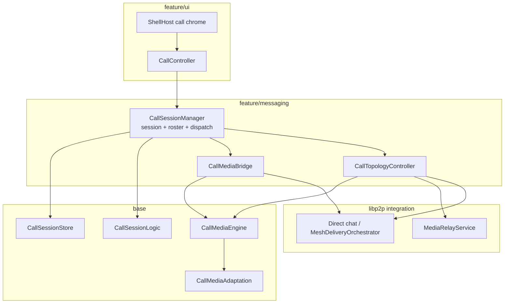
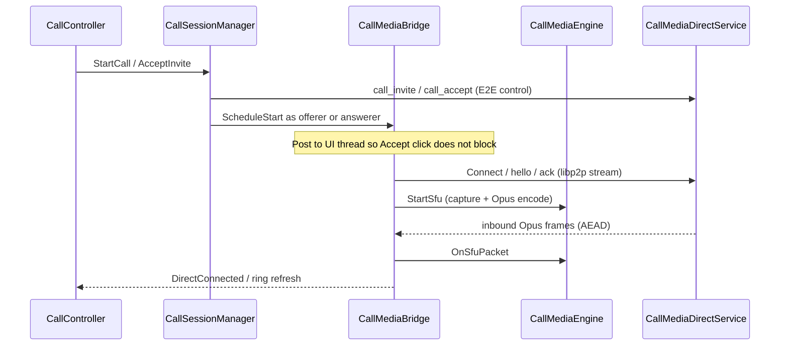
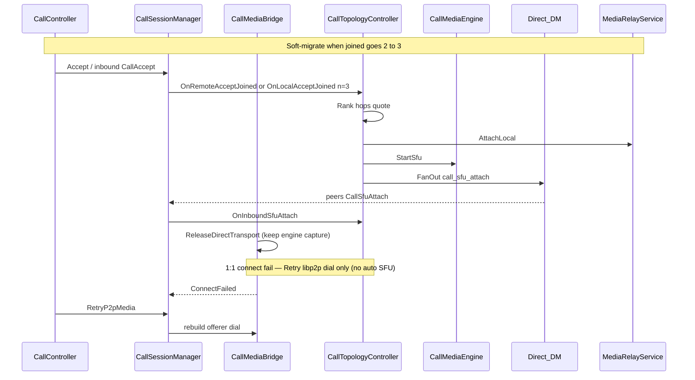

# Call domain architecture

**Tier:** architecture

**Product north star:** [NETWORKING.md](NETWORKING.md) — **HTTP + peer mesh**. Call media → **AMP** ([projects/adp](../../projects/adp/) D10 hard-require); libp2p retained for PeerId/crypto only. Wire-compat `call_sdp` / `call_ice` are ignored inbound; product does not send them.

**Mature code map** — planes, layer ownership, topology rules, session façade vs `CallTopologyController` / `CallMediaBridge`.

**Open delivery work:** [`projects/p2p-av-calls/`](../../projects/p2p-av-calls/).  
**Product ADRs:** [DECISIONS.md](../../projects/p2p-av-calls/DECISIONS.md) (through **V049** — V038 N=2 circuit for NAT, SoftMigrate N≥3 only; V049 simultaneous dial on Accept).  
**Host receive / QoS matrix:** [HOST_RECEIVE_POLICY.md](../../projects/p2p-av-calls/HOST_RECEIVE_POLICY.md) (V032 + V034 video frames / hop audio-priority drop).  
**Transport session machines:** [SESSION_MACHINES.md](../../projects/p2p-av-calls/SESSION_MACHINES.md) (V033 s2a) · [MEDIA_RELAY_ATTACH.md](../../projects/p2p-mesh/MEDIA_RELAY_ATTACH.md) (N026 s3a+s3b) — circuit compose loopbacks green.  
**Rewrite debt:** [PHASES rd](../../projects/p2p-av-calls/PHASES.md#rd--amp-call-media-rewrite-debt-v038) — D0–D4 automated gates (gtest / compose / `B-CALL-*` / `B-HARD-CALL`); OEM dogfood optional — [CURRENT_STATE](../../projects/p2p-av-calls/CURRENT_STATE.md#rd-automated-exit-v038--prefer-over-device-dogfood).  
**Wire controls:** [`contracts/WIRE_SCHEMAS.md`](../contracts/WIRE_SCHEMAS.md).  
**Messaging carrier:** [`P2P_MESSAGING.md`](P2P_MESSAGING.md).  
**SFU / mesh hop:** [`projects/p2p-mesh/`](../../projects/p2p-mesh/) (`media_relay`).  
**Hop dialability:** [`projects/media-hop-reachability/`](../../projects/media-hop-reachability/).

Do **not** restate the full product decision table here — link DECISIONS. Promote wire/disk shapes to `contracts/` when they harden. Dogfood “what works this week” lives only in project [CURRENT_STATE.md](../../projects/p2p-av-calls/CURRENT_STATE.md).

---

## Call lifecycle

What the device shows about calls is a **projection of its calls** ([`LiveCalls`](../../src/lib/calls/LiveCall.h)), not a separate state machine. Each `LiveCall` has a call state (Calling / Ringing / Accepting / Joined / Ended, driven by the session workflow) and its own media progress (the V037 Status, plus "live since the last failure" and "waiting for the key"). `LiveCall::Phase()` projects them to the `CallPhase` the chrome paints (`Idle`, `Ringing`, `Accepting`, `OutboundCalling`, `JoinedLocal`, `MediaPending`, `MediaConnecting`, `InCall`, `ConnectFailed`); `LiveCalls::Phase()` is the shown call's (the active call, else the ring). Clicks and media events go to `CallSessionManager::Apply(event)`: clicks run their session op (accept / decline / leave / retry / resume), media events move the call's progress. Heavy media logic stays in Bridge / Topology planners (V039).

| Owner | Responsibility |
|-------|----------------|
| **LiveCall / LiveCalls** | Per call: call state + media Status / progress; projection (`Phase`, `Status`, `Shown`); path gates (`AllowsDirectPath` / `AllowsHopPath` / `SoftMigrateMayArm`, armed planner); media cancel generation; change hook |
| **CallSessionManager** | UI intents (`Apply`: Accept in flight + dedupe, Decline, Leave, Retry / PeerReconnected restart, answerer kick after accept); binds the path arming ports over `LiveCalls`; persist session/invite/roster; encode/send controls |
| **CallStack** | Publishes the projection in `CallUiState`; on a change refreshes chrome (UI) and wakes N025 listen when `WantEphemeralListen` (a call is shown) flips |
| **CallPresenter** | What the call surface shows and what its buttons do, headless: `CallScreen` (ring / answering / in call / none, conflict, pricing, roster, the status line from `DecideInCallStatus`) + one-shot `CallNotice`s; the buttons (start / join / picker, accept, decline, leave, retry, mute, camera, speaker, add people) → `Apply(event)`; the auto camera of video calls. pp-app-probe drives the same presenter |
| **CallController** | Renders `CallScreen` (words, avatars, video, chrome modes) and owns the devices around it (ringtone, ringback, levels, metrics); Rml clicks → `CallPresenter`; chrome via `apply_chrome_update` → ShellHost Remount / DirtyCallChrome |
| **CallMediaBridge** | Media-key defer, channel connect/retry; report `MediaDeferred` / `DirectConnected` / `ConnectFailed` |
| **CallMediaConnectCoordinator** | Both directions of the 1:1 bundle. Outbound: per attempt reach a link then open the bundle; watchdog (B42), 5 retries, fresh-link feedback (B39). Inbound: owns the transport handler — a hello is an event on the calls owner, parked until its epoch key is available, via `CallMediaInboundPorts` |
| **PeerReachCoordinator** | Call-agnostic link establishment to one peer (dial → circuit → punch, seed park); `Reach` / `Await` modes |
| **ICallMediaTransport** | 1:1 `/pp/realtime/1.0.0` — Amp `CallMediaAmpTransport` / `CallMediaLegCoordinator` ([A020](../../projects/adp/DECISIONS.md#a020--single-transport-entry-per-protocol) / D10) |
| **ConversationsHub** | N025 listen + mDNS as **call-driven** commands (`WantEphemeralListen`), not tick side effects |

The projection, per call (first match wins for a Calling / Joined call):

| Call state | Media progress | Phase |
|------------|----------------|-------|
| Ringing / Accepting / Ended | — | `Ringing` / `Accepting` / `Idle` |
| Calling / Joined | Status `Failed` | `ConnectFailed` (the call stays open: Retry / the peer's reconnect resumes it) |
| Calling / Joined | live since the last failure | `InCall` (Reconnecting / Migrating / DegradedTxOnly keep it) |
| Calling | — | `OutboundCalling` (nobody answered yet) |
| Joined | waiting for the key | `MediaPending` |
| Joined | a connecting Status, or we placed the call | `MediaConnecting` |
| Joined | — | `JoinedLocal` (our accept landed; Status `Deciding`) |

### Ringing handling

Ring chrome is the **ring `LiveCall`** (the newest Ringing / Accepting call), not a free-standing UI poll of `TopPendingInvite`. The controller may observe pending invites to paint labels, but phase / listen / Accept sequencing follow the calls.

```mermaid
sequenceDiagram
  participant WF as CallSessionWorkflow
  participant CSM as CallSessionManager
  participant Stack as CallStack
  participant Hub as ConversationsHub
  participant Ctrl as CallController
  participant UI as Shell_RemountCallChrome

  WF->>WF: inbound invite → LiveCalls AdmitInvited (Ringing)
  WF-->>Stack: calls changed
  Stack->>Hub: WantEphemeralListen=1 (IO only)
  Stack->>Ctrl: chrome refresh (UI)
  Ctrl->>UI: RemountCallChrome (mount only)
  Note over Ctrl,UI: Never full SyncLayout for ring/Accept overlays
  UI->>Ctrl: Accept / Decline click
  Ctrl->>CSM: Apply(AcceptClicked / DeclineClicked) on the calls owner
  alt Accept
    CSM->>WF: AcceptInviteAsync (accept in flight; LiveCall Accepting)
    Stack->>Ctrl: chrome refresh (ring suppressed)
  else Decline or expire
    CSM->>WF: DeclineInvite → LiveCall Ended → Idle
  end
```

| Rule | Why |
|------|-----|
| An admitted invite → `Ringing` | The ring is the LiveCall's; arms N025 via `WantEphemeralListen` |
| Chrome layer = `RemountCallChrome` | Mount into `#shell-call-*-mount` only. Full-shell `SyncLayout` breaks Samsung hit-testing. Always-mounted `data-if` + Dirty alone failed to reveal Accept despite idle Present |
| Labels/pulse/icons = `DirtyCallChrome` | Via `apply_chrome_update(DirtyOnly)` while layer already mounted; does not create the overlay |
| The call surface's state steps live in the calls layer | `CallUiBackend::Settle` takes them on every surface refresh (invite seen / cleared, the orphan leave after a restart, the connect-health poll) and returns what to show (none / ringing / answering / in call); the GUI only renders it, and a headless driver (`pp-app-probe`) runs the same steps |
| Accept on the calls owner, never the click thread | The click only posts; the ring is suppressed from the click (`accepting_call_id`) until the accept answers |
| Accept starts the seed park and does not wait for it | The park makes us reachable for the caller's circuit, which is tried only after our `call_accept` reaches the caller; its StartBridge waits at the relay for us to register (14 s envelope), so a park landing a moment later still serves it. Accept used to wait for the park (≤ 12 s): a seed silently gone held every answer for the whole of it. Only seeds a reachability probe *failed* to dial are left out of the park and the rendezvous surface — a device that never probed (client role: every phone) has not learned they are unreachable. The park redials a lost seed dial and gives up early when no seed can land (pp-cpp-mesh v1.1.0) |
| A second Accept click while one is in flight is not a second accept | Dedupe on the in-flight call id |
| Accept fail → back to `Ringing` | The workflow puts the call back to Ringing; `last_error` for the GUI |
| Decline / TTL expire / `call_ended` → `Idle` | The call closes; listen stops when nothing is shown |
| Conflict (2nd invite while outbound/in-call) | Conflict copy (`End & Accept` / `Ignore`); Accept implies leave-other-except; single active call. The active call stays shown over a second ring |
| Calling each other at once (1:1 invite from the peer our own unanswered call goes to) | No ring: both sides keep the call with the lower call id (same choice on each side, no message). The side whose call lost answers the winner as its own was placed (voice / video) and leaves its own with `LiveCallEndReason::Merged` (no history entry); the winner's side swallows the losing invite (stored Ended, so a redelivery is ignored) — `CallSessionWorkflow::CrossedCall` |
| Calling someone whose call rings here | Is answering it (`CallSessionManager::StartCall`) — not "decline the incoming call first" |
| Same-call duplicate pending | Keep in-call chrome; do not flip back to ring |
| Wire before durable Joined/pending (V045) | `CallInvite` / `CallAccept` / `CallDecline` succeed on the wire before Upsert Joined/Ringing/pending or planner arm; local Decline `EndCallLocal` like expire |

Instrument: INFO `[LiveCall] status=… phase=… reason=…` (and `admit` / `accepting` / `joined` / `close`) and `WantEphemeralListen=` so “no AcceptIncoming” vs “Accept ok, media stuck” is obvious on Android (release emit floor promotes INFO → WARNING for `adb logcat -s pp-browser:W`).

**State + Status ([V037](../../projects/p2p-av-calls/DECISIONS.md#v037--calllifecycle-state--status-one-planner-armed)):** `CallPhase` is the chrome/shell State, projected from the call; `CallMediaStatus` is the call's own and arms exactly one media planner (Bridge vs Topology). JoinedLocal / MediaPending / MediaConnecting are **Calling-like** for arming. SoftMigrate is Status `Migrating`, not a side flag. A new path decision (`Deciding`) or a call closing bumps the media cancel generation late path work compares.

Invite TTL / cancel (wire ageing, `call_ended` to Ringing peers) lives under [Two planes](#two-planes).

### Thread policy

| Work | Thread | Why |
|------|--------|-----|
| Rml click / `DirtyCallChrome` / `RemountCallChrome` | UI only | Return immediately; **never** full-shell `SyncLayout` for call overlays (Samsung hit-test) |
| `AcceptInvite` / `DeclineInvite` / `LeaveCall` / send prep | Worker Critical/Normal | Posted by lifecycle; Leave uses Critical |
| Prefetch / circuit / dial wait / `Connect` | Worker | Seconds-scale waits; aborted via `connect_generation_` on Leave |
| N025 `ListenOn` / Wire / mDNS | Worker → asio | Driven by lifecycle `WantEphemeralListen`, not inventing policy from tick alone |
| `CallMediaEngine::StartSfu` / `Stop` / SDL capture | **UI only** | Bridge posts Stop to UI when LeaveCall runs off-UI; never TearDown SDL on a worker |
| Hub / process shutdown | UI | Stop+join ringtone → Abort circuit → Detach media_relay → `LeaveCall` (CallEnded) → `PrepareForTeardown`; Detach **before** `CallMediaEngine::Stop` so SFU `BlockingWrite` cannot hang quit. Ringtone join must precede `Backend::Shutdown` / `SDL_Quit` (accept-dialog quit hang). |
| Chrome refresh (`RefreshPendingRing` / `SyncShellState` / ringtone) | **Always hop to UI** + `apply_chrome_update` (Remount / DirtyCallChrome) + `RequestForceFrame` | Safe from worker **and coordinator**; Present depends on [THREADING.md UI delivery](THREADING.md#ui-delivery-pipeline) (mailbox liveness), not user input. Ringtone: `CallRingtone` loops `assets/sounds/call_ring.wav` on desktop **and** mobile; UI/Accept `Stop` is async (joinable reaper, never bare `.detach()`); `StopAndJoin` only on app shutdown. The speaker is a shared `MediaDeviceArbiter` lease, so ringing a second invite mixes over call audio; opens / closes are serialized on the arbiter's device thread (no ringtone-close vs call-open race). Caller ringback (`Tone::OutgoingRingback`, 450 Hz 1 s / 4 s, earpiece on phones) plays while `OutboundCalling`; its worker owns the phone audio-session activate / release per generation (fast cancel-redial safe), and call media waits for `CallRingtone::WaitUntilRingbackSessionReleased` before activating its own session. |

### Scenario matrix (v1)

| Scenario | Behavior |
|----------|----------|
| Incoming ring | `InviteSeen` → `Ringing`; Dirty-only chrome; listen desire on |
| Accept | Immediate `Accepting` + dismiss ring chrome + Connecting bar; worker AcceptInvite; suppress ring for accepting id |
| Decline / expire | Idle; listen desire off when no call |
| Outbound unanswered | Offerer `OutboundCalling` with no media past invite TTL (`kDefaultCallInviteTtlMs`) → auto-Leave; clears sticky Calling bar |
| Conflict (2nd invite) | Conflict copy; Accept leaves other local call first; single active call |
| Leave / remote end | Idle; `StopCallMedia` (Detach SFU then SDL Stop) on UI; LeaveCall on Critical. Every end names its reason at the source (`LiveCallEndReason` on the call's `LiveCall`). When the peer ended or declined a call this side had placed or was in (not a ring it withdrew), the UI shows it once: "*name* ended the call" / "*name* declined the call" |
| Answerer before key | `MediaDeferred` → `MediaPending` until `MediaKeyReady` |
| Connect fails (either role) | `ConnectFailed` — the call stays **open** (failed ≠ closed; no auto-close). Retry re-enters `MediaConnecting`; the peer's connection for the call (its Retry) arrives as `PeerReconnected` and resumes media over that stream (no redial). Only Leave / remote end closes it |
| Listen fail / no bound port | Surface error; stay `MediaPending` / `ConnectFailed`; Retry re-arms listen |
| Stack rebuild | Bridge recreate only when `CallSessionManager*` changes |

**1:1 libp2p chrome ([V037](../../projects/p2p-av-calls/DECISIONS.md#v037--calllifecycle-state--status-one-planner-armed)):** Connected when `InCall` **and** Status is `DirectLive` or `HopLive` — not `StartSfu` alone, not TX-only (`DegradedTxOnly`), not seat Live alone when Status lags. Bridge / hop CompleteAttach report Live via Lifecycle; seat `NoteLive` remains the bind projection ([V036](../../projects/p2p-av-calls/DECISIONS.md#v036--mediaseat--exclusive-media-epoch)).

---

## Two planes

| Plane | Carrier | Job |
|-------|---------|-----|
| **Signaling** | Direct E2E system `ChatPayload` (`call_invite`, `call_accept`, `call_sfu_attach`, …; wire-compat `call_sdp` / `call_ice` ignored) | Roster, invite/accept/leave, media-key epochs, SFU attach hints |
| **Media** | libp2p direct and/or blind `media_relay` | Opus + H264 **video_lo** (V034); app E2E under **one shared call media key** (V004 — encrypt once, hop fans out); SDL I/O |

Signaling rides the same P2P/messaging stack as chat. Media never goes through the chat relay as RTP; the SFU is a **blind forwarder** (no call media keys). Group video is **not** encrypted per subscriber: the publisher seals each AU once under the epoch key; the hop copies ciphertext.

**Invite TTL / cancel:** default ring TTL is 60s. Inbox-delivered invites use relay `created_at` + poll `server_time` (age = server_time − created_at); drop when age exceeds TTL + small slack. Without those samples (direct delivery), wire `expires_at` may be re-armed only if still within skew slack of local now — long-backlogged invites are not re-armed. Cancel/end fans out `call_ended` to Joined **and** Ringing/Invited peers so late inbox delivery can clear the ring.



---

## Call media paths (1:1 — call-path-resilience)

A 1:1 call's media rides a **path**: control + media channels bound on one link to the peer, either direct (ADP, dialed or punched) or relayed (a nested link over a circuit carrier). The call keeps a small **path set** and moves between paths without restarting — `CallMediaLegCoordinator` (feature/call_media) owns it; `CallMediaBridge` (feature/calls) decides when to ask. Wire: [AMP-CHANNEL.md § Path migration / § Path liveness and failover](../contracts/AMP-CHANNEL.md#path-migration-make-before-break--call-path-resilience-k3). Decisions: [projects/call-path-resilience/DECISIONS.md](../../projects/call-path-resilience/DECISIONS.md).

| Path | Meaning |
|------|---------|
| **active** | TX goes here; RX is taken from every path of the call (transport-side seq de-dupe) |
| **candidate** | Being brought up by a migration (make-before-break) |
| **retiring** | The previous active path, drained until the driver's `path_release` is acknowledged |
| **standby** | A warm fallback path (bound channels, 10 s heartbeat) — relayed preferred. Either what a migration left behind, or added on purpose: the offerer of a call Live on a direct / punched path adds a relayed one (`path_add`, K003 — best-effort, a loaded relay refuses the least needed first) |

| Situation | Behaviour | Home |
|-----------|-----------|------|
| Leg start, the peer's dial key held by a dial still in flight | The first path opens on any Connected link to the peer (direct first, then the relay carrier); only with none up does it dial by key (#235) | `OpenOutboundControl` over Amp `ResolveConnectedLink` |
| Relayed call, a direct link to the peer is Connected | The glare winner (offerer) migrates onto it (10 s backoff; never back onto the direct link the call left) | `MaybeAutoMigrate` |
| Relayed call, Live | The offerer punches for a direct link at +3 / +20 / +60 s, the circuit's relay as introducer; a landed punch is picked up by the row above | `CallMediaBridge::ArmDirectUpgrade` → `PeerReachCoordinator::UpgradeToDirect` |
| TX-only (no frames arriving — a muted mic still sends silence frames) | Migrate onto a circuit under the live call; break-before-make escalation only if that fails | `EscalateTxOnlyViaCircuit` / `EscalateBreakBeforeMake` |
| Active link lost, or 1.5 s silent from a heartbeating peer | TX onto the standby at once; the peer follows its `active` heartbeat | `FailOverToStandby` |
| Active silent 3 s from a heartbeating peer, no standby | Lost (the row below): the peer's app died or its network went. The link under the path can stay Connected for most of a minute (its liveness window follows the keepalive cadence) | `ShouldEnterPathLost` |
| Active lost, no standby, peer still Connected on another link (dual-dial election after a simultaneous punch) | Quiet rebind: the offerer migrates there; nothing is reported unless it has not landed in 1 s (K011) | `EnterPathLost` |
| No path at all | `Reconnecting…` (planner `Reconnecting`, lifecycle `CallMediaStatus::Reconnecting`, timer runs on) for 30 s while the offerer re-anchors (reach + migrate); then the call fails | `CallMediaBridge::Reanchor` |
| The device's network changed (k5) | Amp probes every link and drops the dead ones within 2 s (so the rows above fire at once); a reconnecting call re-anchors once links settled; a relayed call's upgrade punches start over ([MESH.md § Local network change](MESH.md#local-network-change-call-path-resilience-k5)) | `CallMediaBridge::OnLocalNetworkChanged` |

**Voice / video answer ([V051](../../projects/p2p-av-calls/DECISIONS.md#v051--voice-or-video-answer-video-calls-start-with-the-camera-on)).** `call_accept` may carry `video_allowed: false`, written only when the callee answers a video call as voice. A missing field means unchanged; the field never widens. The callee narrows its own session; the caller narrows the call only for a call started from a direct thread (no `origin_group_id`). Video calls turn the local camera on once media connects — held while the camera button would be hidden, and on the caller while the answer is only implicit (B30).

**Group calls: join, stay, end ([V053](../../projects/p2p-av-calls/DECISIONS.md#v053--group-calls-behave-like-teams--signal-join-while-it-lasts-stay-when-alone-removal-ends-your-part)).** A group call (`origin_group_id`, or more than two offered) lasts while anyone is in it: `TransitionOnLeave(…, group)` ends it only when nobody remains, and the last one in waits (`kAloneInGroupCallMs`, 5 min, then leaves by itself). Whoever it was offered to and is not in it — declined, missed, left — sees it as joinable (`JoinableGroupCall`: someone else Joined, within 6 h); the call button on that group joins it (`StartCall` → `JoinCall`) and reads "Join" meanwhile. Two members calling the group at once keep the lower call id, as two people calling each other do (`CrossedCall` → `OurUnansweredGroupCall`). The joiner sends `call_join_request` to the participants; the earliest joiner still in answers with the mid-call invite, which the joiner accepts without ringing (a retry at half of `kJoinRequestTimeoutMs` with `any` lets anyone answer; no answer means it ended). A roster listing someone who left as Joined brings them back only with a `joined_at` newer than theirs. Who drops out of the group drops out of its call: the sweep compares the group roster (`CallDeliveryPorts::group_members`) with the last check — someone seen in the group and gone is taken as left (key rotation), and this device leaves when it is the one; only members may ask to join. The last one's `call_ended` goes to everyone offered. Each media key rotation (V003) reaches the hop path: `SfuKeyRing` seals with the newest epoch and opens the previous one for 3 s.

**Mobility and pair policy (k6).** Each end classifies itself `stationary | mobile | unknown` (`MobilityClassifier`: cellular or metered attachment → mobile at once; three attachment / observed-address changes in 10 min → mobile; back to stationary after 5 min calm; K004) and advertises it as `caps.mobility` on `call_invite` / `call_accept` (no `caps.v` bump; missing → unknown, K005). A mid-call flip is sent as `call_caps_update` `{call_id, identity, caps}` (additive plumbing — old peers ignore it). Both ends compute the same `CallPathPolicy` from the two classes (`DecideCallPathPolicy`, K013):

| Pair | Call-start punch (answerer's Await) | Upgrade punches | Relay | Standby priority |
|------|------|------|------|------|
| Stationary / Stationary | yes | yes | standby | low (direct), medium (punched) |
| any Unknown, no Mobile | yes | yes | standby | high |
| any Mobile | no — waits for the offerer's circuit | no | **anchor** (the call stays relayed) | high |

**Privacy narrows the policy** (projects/privacy T1): a call whose peer may not learn our address (outside `mesh.direct_connections`; [NETWORKING § Address disclosure](NETWORKING.md#address-disclosure-privacy)) gets `RelayOnlyPolicy` from `CallStack::PathPolicyFor` — no direct dial, no punch, no k3 upgrade, the relay anchors — and its invite / accept carry no listen addresses.

Override (dogfood / lab): config `mesh.mobility` (`auto | stationary | mobile`) or `--mobility=`. Owner: `CallStack` (classifier + per-call remote classes, fed by `NetworkMonitor` and the hub's observed-address changes); consumers: `CallMediaBridge` (upgrade, relay standby, reach `allow_punch`).

Product surface: `on_path_changed` → planner `PathMigrated` (Live stays Live; the path label follows the bound link), `on_path_lost` → `Reconnecting`. Roles: the offerer is the glare winner and drives; a bundle born from the peer's hello takes the complementary role. Lab coverage: hard-w5 Phase-9 UPGRADE (relayed → direct → blackholed → relayed standby), Phase-10 PUNCH, Phase-11 FLIP (address change mid-call → failover onto the added relay standby) and Phase-12 MOBILE (a pinned mobile end keeps a punchable call on the relay) ([HARD_LAB.md](../../packaging/pp-node/HARD_LAB.md)).

## Topology rules (V021 + V026 + V038)

| Joined N | Media path (target) | Notes |
|----------|---------------------|-------|
| 1 (ringing / solo) | No media yet | Invite outstanding |
| **2** | **Direct Amp call-media** when dialable; else **punch → circuit** nested Session | [V038](../../projects/p2p-av-calls/DECISIONS.md#v038--n2-circuit-for-nat-softmigrate-reserved-for-n3) — never SoftMigrate for NAT |
| **≥3** | **SFU** via `media_relay` hop | Soft-migrate same `call_id`; sticky initiator picks hop (re-pick: epoch coordinator); circuit may still reach the hop |

- Soft-migrate on 2→3: keep session/roster/key epoch; tear down 1:1 call-media after SFU attach.
- **Monotonic group topology ([V050](../../projects/p2p-av-calls/DECISIONS.md#v050--group-call-topology-11-first-planned-hop-monotonic)):** planners arm on **joined** count on every side (ringing never arms the hop); the first accept is direct 1:1, the third join migrates onto the **planned hop** chosen at StartCall from the invite list (one adjustment if an accept reported it unreachable); later joins re-pick only when the hop is full or unreachable for the newcomer; nobody leaving triggers re-evaluation (N→2 stays on the hop). The earliest-joined remaining participant owns re-picks after the initiator leaves.
- Mid-call guest without a hop: refuse or eject — do **not** leave invitee on Connecting while existing peers stay on direct media.
- Auto `media_relay` attach is **group-only**; 1:1 undialable recovery is Amp dial / punch / circuit (V025/V038).
- **Hop dial:** SoftMigrate needs stack dialability — [media-hop-reachability](../../projects/media-hop-reachability/) (Amp mesh, H001/H007; punch H009).
- **`CallMediaEngine::StartSfu`:** starts capture + duplex send fn for **both** 1:1 Amp and hop SFU — not “join SFU” alone (document-only name; V038).

`CallMediaTopology` (`ShouldUseMediaRelay` = N≥3 only) matches V038.

---

## Lifecycle sequences

Module timing across the two planes. Product invite/roster rules stay in [DESIGN.md](../../projects/p2p-av-calls/DESIGN.md). Race mitigations summarized again under [Critical races](#critical-races-keep-documented-next-to-code).

### 1:1 happy path (N=2)



### Media-key defer (answerer before key)

Answerer may reach `JoinedLocal` before `CallMediaKey` arrives. `CallMediaBridge` reports `MediaDeferred` → `MediaPending` until the key lands, then enters `MediaConnecting`.

### Soft-migrate 2→3 (V025)



---

## Layer ownership

Respect [`SRC_LAYOUT.md`](SRC_LAYOUT.md): `app → gui → feature → domain → lib → foundation → common`. Object lifetimes follow [OWNERSHIP.md](OWNERSHIP.md) (parent-only destroy; UI affinity for SDL / ringtone teardown).

| Concern | Layer | Today | Target |
|---------|-------|-------|--------|
| Session rows, invites, participants | `lib/calls` | `CallSessionStore`, `CallTypes`, `CallSessionLogic`; what a call's rows say and a peer's roster applied to them in **`CallSessionQueries`** (`call_queries::*`, `ApplyCallRosterToStore`) | Unchanged |
| Control encode/decode | `lib/calls` | `CallControlCodec` | Unchanged |
| PC / Opus / H264 / SDL | `lib/media` | `CallMediaEngine` | libp2p/SFU packet transport only |
| Adaptation policy | `lib/media` | `CallMediaAdaptation`, `CallMediaTopology` | Unchanged |
| Call stack ownership (phase assembly + media plane) | `feature/calls` | **`CallStack`** + **`CallMediaPlane`** | Stack owns stores / CSM and phase-orders the plane; plane owns the call_media Amp transport and builds the 1:1 path's deps and the topology's relay deps (CSM owns the seat and both paths) ([V040](../../projects/p2p-av-calls/DECISIONS.md#v040--callmediaplane--callstack-ownership-collapse)); dial registry / circuit reach / parking are the hub's shared `MeshConnectivity` and the media_relay client its `MeshMediaRelay`, both borrowed ([L015](../../projects/media-client-layers/DECISIONS.md#l015--a-neutral-meshmediaplane-in-domainmesh-owned-by-the-product-hub-lent-to-calls-and-broadcast)); `CallsParticipant` (`feature/product`) owns the stack and drives it from the hub's lifecycle; `CallUiBackend` binds the stack |
| **Exclusive media bind (epoch)** | `lib/calls` | **`CallMediaSeat`**, driven per call by **`CallMediaCoordinator`** ([V036](../../projects/p2p-av-calls/DECISIONS.md#v036--mediaseat--exclusive-media-epoch)) | Sole `Acquire`/`Release`/`NoteLive`/`IsBound`; path ops token-gated (`AllowsPathOp`); SoftMigrate = path replace under same token |
| Session lifecycle + inbound dispatch | `feature/calls` | **`CallSessionManager`** | Signaling only for duplex start/stop (seat + path façades); mute/camera stay device controls |
| 1:1 phase / ring / listen desire | `lib/calls` | **`LiveCalls`** projection (each call's media coordinator in `feature/calls` **`LiveCallMedia`**); intents on **`CallSessionManager::Apply`** | Phase projected from the calls; see [Ringing handling](#ringing-handling) |
| 1:1 Amp dial + connect-fail / Retry | `feature/calls` | **`CallMediaBridge`** (the call's `CallDirectDriver`) | Direct path under seat token |
| Soft-migrate / attach-wait / hop pick | `feature/calls` | **`CallTopologyController`** (hop side of the call's coordinator) | Hop path under seat token |
| N→planner select (pure) | `lib/calls` | **`CallMediaPlannerSelectLogic`** | Joined N (V050); arm Hop vs Direct; relay-cap SoftMigrate nudge gates |
| Direct planner Apply (V039) | `feature/calls` | **`CallMediaBridge`** + **`CallDirectPlannerLogic`** (`lib/calls`) | Schedule/Key/Connect/TX-only/Release; health timer |
| Hop planner Apply (V039) | `feature/calls` | **`CallTopologyController`** + **`CallHopPlannerLogic`** (`lib/calls`) | SoftMigrate/attach-wait/inbound SFU; attach-wait timer |
| Media keys wrap/unwrap | `lib/calls` | `CallMediaKeyStore` | Unchanged |
| Media keys between peers | `lib/calls` | **`CallMediaKeyExchange`** (owned by `CallSessionManager`, which fills its `Transport` from `CallControlClient`) | Mint (new call / rotation), wrap into the invite, send `CallMediaKey` (accept, resend, rotation), take a peer's wrapped key → "key ready" (V015 answerer start); the workflow decides when |
| Ring / in-call chrome | `feature/ui` | `CallController`, `CallChromeSync`, `ShellCallChromeGesture`, `ShellHost::ApplyCallChromeUpdate` | Layer identity / control *presence* / **mode** (Expanded/Immersive/Minimized — V031) / status kind → remount; mute/speaker/camera icons → DirtyCallChrome (`data-attr-src` + `data-class-*--on`); meters/pulse/quality chip → DirtyCallChrome; mobile speaker via `CallAudioSession` |
| Call media health | `lib/media` + `feature/ui` | `CallMediaHealth`, `CallMediaEngine::HealthSnapshot`, hop `HealthSnapshot`, `CallController::ApplyMediaHealth` / `ShowCallDetails` | Tier A quality bars always; Call details for everyone, with a **Network** line when the call's link is known — smoothed round trip and Reliable resend % between 2 s samples (`CallLinkHealthBetween`) of the association the call rides: the 1:1 call-media link (`ICallMediaTransport::ActiveLinkCounters`; a relayed call reads the association under its carrier) or, on a hop, the link to the relay (`CallHopHealth::link`). Informative only: media is BestEffort, so these figures do not grade the call; debug subtitle + rich diagnostics behind profile `call_diagnostics` or `--debug`; `media_health` INFO ~2s |
| Blind SFU protocol | pp-cpp-mesh | `MediaRelayServer` | Unchanged |

UI must not choose P2P vs SFU. It posts clicks to `CallSessionManager::Apply` and paints from session + the projected phase; it does not invent listen or media policy.

---

## Major systems (relationships)

### ConversationsHub / CallStack (through `CallsParticipant`)
`CallStack` (`feature/calls`) is a **phase assembler** ([V040](../../projects/p2p-av-calls/DECISIONS.md#v040--callmediaplane--callstack-ownership-collapse) / [V041](../../projects/p2p-av-calls/DECISIONS.md#v041--calllifecycle-signaling-ports--stack-composition-root)): profile stores (`CallSessionStore`, `CallMediaKeyStore`, `CallMediaEngine`), `CallSessionManager`, `CallMediaSeat`, and `unique_ptr<CallMediaPlane>`. **`CallMediaPlane`** owns the Amp call-media transport; the session manager owns the 1:1 path (`CallMediaBridge`, via `AttachDirectPath` on the plane's transport) next to the group path (topology) and the seat; the dial registry + listen book, circuit reach and rendezvous parking live in the hub-owned **`MeshConnectivity`** (pp-cpp-mesh `connectivity`) and the media_relay client in **`MeshMediaRelay`** (pp-cpp-mesh `media_plane`, L015), which the stack borrows through `CallStackDeps::connectivity` / `media_relay`. The stack hands CSM the plane's `DirectPathDeps` and installs relay deps onto CSM — the plane does **not** hold standing live refs to CSM/stores. N025 listen *desire* is "a call is shown" (`LiveCalls::Phase() != Idle`); the stack wakes Hub sync when it flips. The hub never names the stack: `CallsParticipant` (`feature/product`, a `HubParticipant` the `ProductStack` registers) owns it, builds `CallStackDeps` from what the hub lends (stores, delivery through the current orchestrator, mesh/config/mDNS glue, the neutral mesh objects) and maps the hub's lifecycle hooks onto it. The hub still owns mesh admission, LAN mDNS, N025 listen *execution* (Hub `SyncMobileEphemeralListen`), and inbound control routing via `RelayReceivePipeline` → `ApplyInboundControl`. Build/teardown order: Hub `Initialize` → `OnStoresOpened` → `CallStack::InitializeStores`; each messaging stack built → `OnMessagingBuilt` → `BuildSessions` (once: while sessions exist it keeps them — Amp attach no longer rebuilds them, which dropped a call already ringing over the relay); mesh up → `DetachMeshMedia` → `MeshConnectivity::Wire` → `MeshMediaRelay::Wire` → `OnMeshServicesStarted`; capability refresh → broadcast reset → `DetachMeshMedia` → `ResetRelayClients` → `Wire` → `RebindMeshMedia`; `StopMesh` → `InvalidateAsyncOps` → `PrepareForMeshStop` (bracketed by mesh circuit aborts) → relay client reset → `mesh_->Stop()` → `FinishMeshStop` → `ResetAfterMeshStop`. Do **not** recreate dial registry / bridge mid-call on N025 listen sync — rebuild bridge only when the CSM rebuild key changes. `MeshConnectivity::Wire()` / `MeshMediaRelay::Wire()` are mesh-only; `BindMediaProducts` on the stack follows — keep both thin under the general [function complexity](../../AGENTS.md#conventions) convention.

| Piece | Owns | Standing ptrs to siblings | Bind-only / ports |
|-------|------|---------------------------|-------------------|
| **CallStack** | `unique_ptr`s + deps | all siblings (composition root) | wires everyone |
| **CallMediaSeat** | exclusive media epoch (owned by CSM) | none | teardown hooks from CSM |
| **CallMediaPlane** | call_media transport | none to CSM; borrows `MeshConnectivity` + `MeshMediaRelay` | `DirectPathDeps` + deps callbacks |
| **CallSessionManager** | signaling façade + UI intents | stores (ctor); owns Workflow + Topology + LiveCalls + LiveCallMedia + the seat + the 1:1 path (bridge); builds the path arming / seat ports over LiveCalls | `Set*Ports` / `SetTopology*Ports` / `BindWorkflowHostPorts` / `BindTopologyHostPorts` |

### CallSessionManager (façade)
**Should own:** Hub-facing API, Topology/MediaHost, dial-book maps, delivery, port install, device mute/camera. Durable session/roster work lives in owned **`CallSessionWorkflow`** (V044).

**Should not own long-term:** libp2p stream lifecycle details, SFU quote/attach loops, or duplicated “if N≥3 …” trees in every accept path. Pure N→planner policy lives in **`CallMediaPlannerSelectLogic`**; Accept arms Bridge **or** Topology via `OnLocalAcceptJoined` / `ScheduleStartDirectMedia` (V039 Direct/Hop `Apply`). SoftMigrate relay-cap nudge is **`CallTopologyController::OnPeerMediaRelayCapLearned`** (N≥3 / attach-wait only).

### CallSessionWorkflow (V044)
Durable multi-party session/roster executor (store mutations + `CallSessionLogic` transitions + invite/leave/inbound arms). Side effects via clustered **HostPorts** (`wire` / `duplex` / `hop` / `chrome` / `reach`) from CSM — **not** a second chrome `CallPhase` machine.

### CallTopologyController (V046/V047)
Hop planner façade (`Apply` / On*). SoftMigrate + attach completion live in value-owned **`CallHopMigrateWorkflow`**, which **owns** race clusters; Topology holds cluster refs (`flight_` / `sfu_` / …) and projects Host/Arming/Seat into Workflow ports + **TopologyOps**. CSM fills Topology `HostPorts` (`CallTopologyHostPorts`); Stack installs Topology **`CallHopArmingPorts`** / **`CallTopologySeatPorts`**. Clusters: `SoftMigrateFlight`, `AttachWait`, `InboundAttachGate`, `GuestSfuSession`, `PublisherStreams`, `SfuSurface`.

**Vocabulary ([COMPOSITION_VOCABULARY.md](COMPOSITION_VOCABULARY.md), [V048](../../projects/p2p-av-calls/DECISIONS.md#v048--composition-vocabulary-no-upward-concepts)):** repo-wide — lower peers must not speak higher peers’ concepts. Topology embeds **`CallHopArmingPorts`** / **`CallTopologySeatPorts`**; owned Workflow embeds migrate host/arming/seat ports; Bridge embeds **`CallDirectArmingPorts`** / **`CallDirectSeatPorts`**; CSM embeds Direct/Lifecycle/Seat ports. The per-call **`CallMediaCoordinator`** holds the seat and the direct driver (`CallDirectDriver`, bound by the stack); drivers reach it by call id. Stack / Topology private `Make*` (and CSM `MakeSeatPorts`) close over producers.

### CallMediaSeat (V036)
Process-wide exclusive bind `call_id` ↔ duplex. `Release` = topology Detach then engine Stop; `NoteStart` invalidates in-flight Release; SoftMigrate uses `NotePath(Hop)` without Release. Topology “active call” prefers `seat.IsBound`, not leftover engine `ActiveCallId`. **Phase 2:** `MediaState` (`Idle` / `Connecting` / `Live` / `Failed`) drives chrome Connected; `BeginAttach` serializes hop AcceptAndAttach. **Phase 3 (now the call's `CallMediaCoordinator`):** `BeginDirect` (seat, then the direct driver connects), `HoldSeatForHop`, `ReleaseDirect` (Direct → Hop hand-off under the seat token, `NotePath(Hop)`); path ops require `AllowsPathOp(token)`; CSM starts Direct via the coordinator and releases the seat only (no parallel `StopMeshMedia` when seat wired).

### LiveCall and CallMediaCoordinator
`LiveCalls` (owned by `CallSessionManager`, driven by the workflow) holds one **`LiveCall`** per call on this device from admission to close: who placed it, its peers, call state (Calling / Ringing / Accepting / Joined / Ended) and the end reason, named where the call ended. Persisted facts stay in `CallSessionStore`. The ring the device shows is `LiveCalls::TheRing()` (the newest call still Ringing or being accepted); Accept / Decline without a call id take it, and the stored pending invite carries its content. What the device shows (phase, Status, the gates) is projected from the calls — see [Call lifecycle](#call-lifecycle). `LiveCalls` lives in `lib/calls` and knows nothing of media objects; **`LiveCallMedia`** (`feature/calls`, next to it in `CallSessionManager`) holds one **`CallMediaCoordinator`** per admission of a call (created on first use; a re-admitted call id gets a fresh one, a call `LiveCalls` no longer keeps loses its): that call's use of the one engine and the seat. Both path drivers start and stop the engine through it — `StartEngine(path, send)` takes the seat, starts (or re-points) the engine and marks the seat on the path; the drivers reach it through `CallMediaHost::P2pCallMedia` (Bridge) and the topology host's `call_media` (hop workflow). It also owns the call's media path: at each join (`DecideOnLocalAccept` / `DecideOnRemoteAccept`) it asks the hop driver (`CallHopDriver`, implemented by `CallTopologyController`) whether the group path takes the call, and records `CallMediaPath` (Undecided → Direct → Hop; a call never goes back from Hop). The 1:1 start (`BeginDirect`, via the Bridge as `CallDirectDriver`) and the Direct → Hop hand-off (`HoldSeatForHop`, `ReleaseDirect`) run through it, and the Bridge asks it — not Topology — what the group path is doing (`HopAttached`, `HopInFlight`, `ExpectsHop`, `ExpectHopAttach`). The call's devices (mute, camera with the hop's adaptation, keyframes) and Retry / resume go through it too; stopping a call's media is `LiveCallMedia::StopMedia` (seat release, or each driver with no seat), and before a call takes media `StopMediaExcept` stops what an ended call left running.

### CallMediaEngine
Single A/V device for the process (owned by the seat’s bound call):

- **Direct 1:1:** `CallMediaBridge` runs it (via the call's `CallMediaCoordinator`) with a send fn wired to Amp call-media transport; inbound frames → `OnSfuPacket`.
- **Group SFU:** encode → `SfuSendFn` / inbound `OnSfuPacket` via `media_relay` (hop workflow, via the same coordinator).
- Capture/playback and camera stay off the libp2p IO thread (mic TCC can block).

### CallController / shell
`CallPresenter` (feature/calls) decides the call screen from `CallUiBackend::Settle` (the surface) + the session snapshot and runs the buttons; `CallController` renders it. The presenter is what the app lab (`pp-app-probe`) presses and reads, so the decisions behind the chrome are under the lab's scenarios; only the words, layout and devices are GUI-only. **Layer appear/disappear** uses `ShellHost::RemountCallChrome` (dedicated mounts only) via `apply_chrome_update(Remount)`. **Labels / pulse / meters / icon toggles** use `DirtyCallChrome` while a layer is already mounted. Clicks → `CallSessionManager::Apply` (via `CallUiBackend`); attach-wait / connect health are **planner SM timers** (V039) — CallController must not poll them on UI tick. CallController notifies ShellHost; it does not call grab-bag `DirtyWindow`.

**Do not** rely on always-mounted `data-if="call_ring_active"` alone to show Accept — dogfood showed C++ `active=true` + Present alive while the overlay stayed `display:none`. **Do not** full-shell `SyncLayout` for call chrome (Samsung Accept hit-test).

### media_relay (mesh)
Desktop/org Node capability. Blind hop ranks contact∪seed hops, quotes, attaches, fans out `call_sfu_attach`. Mobile may host ephemerally on Wi‑Fi (V027) with contacts-only *new* sessions.

**Who picks (V021 / V022):** first soft-migrate is the sticky **call initiator** (earliest `joined_at` = session payer). Mid-call invite: `CallAccept` reaches only the inviter (WaitForAttach); **CallRoster** drives `JoinedCountObserved` so the initiator SoftMigrates. Joiners without hint WaitForAttach. ICE re-pick is epoch coordinator only. Fan-out clears `quote_id` (peers `RequestQuote` locally).

**Hop preference (V035):** infer call hop scope from joined peers’ `listen_multiaddrs` (`Link` / `Site` / `Wide`; missing remotes → `Wide`). PreferLocal (`AttachAsLocalHop`) only for **LAN-confirmed Link** (Amp connected / mDNS) — not Site, and not same-/24 alone. On `Wide`/unconfirmed Link, SoftMigrate picks org/directory public seeds first — never fan-out RFC1918 PreferLocal MAs. Guests fail-fast private hop MAs unless LAN-confirmed; ignore attach for non-active calls. Contacts still need `caps.media_relay` (V030). **Do not** PreferInCall phones as SFU host (V029). Guest attach failure → rare hop-hint SoftMigrate under per-call Attached/Attaching FSM (same hop = re-fan-out only; coalesce hints; gen bump on Leave). Owner re-picks or `call_hop_refuse` with friendly copy.

**Call-scoped admission:** the first dialer (or local hop) that opens a `HostSession` for `call_id` must pass contact/scope admission. After that session exists, further dialers for the same `call_id` are admitted even if strangers to the hop (owner-picked hop serves the whole call, including mid-call joiners). Mobile stays non-Public for *new* sessions. The session exists while it has participants, and for a **60 s grace** after the last one leaves (a participant leaves when its channel ends — closed, reset, link dropped — not only on `detach`): everyone dropping at once (the hop's links flap, a path migration) can re-attach in any order. After the grace the call is over and the session is dropped; a new one for the same `call_id` needs contact/scope admission again.

**Guest duplex recovery:** if a phone’s media-relay client duplex dies mid-call (`CloseSession` / hop `CleanupParticipant`), `MediaRelayService` notifies topology; guests re-`AcceptAndAttach` + re-subscribe without restarting capture (keeps publisher `stream_id`). Logs: `DuplexFrameSession CloseSession reason=…`, `client duplex lost`, `Guest SFU duplex lost — reattach`.

**1:1 → SFU track hygiene:** inbound call-media must map `remotePeerId` → that peer’s **Account ID** via in-memory `peer_id_to_relay_` (from Invite/Accept `libp2p_peer_id` and/or listen `/p2p/`), optional contact upsert, and bridge `NotePeerIdRelayMapping` — never `P2pPeerIdentityForCall`, never hash bare PeerId. Works for **non-contact** call mates (map does not require a contact row). `BeginSession` / deferred `on_audio` rebinds when Account identity arrives after hello. After SoftMigrate attach, 1:1 `on_audio` is ignored; `ReleaseDirect` must **not** clear live media_relay tracks. Engine drops `stream_id==1` (empty identity).

**SoftMigrate 1:1 close race:** PreferLocal `ReleaseDirect` closes the call-media stream while capture stays up. Guests must not treat `read_eof` / `stream closed` as `ConnectFailed` when media is still active, SFU attach is expected (`Joined|Ringing|Invited` ≥ 3 / `sfu_hint` / attach-wait), or attach is already live. Hop side delays `ReleaseDirect` (~3.5s) and re-fans `CallSfuAttach` immediately before teardown (PreferLocal hop only — guests must not announce as hop owner).

**PreferLocal hearability dogfood:** guest→guest Fanout is proven (Samsung `OnSfuPacket` Moto `stream=3272724854`); unit test `PreferLocalHopFanoutGuestToLocal` covers guest→local hop owner. Aggregate `streams=2` can hide a stale track — `media_health` now logs per-stream `rx_streams=<id>:n=/age=/lvl=` plus `mic_lvl` / `peer_lvl`. After SoftMigrate, look for a second `OnSfuPacket first stream=3272724854` (first-log set clears on send-swap).

**Camera toggle:** `SetLocalVideoEnabled` → `CallMediaEngine::SetCameraEnabled` returns at once — it records the request and the display rotation (read on UI; iOS orientation is UIKit). The engine's video thread takes a `CameraDeviceLease` (opened on the `MediaDeviceArbiter` device thread), creates / configures the local encoder, and owns it (bitrate applied before each encode). `IsCameraEnabled` is true from the request until it is turned off or the open fails; a failure is taken once by `CallController` (`TakeCameraFailure`), shown, and withdrawn from the roster with `SetLocalVideoEnabled(false)`. The camera button gates on `VideoEncoderAvailable` = host capability (`PlatformVideoEncoderSupported`, probed once), not on an open encoder.

**Speaker vs mute / silent uplink:** `call_speaker` only toggles `CallAudioSession` route (`SetSpeakerphoneOn`); `call_mute` zeros PCM via `SetMuted`. They do not share state. PreferLocal dogfood (`call:72c511c4`): Linux RX of Moto stayed live (`age≈1`) but `lvl≈3e-5` while Moto `mic_lvl` collapsed to ~0 after SoftMigrate / speaker taps even as `tx_frames` rose — encode of silence, not a hop Fanout bug. Fix: Android `setCallSpeakerphoneOn` / `setCallAudioSessionActive` apply `AudioManager` **synchronously** (so SDL reopen sees the route) and re-assert `MODE_IN_COMMUNICATION`; SoftMigrate send-swap and speaker toggle call `RequestAudioDeviceReopen` so the capture worker reopens its mic / speaker leases (the close, Android settle and open run on the `MediaDeviceArbiter` device thread). Log: `ToggleSpeaker` / `reopening audio devices`.

**Echo cancellation (macOS VPIO):** a duplex call first asks the arbiter for a voice duplex (`AcquireVoiceDuplex`): the backend opens one OS voice-processing unit (`VoiceProcessingIo`, Apple VPIO — AEC / NS / AGC with its own playback as the echo reference) and hands out a mic and a speaker lease sharing it; the unit closes on the device thread once both are released. Other platforms' stub answers "unsupported" and the call takes separate SDL leases. A default-device change or a reopen re-acquires the pair whole (a half never reopens alone); three starved-capture reopens in a row fall back to SDL for the rest of the call. Playout is clocked from the speaker queue (one render chunk + a frame for VPIO), the jitter buffer holds Opus packets (in-band FEC decoded on a gap, PLC otherwise), and the capture-side `NoiseSuppressor` runs only without VPIO. Health: `audio_io=vpio|sdl|none`, `io_underruns`, `fec=`.

**Moto speaker → "Your mic isn't sending" (`call:fde969b9`, 2026-08-07):** SoftMigrate reopen recovered mic briefly; user tapped speaker → `MotSpeakerHelper` device change → `AAUDIO_ERROR_DISCONNECTED` on playback (SDL auto-Recover) **and** recording (SDL used to return `-1` forever — no Recover). ToggleSpeaker reopen then re-applied `setSpeakerphoneOn(true)` via `ActivateForVoipCall`, racing another OEM route change; capture open produced no `recording=1` log and `tx_frames` froze at 720 (`asymmetry=2`). Fixes: (1) AAudio `RecordDevice` Recover like playback; (2) skip redundant `setSpeakerphoneOn` when already on that route / don't re-apply speaker on every `ActivateForVoipCall` reopen; (3) retry capture open with backoff + short settle delay; (4) if capture starves >500ms, keep encoding silence (so UI doesn't stick on ReceivingOnly) and request reopen.

**Android playout loudness (speaker whisper-quiet):** SDL AAudio defaults to **MEDIA** usage; under `MODE_IN_COMMUNICATION` Android ducks media, so speaker (and some OEM earpiece paths) sound very quiet even when RX/`peer_lvl` is healthy. Call open sets the stock SDL 3.4.16 hints `SDL_HINT_AUDIO_DEVICE_STREAM_ROLE=Communications` (→ `AAUDIO_USAGE_VOICE_COMMUNICATION`) and `SDL_HINT_ANDROID_AAUDIO_INPUT_PRESET=7` (VOICE_COMMUNICATION preset, engages OEM AEC/NS). The former vendored `SDL_ANDROID_AAUDIO_VOICE_COMMUNICATION` patch was dropped with the SDL 3.4.16 bump. Java side: voice-call audio focus, API 31+ `setCommunicationDevice` for speaker/earpiece, and a floor on `STREAM_VOICE_CALL` if near mute.

**Tablet speaker toggle is a no-op (SM-T380 dogfood):** Galaxy Tab A reports `ro.build.characteristics=tablet`, no `FEATURE_TELEPHONY`, and `STREAM_VOICE_CALL` **Devices: speaker** only (no earpiece index). `setSpeakerphoneOn` still flips `FORCE_SPEAKER` ↔ `FORCE_NONE`, but output stays on the same loudspeaker — little/no loudness change (unlike Moto g7 play, which has distinct `earpiece` vs `speaker` volume indices). `SupportsSpeakerToggle` now requires `TYPE_BUILTIN_EARPIECE` (`hasCallEarpieceRoute`); without it the in-call speaker control is hidden and the session defaults to speakerphone on.

**Tablet whisper-quiet playout (SM-T380, API 27):** AAudio `setUsage(VOICE_COMMUNICATION)` needs API 28+, so the Tab kept default **MEDIA** usage while we forced `MODE_IN_COMMUNICATION` — Android ducks MEDIA under that mode, and `STREAM_VOICE_CALL` was already maxed (5/5) so the Java floor could not help. Fix: speaker-only devices use `MODE_NORMAL` + `STREAM_MUSIC` volume floor + leave the VoIP AAudio hint off (MEDIA unducked). Phones keep `MODE_IN_COMMUNICATION` + voice-communication usage.

---

## Target internal design

Extract without changing the external façade (`ConversationsHub::Calls()`, `CallController`).

### Pure units (`lib/calls`, gtest — no libp2p)

| Unit | Job |
|------|-----|
| `SoftMigrateLogic` | Who-picks: initiator first hop (V021/V022); `JoinedCountObserved` / `RemoteAcceptObserved`; ICE → coordinator |
| `CallHopAttachLogic` | Attach-wait poll (**no TimeoutLeave while migrate in flight**); fan-out detail with empty `quote_id`; publisher stream id; hop-hint owner decision |
| `MeshHopPolicy` | Contact∪seed rank; Prefer contacts; `ExcludeSelfHop`; `PreferLocalMediaHop` / `PreferInCallMediaHops` |

### 1. `CallTopologyController` (feature adapter)
Responsibilities:

- Hop `Apply` / On*; SoftMigrate/attach → owned **`CallHopMigrateWorkflow`** (owns race clusters + ports/Ops; V046/V047)
- Hop ranking via `IMediaRelayClient` / `IDialRegistry`; attach-wait via `CallHopAttachLogic`
- Eject joiner when migrate fails but 1:1 P2P remains
- ICE `failed` recovery **only** when N≥3 (historical group path; no WebRTC PC in product)

State clusters (V047 on Workflow; Topology refs): SoftMigrate flight, attach-wait, inbound attach gate, guest SFU session, publisher streams, SFU surface.  
Session manager asks: “joined count is now N — what media action?”

### 2. `CallMediaBridge` (feature)
Responsibilities:

- `StartMediaAsOfferer` / `Answerer` + `Schedule*`
- Builds the connect request (bundle params + link request) and hands it to the owned [`CallMediaConnectCoordinator`](../../src/feature/calls/CallMediaConnectCoordinator.h), which per attempt asks [`PeerReachCoordinator`](https://github.com/people-post/pp-cpp-mesh/blob/develop/include/mesh/reach/PeerReachCoordinator.h) for a link and opens the bundle on it (hello/ack, AEAD Opus)
- Call-side hooks only: offerer media-key resend before each attempt, path label, commit Connected / surface ConnectFailed when the sequence finishes; `exclude_direct` after TX-only
- **Failure decision** (`DecideConnectFailure`, [`CallDirectPlannerLogic.h`](../../src/lib/calls/CallDirectPlannerLogic.h)): when the sequence gives up — commit if direct media is already up, one short grace if the peer's hello is mid-handshake (B44), else `ConnectFailed`. Failed is not closed: the engine stops, but the bridge keeps the call's peer and role (`failed_open_`), so Retry works and a later connection for the call resumes it (`PeerReconnected` → `ResumeMeshMediaFromInbound`, which keeps the inbound bundle and re-arms the direct planner). Leave / remote end clears it
- `ReleaseDirectTransport` on soft-migrate (keep engine capture for SFU)

Does not decide SFU. Topology calls `StartSfu` / attach via session or engine APIs.

**Link / channel / call layers.** `CallMediaConnectCoordinator` knows the bundle protocol (params, ConnectAsync, MediaReady) and retry policy but not the call product (no engine, seat, planner, SFU); a give-up is an event, dropped if Abort / Start ran since. Inbound hellos reach the bridge only through `CallMediaInboundPorts` (session open, load / request key, accepted → callbacks) on the calls owner; the bridge maps the dialer's mesh PeerId to the roster identity (mixer stream id) as its own event, queued ahead of the bundle's callbacks. `PeerReachCoordinator` takes mesh dial keys (PeerId first, aliases after) and a mode, and returns a Connected link kind (`Direct` / `Punched` / `Relayed`). It knows no call id, media key, roster identity or SFU state. **Glare (simultaneous open):** when both sides send a call-media hello on one link, exactly one wins — `LocalWinsCallMediaGlareForRoles`: offerer beats answerer; equal roles (e.g. two retries) fall back to the PeerId order. The winner rejects the inbound hello, the loser yields its outbound and adopts the inbound. (The earlier rule let an answerer always yield and an offerer with the lower PeerId yield too — both yielded and both bundles closed.)

**Threads:** bridge state, `CallMediaConnectCoordinator` sequence state and engine `StartSfu` / `Stop` belong to the calls owner (`CallStack`'s `RuntimeOwnerExecutor` → media-sessions owner, [THREADING.md § Owner threads](THREADING.md#owner-threads)). The SFU attach completion (`CallHopMigrateWorkflow::CompleteAttachLocalToSfu`: `StartSfu`, adaptation, seat, hop planner) runs on the owner as an event after the attach network work; the topology's publisher-stream sets are mutex-guarded because relay subscription paths read them off the owner. Engine audio bitrate changes are applied by the capture thread before its next encode (Opus encoders are not thread-safe). `StopMeshMedia`, Retry (`CallSessionManager::Apply(RetryClicked)` → `RetryMeshMedia`) and the connect coordinator's `Start` / `Abort` are owner-only (asserted in Debug) — [THREADING.md § Owner runners](THREADING.md#owner-runners). The engine is stopped before the bridge is destroyed (its send / state callbacks point into the bridge). The bridge holds no dial registry or circuit reach of its own: link-state changes go through named `PeerReachCoordinator` operations (`ForgetPath` before a re-selection, `ReleasePeer` when the call no longer needs the link, `AbortCircuitAttempts`, `PreferDialKey` for account-alias vs PeerId dial keys). The bridge maps call knowledge onto it: account → PeerId resolution, offerer → `Reach`, answerer → `Await` (invite/accept is the agreement that the peer reaches; the coordinator does not negotiate roles). All reach state lives on the Coordinator strand; the bridge's attempt state is owner-only.

### 3. `CallSessionManager` (shrunk)
Keeps thin `ApplyInboundControl` switch → `CallSessionWorkflow::HandleInbound*`. Store mutations and invite/leave arms live on the Workflow (V044).

### 4. Inbound control flow (target)

Call control reaches the calls owner as the `call` **system-control family**
([P2P_MESSAGING § System-control families](P2P_MESSAGING.md#system-control-families)), which the stack
binds on build and unbinds on teardown (`CallControlFamily.*`). Every signaling type rides the
**control lane** (`CallControlClient::SendDirect` → `send_control`): applied once while fresh, never a
transcript row, no thread. A live call holds key rotation and defers background history sync.

**History** is one `call_summary` per call (`CallSummaryDetail`: outcome, media, talk time, group or
not), written when the call ends (`CallSessionWorkflow::SendSummary`), worded from the reader's side:

- **1:1:** the starter sends it into the call's thread as a normal chat message (both sides and all
  their devices read it; kept locally when it cannot be sent or the app is going down). Talk time runs
  from the answer. "Outgoing voice call · 3:21", "Missed voice call"; quiet unless it is a call we missed.
- **Group:** a group has no one view of a call, so each device keeps its own summary of its user's
  part (not sent): "Group voice call · 12:03" from when it was in the call with someone else,
  "Missed group voice call", "Declined group voice call".

**The call's thread** is local to each device: the starter's is the thread it called from; an
invitee resolves its own (`resolve_call_thread`: the group's thread for a group call, else its DM
with the caller — the private one when there is one). Invites carry no thread id.

```text
ApplyInboundControl(type)
  → HandleInbound*(…)
       decode → update CallSessionStore / keys as needed
       CallAccept / participant join  → Topology.OnRemoteAcceptJoined / OnJoinedCountObserved
       CallSdp / CallIce              → ignore (wire compat)
       CallSfuAttach                  → Topology.OnInboundSfuAttach
       CallLeave / CallEnded          → Topology.Clear + EndCallLocal (+ media stop)
```

---

## Critical races (keep documented next to code)

These are architectural, not one-off hacks.

| Race | Direction / symptom | Mitigation (home) |
|------|---------------------|-------------------|
| 1:1 enters SFU wait | “group needs media_relay” on direct call | Topology: SFU paths only for N≥3; ignore stale `sfu_hint` on 1:1 (V025/V038) |
| Direct + Hop both StartSfu | Brief hop audio then chrome “direct” / silence | **V037/V039:** Status arms one planner; Direct/Hop `Apply` + `media_cancel_gen`; inbound CallSfuAttach gated |
| 1:1 connect fail / hang | Connecting forever | Direct planner health timer + ~75s timeout; UI Retry rebuilds offerer dial; tip via `PlatformUserHints` |
| Mid-call invite from 2nd peer | Chrome gone after 45s | Hop `Apply(SoftMigrateRequested)` / `JoinedCountObserved`; WaitForAttach + attach-wait timer (pm3); Status `Migrating` |
| macOS Local Network | Android↔Mac LAN libp2p dial | Packaged `NSLocalNetworkUsageDescription` ([PLATFORMS.md](PLATFORMS.md)); on 1:1 connect fail UI tips Local Network |
| Accept on UI / ring stuck | Samsung frozen Accept dialog | `Apply(AcceptClicked)` on the calls owner + Dirty-only chrome; see [Ringing handling](#ringing-handling) |
| Answerer media before `CallMediaKey` | Hello rejected / silent call | Direct `KeyWait` → `KeyReady` / KeyTimeout; **exhaustion → `ConnectFailed` + `call.error.media_key_timeout`** |
| N025 listen on UI tick | UI hitch; `/tcp/0` advertised | Late bind in fork; lifecycle desire; start listen on IO; mDNS after bound port |
| Dual call-media dial (offerer fallback + late reverse-dial) | Connecting forever; Critical hello/ack deadlock; shutdown segfault | Offerer grace ≥ dial budget; async hello on host io_context; inbound hello parked on the calls owner until its MediaKey (`CallMediaConnectCoordinator`; notify on key/teardown — no thread waits); handshake deadline + `reset()` on timeout/Detach (do not trust peer); one-stream adopt; reject inbound while outbound hello (`offerer_glare` / HelloOutbound); `ClearInboundHandler` on teardown — **home:** call-media session SM ([SESSION_MACHINES.md](../../projects/p2p-av-calls/SESSION_MACHINES.md) / V033 s2a) |
| SoftMigrate ReleaseDirect vs duplex EOF | Local Detach then `on_failed` / ConnectFailed | Intentional Detach sets Detaching/Idle first; late `Fail` ignored when already detaching — bridge still suppresses ConnectFailed when SFU expected |
| Seat Live vs TX-only | Connected chrome with no RX | Direct `DegradedTxOnly` / `TxOnlyGraceExpired` + circuit escalate; health NoAudio overrides Connected (V037/V039) |
| Simultaneous punch → dual-dial election drops the call's link | `Reconnecting…` flash on a healthy call | Quiet rebind onto the surviving link, loss reported only after 1 s ([K011](../../projects/call-path-resilience/DECISIONS.md)) |
| Answerer's hello reaches the offerer before its own media starts | Offerer joins that bundle with the default answerer role → nobody drives migrations | Hello-born bundle takes the complementary role; a joining local leg stamps its own ([K011](../../projects/call-path-resilience/DECISIONS.md)) |
| New path dies right after a switch (dual-dial election after an upgrade punch) | Call pathless while the path it left is still retiring; every re-anchor refused ("migration in progress") | Fall back onto the retiring path; the auto-migrate backoff is cleared so the winning direct link is taken before it idles out (K013) |
| Inbound placeholder keyed by channel id | Placeholder on one link collided with channel 1 on the next link → use-after-free | Placeholder key is unique per bundle (leg id + channel) |
| Channel closed by a send on the media thread | Lock-order inversion with the IO pump (coordinator `mu` ↔ link manager) | Close handling always posted to the IO strand (`PostChannelClosed`) |

### Transport + planner machines (V033 / V039 / N026)

Product phases are the calls' projection (`LiveCall::Phase`). Planners and host sessions use flat enum + phase logs:

| Concern | Home | Status |
|---------|------|--------|
| Direct planner (N=2 Schedule/Connect/TX-only) | [SESSION_MACHINES.md](../../projects/p2p-av-calls/SESSION_MACHINES.md#planner-machines-v039) · `CallMediaBridge` | **V039 pm1** |
| Hop planner (SoftMigrate / attach) | same · `CallTopologyController` | **V039 pm2** |
| 1:1 call-media session (glare, adopt, Detach, timeout) | [SESSION_MACHINES.md](../../projects/p2p-av-calls/SESSION_MACHINES.md) · `CallMediaDirectService` | **s2a** + circuit compose |
| `media_relay` inbound quote/accept/attach | [MEDIA_RELAY_ATTACH.md](../../projects/p2p-mesh/MEDIA_RELAY_ATTACH.md) · `MediaRelayAttachPhase` | **s3a** |
| `media_relay` client `AcceptAndAttach` | same · `MediaRelayClientPhase` | **s3b** + circuit compose |

Do **not** introduce a host-wide inbound-request SM; leave chat/history/dial-back as procedures.

---

## Extraction sequence

Landed (behavior-preserving + who-picks fix):

1. **Topology extract** — `CallTopologyController` owns soft-migrate / attach / wait / eject / hop helpers.
2. **Libp2p media bridge** — `CallMediaBridge` owns schedule/dial/retry/stop-media + 1:1 connect-fail / Retry.
3. **Dispatch cleanup** — thin `ApplyInboundControl` → `CallSessionWorkflow::HandleInbound*`.
4. **Pure who-picks / wait / fan-out** — `SoftMigrateLogic`, `CallHopAttachLogic` + fakes (`IMediaRelayClient` / `IDialRegistry`).
5. **Tests** — `CallMediaTopology` N≥3-only; SoftMigrate / wait / fan-out / topology controller unit tests; `media_relay_service_test` loopback remains integration.
6. **m2 teardown** — removed `CallP2pSignalingBridge` + libdatachannel from build; wire-compat ignore for `call_sdp` / `call_ice`.

---

## File map

| Path | Role |
|------|------|
| `src/feature/calls/CallStack.*` | Phase assembler — stores / CSM / Lifecycle / Seat + owns `CallMediaPlane` |
| `src/feature/calls/CallMediaPlane.*` | Call media plane — call_media Amp transport, the 1:1 path's deps, topology relay deps (borrows `MeshConnectivity` + `MeshMediaRelay`) |
| pp-cpp-mesh `connectivity/MeshConnectivity.*` | Shared connectivity owner — dial registry + listen book, circuit reach built from `PunchIntroducerWalk` + `CircuitRendezvousCoordinator` (reachability), hop policy, local view (hub-owned, L015) |
| pp-cpp-mesh `media_plane/MeshMediaRelay.*` | Shared media_relay client, built on `MeshConnectivity` (hub-owned, L015) |
| `src/lib/calls/LiveCall.*` | The calls on this device: call state, per-call media progress, the V037 projection (phase / Status / gates) |
| `src/feature/calls/LiveCallMedia.*` | Each live call's `CallMediaCoordinator` (one per admission), the media resources they drive, stop / stop-except |
| `src/feature/calls/CallSessionManager.h` | Port structs for CSM: `CallDirectMediaPorts` / `CallSessionLifecyclePorts` / `CallMediaSeatPorts` (V042/V043); `MakeSeatPorts` private on CSM |
| `src/feature/calls/CallSessionWorkflow.*` | Durable session/roster workflow (V044/V045) — HostPorts clustered wire/duplex/hop/chrome/reach (V048) |
| `src/feature/calls/CallSessionManager.*` | Façade — thin Start/Accept/Leave/inbound → Workflow |
| `src/feature/calls/CallMediaHost.h` | Narrow host façade for mesh media side effects |
| `src/feature/calls/CallMediaBridge.*` | Amp 1:1 media — key defer, dial/retry, connect-fail; embeds `CallDirectArmingPorts` / `CallDirectSeatPorts` (V048) |
| `src/domain/call_media/CallMediaAmpTransport.*` | Amp call-media transport (`pp_domain_call_media`: pp-browser's realtime protocol, a client of the mesh) |
| `src/domain/call_media/CallMediaFrameCrypto.*` | AEAD frame wrap under call media key |
| `src/feature/calls/CallTopologyController.*` | Hop planner façade; embeds `CallHopArmingPorts` / `CallTopologySeatPorts`; projects into owned Workflow (V046/V048) |
| `src/feature/calls/CallHopMigrateWorkflow.*` | SoftMigrate + SFU attach; embeds `CallHopMigrateHostPorts` / arming / seat ports (V047/V048) |
| `src/feature/calls/CallTopologyHostPorts.h` | CSM→Topology HostPorts (V046); Topology projects migrate subset to Workflow |
| `src/feature/calls/CallStack.*` | Private `Make*Ports` adapters close over Lifecycle / Bridge / Seat |
| `src/feature/calls/CallTopologyRelayDeps.h` | `CallTopologyMediaRelayDeps` (hop pick wiring); includes the neutral ports below |
| pp-cpp-mesh `reach/MeshReachPorts.h` | `IDialRegistry` + `PeerSessionDialRegistry`, `ICircuitHopReach` (link / service reach — [media-client-layers L008](../../projects/media-client-layers/DECISIONS.md)) |
| pp-cpp-mesh `l4/media_relay/client/IMediaRelayClient.h`, `media_plane/MediaRelayAttach.*` | `media_relay` client surface; `AttachToMediaRelayAsync` = service reach → quote → quote gate → AcceptAndAttach, shared by the group joiner and (later) broadcast |
| `src/lib/calls/CallMediaKeyStore.*` | Epoch key wrap |
| `src/lib/calls/CallMediaKeyExchange.*` | Epoch keys between the peers (mint, wrap, send, take in) |
| `src/feature/calls/CallInitiationBilling.*` | P001 initiation pricing on invite / accept (offer, payable checks, our floor, per-peer book) |
| `src/lib/people/PeerAccountBook.*` | Mesh PeerId ↔ account learned from invite / accept (in memory, written back onto the contact); CSM asks it for stream ids and dial keys |
| pp-cpp-mesh `reach/PeerMediaRelayCaps.h` | Which mesh peers advertised media_relay (V030), from their caps ads |
| pp-cpp-mesh `reach/SignalingPunchExchange.*`, `CircuitR1Hint.h` | H012 punch over a signaling carrier (offer / answer epochs, bursts); H011 R1 hint (kept until a carrier exists) — carrier-agnostic |
| `src/feature/calls/CallReachSignals.*` | Call-control as their carrier to the active call's peer, plus the K005 caps update; CSM routes the inbound types to it |
| `src/feature/calls/CallHopRanking.*` | Media hops ranked (contacts ∪ directory ∪ DHT ∪ seeds, V030 ads, dialable), hop scope / LAN confirmation for the call's peers — shared by Topology, SoftMigrate and planning |
| `src/feature/calls/CallHopPlanning.*` | V050: planned hop at StartCall, invitee probes while ringing, accept reports, join resolution (keep / one adjustment / refuse), hop-hint member filter |
| `src/lib/calls/CallPathMobility.*` | k6: this device's mobility class (attachment, rebinds, override, timed re-evaluation) and each call peer's → the call's path policy; the stack reacts to a flip (caps update + re-plan) |
| `src/feature/calls/CallPresenter.*` | The call surface's decisions (`CallScreen`, `CallNotice`) and the call buttons, headless — shared by the GUI and pp-app-probe |
| `src/lib/calls/CallScreen.*` | The screen model and `DecideInCallStatus` (the in-call status line, pure) |
| `src/gui/CallController.*` | Renders `CallScreen` (ring + in-call UI, ringtone, levels, video, metrics) |
| `src/lib/media/CallMediaEngine.*` | Opus/H264/SDL capture; libp2p/SFU packet transport |
| `src/lib/media/CallMediaAdaptation.*` | V024 + `CallMediaTopology` |
| `src/lib/calls/CallSessionStore.*` | Persistence |
| `src/lib/calls/CallSessionQueries.*` | What a call's rows say (who is in it, who is awaited, sticky initiator, our unanswered call to a peer, a peer still to answer our 1:1); a peer's roster applied (our own row never overridden, no resurrection, no demotion) |
| `src/lib/calls/CallSummaryLogic.*` | The history entry a device writes when a call ends (who reports, answered / outcome, talk time, local only) |
| `src/lib/calls/CallSessionLogic.*` | Pure transitions / expiry / coordinator pick / roster join stamps and co-invitees |
| `src/lib/calls/SoftMigrateLogic.*` | Pure who-picks, the arming gate (1:1 stays Direct), who hosts the hop, a re-pick while on a hop, what a failed pick tells the user |
| `src/lib/calls/CallHopAttachLogic.*` | Pure attach-wait / fan-out / hop-hint |
| `src/lib/calls/CallDirectPathLogic.*` | Pure 1:1-path decisions: connect health, a failed carrier, network change, when to try for a direct link / keep a relayed standby and their backoff |
| `src/lib/calls/CallMediaSessionTypes.h`, `CallMediaSessionLogic.*`, `CallMediaBundleLogic.*` | The 1:1 media session's vocabulary (phases, events, link kind, connect params) and its pure decisions (phase table, glare, bundle hello / close, failover, retiring a left path) |
| `src/lib/calls/CallMediaControlCodec.*` | The 1:1 call-media control channel's wire messages (hello, migrate / path_add and acks, path release, heartbeat) |
| `src/lib/calls/CallHopJoinLogic.*` | Pure group-path decisions as people join: which call the hop serves, our accept / a peer's accept / the roster's joined count, an inbound attach on a 1:1, a joiner's hop failure |
| `src/lib/calls/CallControlCodec.*` | Wire JSON for call controls |
| `src/lib/people/MeshHopPolicy.*` | Contact∪seed hop rank / ExcludeSelfHop |
| pp-cpp-mesh `l4/media_relay/serve/MediaRelayServer.*` | Blind SFU |

---

## Related docs

| Doc | Use when |
|-----|----------|
| [RUNTIME_COMPOSITION.md](RUNTIME_COMPOSITION.md) | How Hub / shell / threads compose at runtime |
| [P2P_MESSAGING.md](P2P_MESSAGING.md) | Direct/group chat carrier under signaling |
| [PLATFORMS.md](PLATFORMS.md) | Mic/camera/Local Network per OS |
| [projects/p2p-av-calls/DESIGN.md](../../projects/p2p-av-calls/DESIGN.md) | Product design + entity model |
| [projects/p2p-av-calls/DECISIONS.md](../../projects/p2p-av-calls/DECISIONS.md) | V014–V033 ADRs |
| [projects/p2p-av-calls/SESSION_MACHINES.md](../../projects/p2p-av-calls/SESSION_MACHINES.md) | Transport session SM design (call-media; V033) |
| [projects/p2p-mesh/MEDIA_RELAY_ATTACH.md](../../projects/p2p-mesh/MEDIA_RELAY_ATTACH.md) | media-relay attach SM design (N026) |
