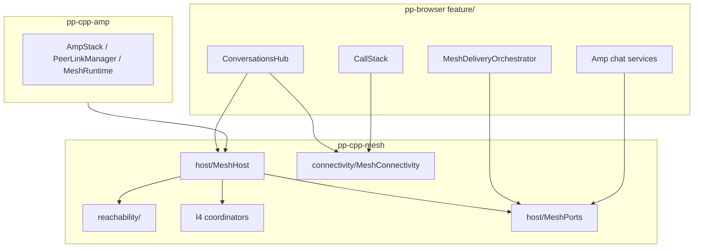

# Mesh layer

**Code:** [pp-cpp-mesh](https://github.com/people-post/pp-cpp-mesh) — namespace `pp::mesh`, `#include "mesh/…"`
(pinned in [`cmake/PpCppMesh.cmake`](../../cmake/PpCppMesh.cmake); `-DPP_CPP_MESH_SOURCE_DIR=…` for a local checkout)  
**CMake:** `pp_mesh` (feature / app), `pp_mesh_types` (the vocabulary, through `pp_pbr_common`), `pp_mesh_testing` (tests)

The mesh layer is the peer-network runtime: Amp composition, reachability, and L4 protocol hosting. It
is not chat UX, HTTP Brief, or hop-ranking policy — those stay in pp-browser (`feature/`, `domain/`)
and reach the mesh as pushed snapshots and app protocols. This page is pp-browser's view of it: how
the app composes and uses it. The library's own layout, rules and threading contract are in its
[README](https://github.com/people-post/pp-cpp-mesh#readme) and
[docs/THREADING.md](https://github.com/people-post/pp-cpp-mesh/blob/develop/docs/THREADING.md).

## Architecture

PeerIds come from pp-cpp-crypto ([MESH_IDENTITY.md](MESH_IDENTITY.md)).

## In pp-browser

- **Who composes it:** `ConversationsHub` (the app) and `NodeBootstrap` (pp-node) each own one
  `MeshHost`, built with `AppRuntimeMeshExecutors()` and `MetricsRegistry::Global()`
  ([THREADING.md § Mesh threads](THREADING.md#mesh-threads-control-runs-on-the-io-lane)).
- **Spelling:** app code is in `pbr` and writes `mesh::MeshHost`, `mesh::DirectoryHit` through the alias
  in [`common/MeshAlias.h`](../../src/common/MeshAlias.h).
- **Layers:** `common/`, `foundation/` and `domain/` may include only the vocabulary (`mesh/types/…`:
  directory rows, hops, relay scope, address disclosure, public address, media channel, config — no
  Amp); the mesh itself is `feature/` and `app/`'s to compose. `check_base_includes.sh` enforces it.
- **Tests:** the mesh's own run in pp-cpp-mesh CI; pp-browser's tests that need live Amp stacks link
  `pp_mesh_testing` (`mesh/testing/mesh_test_harness.h`, `mesh_triple_harness.h`).
- **UPnP** is off (`PP_MESH_WITH_UPNP`), as it always was here: pp-browser's build never found the
  vendored miniupnpc target. Turning it on is a product decision (router port mappings disclose and
  expose this device).

## Feature boundary

Feature code accesses mesh only through **`MeshHost` narrow ports**:

| Port | Accessor | Use |
|------|----------|-----|
| Chat / dial | `MeshHost::ChatDeps()` → `IChatPeerLinks&` | Amp chat, history, blob, warm/dial |
| Circuit | `MeshHost::CircuitDeps()` | Circuit bridge, hop reach |
| Call-media transport | `CallMediaAmpTransport` via `CallStack` | `feature/call_media` (a client of the mesh's io lane and L4 helpers); `CallMediaBridge` in `feature/calls` |
| App protocols | `MeshHost::SetAppProtocols` | Advertise the protocols the app serves on the mesh's links (chat, history, blobs, announce, broadcast, call media: `ProductMeshProtocols`) beside the mesh's own |
| Dial / reach / parking | `MeshConnectivity` (owned by `ConversationsHub`) | Borrowed by `CallStack` (`CallStackDeps::connectivity`); hop candidates injected by `MakeMeshConnectivityDeps` ([L015](../../projects/media-client-layers/DECISIONS.md#l015--a-neutral-meshmediaplane-in-domainmesh-owned-by-the-product-hub-lent-to-calls-and-broadcast)) |
| Media relay | `MeshMediaRelay` (owned by `ConversationsHub`, built on `MeshConnectivity`) | Borrowed by `CallStack` (`CallStackDeps::media_relay`) and broadcast (`RelayAttachPorts`) |

Feature must **not** `#include "amp/link/*"` in headers. Implementation `.cpp` files may include `amp/link/PeerLink.h` only where channel session binding requires it; new code should prefer `IChatPeerLinks`.

`IChatPeerLinks::LinkRoe` / `ChannelRoe` are `CodedRoe` aliases — stable `Err` codes match `PeerLinkManager` ([AMP-LINK-ERRORS.md](../contracts/AMP-LINK-ERRORS.md)). Inspect `Failure::GetCode()` for retry/backoff logic; use `message` for logs only. L4 coordinators must **wrap** link failures (not identity-map) per [CODED_FAILURE.md](../contracts/CODED_FAILURE.md).

`MeshHost::Amp()` remains for mesh tests and `AttachAmpStack` harnesses only.

## Link events and hygiene

Amp owns link liveness; the mesh layer only observes it ([ADR_LINK_PLANE §9–11](https://github.com/people-post/pp-cpp-amp/blob/develop/docs/ADR_LINK_PLANE.md), keepalive v2 in [KEEPALIVE.md](https://github.com/people-post/pp-cpp-amp/blob/develop/docs/KEEPALIVE.md)).

- **Events:** `MeshRuntime::AddLinkEventListener` posts `Connected` / `Dropped` (+ `LinkDropReason`) / `PathChanged` off the strand. `host/MeshLinkEventLog` logs them under `MeshLink` with `path=direct|punched|carrier`, the remote endpoint and RX age — INFO for connects and path changes, WARNING for the drop of a connected link, DEBUG for failed attempts.
- **Per-link, not per-peer:** a direct (ADP) link and a nested relay-carrier link to one PeerId coexist ([A024](../../projects/adp/DECISIONS.md#a024--amp-call-media-over-circuit--nested-session)); drops, waits and lookups key on `LinkHandle`, and `PeerLinkManager::FindConnectedLinkByPeerId(peer, TransportClass)` picks exactly one class. Call media binds a path to one handle and never follows an alias to "whatever now carries the peer" ([AMP-CHANNEL.md § Call-media bundle](../contracts/AMP-CHANNEL.md#call-media-bundle)).
- **Dual dial:** two associations to one PeerId of the same class (a simultaneous punch, a crossed dial) are elected down to one after both were Connected (`dual-dial-lost`). Consumers bound to the loser see an ordinary drop; call media rebinds quietly ([K011](../../projects/call-path-resilience/DECISIONS.md)).
- **Hygiene** (pp-cpp-amp v2.4.0): carrier-closed and failed-inbound links are dropped; only fresh authenticated packets move the path or prove liveness; OS-unreachable sends drop the link at once. Keepalive tiers: product **hot 10 s** (relay reservations, standby paths), **warm 25 s** (chat peers), cold otherwise (`AmpLinkConfig.h`).

### Local network change (call-path-resilience k5)

`foundation/platform/NetworkMonitor` reports material changes of the device's attachment (online, transport, cost, and a fingerprint of the default-route interfaces and their addresses). Backends: Linux rtnetlink (2 s poll fallback), macOS / iOS `NWPathMonitor`, Windows IP-helper notifications + `GetNetworkConnectivityHint`, Android `registerDefaultNetworkCallback` (`PpNetworkMonitor.java`). The owner of the mesh services starts it — `ConversationsHub` in the app, `ProductStackHarness` in `pp-call-probe` — and fans changes out: the mesh first (`ReactMeshToNetworkChange`, `feature/conversations/MeshNetworkReaction.h`), then the calls with what the mesh made of it (`ReactCallsToNetworkChange`, `feature/calls/LocalNetworkReaction.h`; the hub reaches them through its participants):

| Change | Mesh (`MeshHost::OnLocalNetworkChanged`, `DecideLocalNetworkReaction`) | Calls (`CallMediaBridge::OnLocalNetworkChanged`) |
|--------|---------------------------|------------------|
| Online on a new attachment, or back online | Amp `NotifyNetworkChanged`: every direct link probed at once (the probe from the new address also moves the peer's path), silent ones dropped after 2 s (`network-changed`), dial backoffs cleared ([KEEPALIVE.md § Network change](https://github.com/people-post/pp-cpp-amp/blob/develop/docs/KEEPALIVE.md)); reachability re-probed 2.5 s later → advertised / punch addresses refreshed | Reconnecting: re-anchor once links settled (2.5 s); Live relayed (offerer): direct-upgrade punches start over |
| Offline | Nothing — probes into no route would drop every link; they may survive a short outage | Nothing |
| Cost / transport label only | Nothing (mobility policy, k6) | Nothing |

Hard lab: hard-w5 Phase-11 FLIP (peer-a changes address mid-call → reconnected on a new path in 2.3 s).

## pp-node

Full `MeshHost` + `MeshHostConfig` flags (no slim `NodeMeshHost` subclass). See [NETWORKING.md](NETWORKING.md) and [projects/adp/STACK.md](../../projects/adp/STACK.md).

**Ledger role** (pp-ledger platform-integration pi4): with `--ledger-role relay|miner`, pp-node runs
one pp-ledger role on its mesh runtime (`feature/node/NodeLedgerRole`, over pp-ledger's
`RoleRunner`): the node's identity and address, pp-ledger's handlers bound on the runtime, and the
ledger's protocols advertised through `MeshHost::SetAppProtocols` only while they are bound — the
mesh refuses opens for protocols nothing serves. It stops (stop → join) before `MeshHost::Stop`.
Operator flags: [BUILD.md § Headless mesh node](../ops/BUILD.md#headless-mesh-node-pp-node).

## Related docs

- [MESH_IDENTITY.md](MESH_IDENTITY.md) — PeerId derivation
- [projects/adp/STACK.md](../../projects/adp/STACK.md) — Amp stack
- [AMP-CHANNEL.md](../contracts/AMP-CHANNEL.md) — L3 channels
- [NETWORKING.md](NETWORKING.md) — product networking overview
- [projects/p2p-mesh/MESH_ORGANIZATION.md](../../projects/p2p-mesh/MESH_ORGANIZATION.md) — rename + consolidation notes

## Extraction to `pp-cpp-mesh`

The mesh moved to its own library, [pp-cpp-mesh](https://github.com/people-post/pp-cpp-mesh)
(decided 2026-10-19, moved with its history the same month), consumed like pp-cpp-amp (FetchContent
pin, local-checkout override).

| Package | Contents |
|---------|----------|
| `pp-cpp-amp` | L1–L3 + link; links name peers by their PeerId (`PeerIdFromIdentityKey`); `PeerIdFromMultiaddr` |
| `pp-cpp-crypto` | ML-DSA / ML-KEM, the AEAD (`XChaCha20Poly1305`), and the PeerId derivation ([MESH_IDENTITY.md](MESH_IDENTITY.md)) |
| `pp-cpp-mesh` | host, connectivity, DHT, discovery, reach, reachability, circuit and media relay (both ends), media plane, the vocabulary it shares with apps (`types/`) and test harnesses (`testing/`) |
| `pp-browser` | feature + app, **pp-node** (an app on pp-cpp-mesh), call media (`feature/call_media`: pp-browser's realtime protocol, a client of the mesh), policy (`MeshHopPolicy`, `SoftMigrateLogic`) |

The library depends on pp-cpp-common, pp-cpp-crypto and pp-cpp-amp only; it carries protocols and
bytes, product types stay in pp-browser; its threads and rules are its
[docs/THREADING.md](https://github.com/people-post/pp-cpp-mesh/blob/develop/docs/THREADING.md).

| Step | |
|------|---|
| Mesh config types out of the app's `Config` (now `mesh/types/MeshConfigTypes.h`) | done |
| `DeferredSelf` → `pp::Lifetime` (pp-cpp-common), app-wide | done |
| Mesh threads in place of `AppRuntime` ([THREADING.md § Mesh threads](THREADING.md#mesh-threads-control-runs-on-the-io-lane)): control on the io lane, `work` / `blocking` executors per instance, one driver | done |
| `l4/call_media` out of the mesh (now `feature/call_media`); `host` names no app protocol (`MeshHost::SetAppProtocols`; pp-node advertises none); product `common/` types (chat, thread, media health) out of mesh code (`MediaRelayClientHealth`) | done |
| PeerId derivation into pp-cpp-crypto (below the network stack: product code derives PeerIds too) and the link hook / multiaddr helper into pp-cpp-amp; ML-DSA and the AEAD from pp-cpp-crypto (`XChaCha20Poly1305`, which `MessageCipher` now forwards to) | done |
| Generic helpers into pp-cpp-common v1.2.0 (`ValueJson`, `SettledWait`, `CodedFailure`, `AtomicFileWrite`, `MetricsRegistry`) | done |
| Metrics per mesh instance (`MeshHost(executors, metrics)`; the relay, punch and link-event counters go to that registry; the app passes `MetricsRegistry::Global()`) | done |
| Links and tests self-contained (no app library or header, tests included) | done |
| The move, with history: `namespace pp::mesh`, `mesh/…`; the vocabulary (directory types, `MeshHop*`, `RelayScope`, `MediaChannel`, `AddressDisclosure`, `PublicAddress`, `MeshConfigTypes`) as `pp_mesh_types`; the vendored miniupnpc along with it | done (pp-cpp-mesh v1.0.0) |

Left for later, each its own change:

- **Mesh wire contracts** (`MESH_DHT.md`, the mesh parts of `L4_PROTOCOL_KINDS.md` / `WIRE_SCHEMAS.md`,
  `MEDIA_CHANNELS.md`) move to pp-cpp-mesh's `docs/`; this repo links them.
- **App protocol policies still in the mesh:** `l4/shared/ProductChannelPolicies.h` names pp-browser's
  realtime and blob protocols — they belong with the app, which hands its policies in with
  `SetAppProtocols`.
- **UPnP** on or off for desktop / pp-node (above).

Invariants: the mesh must not depend on `feature/*`; policy (`MeshHopPolicy`, `SoftMigrateLogic`)
stays in browser.
