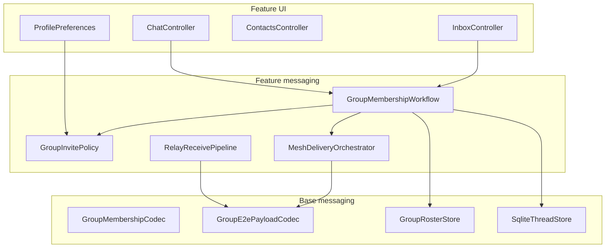

# Group chat — design specification

Maturity tags: unmarked items ship in the first group slice; **`[later]`** next; **`[future]`** deferred.

Cross-project: [chat-storage D076/D089/D095](../chat-storage-and-memory/DECISIONS.md), [e2e E022/E024](../e2e-message-crypto/DECISIONS.md), [WIRE_SCHEMAS](../../docs/contracts/WIRE_SCHEMAS.md).

---

## Resolved product decisions

| # | Topic | First-slice behavior | Extensibility |
|---|--------|-------------|---------------|
| 1 | Invite authority | Owner-only invite/remove/rename | `MemberRole`, `PermissionFlags`, `group_policy.invite_policy` |
| 2 | Fork history | Fresh start (empty transcript) | `history_mode`, `source_group_id`, `fork_message_id`, `ExportMessagesUpTo` |
| 3 | New member history | Full backfill on accept | `history_visibility`: `full` \| `since_join` |
| 4 | Group identity | Local `group:<uuid>` | — |
| 5 | Offline invitee | Outbox queue + retry | — |

---

## Architecture overview



**Two authority domains:**

| Domain | Mechanism |
|--------|-----------|
| Membership / roster | Owner-signed events; monotonic `roster_epoch` |
| Message ordering | Per-sender `sender_seq` in `(group_id, session_epoch)`; relaxed ingest (D046) |

---

## Roles and permissions

### MemberRole

| Value | First slice | Notes |
|-------|---------|-------|
| `owner` | yes | One per group |
| `admin` | schema only | v1.1 |
| `member` | yes | Default for non-owner |

### PermissionFlags (bitmask)

| Flag | Owner | Member (v1) |
|------|-------|---------------|
| `send` | yes | yes |
| `invite` | yes | no |
| `remove` | yes | no |
| `rename` | yes | no |
| `transfer_owner` | yes | no |
| `fork` | yes | yes |
| `leave` | yes | yes |

Enforcement: signed membership events include `actor_role`; ingest validates permission at event `roster_epoch`.

### group_policy (JSON on roster state)

```json
{
  "invite_policy": "owner_only",
  "history_visibility": "full"
}
```

Future `invite_policy`: `"admins"`, `"any_member"`.

---

## Membership event wire schema

Delivered as **`ChatPayload` system messages** (`content_type=system`) with `control_type` and JSON `detail`, or as **direct-thread invite cards** to the invitee before they join.

### Event types

| control_type | Signer | detail JSON (required fields) |
|--------------|--------|-------------------------------|
| `group_invite` | owner | See InvitePayload |
| `group_invite_accept` | invitee | `{ "invite_nonce", "group_id" }` |
| `group_invite_decline` | invitee | `{ "invite_nonce", "group_id" }` |
| `member_joined` | owner | `{ "group_id", "member_identity", "role", "roster_epoch", "members"? }` — `members`: the roster, `[{ "member_identity", "role", "card"?, "relay_user_id"? }]`; `card` is the member's card as the owner keeps it (the members get the newcomer's, the newcomer everyone's, ~128 KB at most), `relay_user_id` the owner's relay route to them ([ACCOUNT_CARD.md](../../docs/contracts/ACCOUNT_CARD.md#groups)). Receivers keep a card only for its own row once it proves itself, take the route as a contact card's, and store the event without the cards (as does the owner's copy) |
| `member_left` | member | `{ "group_id", "member_identity", "roster_epoch" }` |
| `member_removed` | owner | `{ "group_id", "member_identity", "roster_epoch" }` |
| `owner_transferred` | owner | `{ "group_id", "new_owner_identity", "roster_epoch", "leave_previous"? }` |
| `group_renamed` | owner | `{ "group_id", "title", "roster_epoch", "title_version" }` — the owner bumps `title_version` per rename; receivers apply only a newer one (renames do not move `roster_epoch`) |
| `group_forked` | actor | See ForkPayload |

### InvitePayload

```json
{
  "group_id": "group:550e8400-e29b-41d4-a716-446655440000",
  "group_title": "Weekend hike",
  "inviter_identity": "relay:abc123",
  "invitee_identity": "relay:def456",
  "invite_nonce": "uuid",
  "roster_epoch": 1,
  "expires_at": 1735689600000,
  "actor_role": "owner"
}
```

**Delivery :** encrypted direct message to invitee (`route.kind=direct`, `channel=e2e_public`) containing the system payload. Invitee UI renders Accept / Decline / Block.

**Lifecycle:** `pending` → `accepted` | `declined` | `expired` | `blocked`

### ForkPayload

```json
{
  "source_group_id": "group:…",
  "new_group_id": "group:…",
  "new_group_title": "…",
  "selected_identities": ["relay:a", "relay:b"],
  "history_mode": "fresh",
  "fork_message_id": null,
  "actor_identity": "relay:…",
  "roster_epoch": 2
}
```

v1: `history_mode` is always `"fresh"`. v1.1: `"copy_to_fork_point"` with non-null `fork_message_id`.

---

## Invite spam controls

### Profile setting: `group_invite_policy`

| Value | Behavior |
|-------|----------|
| `everyone` | Accept invites from any verified sender |
| `contacts_only` | Reject if inviter not in local contacts (default) |
| `nobody` | Reject all inbound group invites |

Stored in `ProfilePreferences` (profile `prefs.json`).

### Enforcement layers

1. **GroupInvitePolicy::AllowsInboundInvite** — checks policy + `TrustLevel::Blocked`
2. **Rate limit** — max 20 pending invites per 24h (local counter in profile.db)
3. **Per-invite UI** — Decline, Block inviter (sets contact `trust=blocked`)

Separate from 1:1 DM blocking: a contact may DM but not spam group invites.

---

## Group wire envelope (D095)

### Route

```json
{ "kind": "group", "group_id": "group:550e8400-…" }
```

No `channel` field on group routes (sign bytes use `channel=0xFF` per E014).

### Body — N ciphertexts

```json
{
  "e2e": {
    "member_payloads": {
      "relay:alice": "<base64 AEAD blob>",
      "relay:bob": "<base64 AEAD blob>"
    }
  }
}
```

Each blob uses pairwise `ChatTargetKey` with `(peer_identity, e2e_public)` for auto-key bootstrap (E022/E024).

Sent as one envelope per member, keyed by the member's account, each delivered like a direct message
(`DeliveryOutbox`): over a live link to one of the member's devices, else the relay to their `relay:` id
(`recipient_contact_id`). A member with neither is marked unreachable; the row is marked once any copy is out.

Direct tiers continue using `payload_b64` only.

### Stream id

Opaque: `v1:group:{group_id}:{session_epoch}:{member account}` — one per member: the relay stores one
row per (sender, stream, seq), so copies of one message to different members must not share a stream
(until 2026-10-23 they did, and only the first member's copy was kept).

---

## Storage

### profile.db additions

**`group_targets`** — seq/epoch per group (parallel to `chat_targets`):

| Column | Notes |
|--------|-------|
| `group_id` | PK |
| `local_thread_id` | FK to threads.id |
| `session_epoch` | default 1 |
| `next_outgoing_seq` | default 1 |

**`group_rosters`** — canonical membership:

| Column | Notes |
|--------|-------|
| `group_id` | PK part |
| `member_identity` | PK part — communicating identity value |
| `contact_id` | local Contact.id (optional) |
| `role` | owner \| admin \| member |
| `joined_at` | unix ms |

**`group_metadata`**:

| Column | Notes |
|--------|-------|
| `group_id` | PK |
| `owner_identity` | current owner communicating identity |
| `title` | Shared group name (owner rename / create). Clients may also keep a local override on `threads.local_title` (not synced). |

### Dual title display

| Priority | Source | Synced? |
|----------|--------|---------|
| 1 | `threads.local_title` | No (device-only nickname) |
| 2 | `group_metadata.title` | Yes (`group_renamed`) |
| 3 | `threads.title` cache / `"Group chat"` | Denormalized |

When a local override is active, UI may show the shared name in the subtitle (`Shared: …`). Owner “Rename for everyone” updates metadata + fans out `group_renamed` DMs; it does not clear peers’ `local_title`.

**`pending_group_invites`**:

| Column | Notes |
|--------|-------|
| `invite_nonce` | PK |
| `group_id`, `inviter_identity`, `invitee_identity` | |
| `status` | pending \| accepted \| … |
| `expires_at`, `created_at` | |

### threads table

Populate `group_id` column when `kind=group`. `Thread.group_id` field in C++ struct.

### sync_state (thread.db)

Group scope: `peer_identity_kind=group`, `peer_identity_value={group_id}` (D076 generalization of 1:1 PK).

---

## Inbound ingest

1. Verify signature (sender identity)
2. If `route.kind=group`: lookup roster — hard-reject if recipient not a member (except invite path on direct thread)
3. Decrypt local slice from `member_payloads[local_relay_id]`
4. Classify seq (relaxed ingest default — D046)
5. Append to group thread; update sync_state

**Invite handshake :** Invite records **pending only** — the invitee is not an encrypt target until commit. Invitee Accept/Decline send `group_invite_accept` / `group_invite_decline` DMs back to the inviter. Owner ingest of accept requires an invite this device issued (pending rows carry their direction), for the group the accept names, which this device owns, not expired; it upserts the member, bumps its own `roster_epoch` by one, then publishes owner-signed `member_joined` to all active members (G006 commit). An accept for an invite already accepted adds no one (a member removed since, or one who left, needs a new invite). An inbound `group_invite` is recorded only when its signed sender is the `inviter_identity` and the local account the `invitee_identity`, and — for a group already known locally — only from that group's owner while we are not a member; a stored invite is never rewritten by another with the same nonce. Group messages are dropped unless both the local account and the (non-blocked) sender are on the local roster. Peers apply `member_joined` (owner + epoch gates) as the roster source of truth. Decline clears pending only. Pending invites store `group_title` / `roster_epoch` so Accept can seed local `group_metadata`. On Accept, the invitee also upserts the inviter as `Owner` and self as `Member` locally so member→owner fan-out works before `member_joined` arrives. Closing a group session dismisses local membership (and clears `group_targets`) so inbound group traffic hard-rejects instead of recreating the thread with an unread. After Accept/Decline/Block, the DM invite card is resolved in-place (actions cleared; status line text).

**Leave / transfer / prune (G009):** Member close fans out `member_left` then deletes the local thread. Owner close with others picks a successor and fans out `owner_transferred` with `leave_previous: true` (one DM applies succession + removes the old owner). Solo owner close is local dismiss only. Ingest rejects `member_left` from a recorded owner and requires monotonic `roster_epoch`. Send/encrypt failure marks members unreachable; owner may remove via `member_removed` fan-out. Unreachable owner shows a local advisory card (Fork / Message owner / Got it) — no automatic second owner.

**Auto-create:** on accepted invite / first valid `member_joined` for local identity.

---

## UI surfaces

| Surface | Location |
|---------|----------|
| Create group | Contacts or inbox action |
| Group roster | Thread menu / working set |
| Invite card | Direct thread bubble (structured actions) |
| Block invites setting | Me → Security or Messaging prefs |
| Fork group | Thread menu → select members |

---

## Phasing checklist

- [x] Design doc + ADRs (G001–G009)
- [ ] C0: `e2e_public` compose enabled when messaging ready
- [x] C1: Group envelope parse/send, N ciphertexts (scaffold)
- [x] C2: Membership codec + invite/accept/decline + leave/transfer/remove wire (fork peer fan-out still incomplete)
- [x] C3: Roster store + group seq targets (group sync polish remaining)
- [x] C4: Inbox create + invite UI + settings
- [ ] C5: Fork flow (fresh start) — local only today; peer fan-out incomplete

---

## Out of scope (explicit)

- MLS / sender-keys tree
- Relay-side encrypted fan-out
- Multi-device seq coordination (D074)
- End-to-end encrypted roster on relay
- Copy-to-fork-point history (v1.1)

---

## Restore and roster sync (proposed, 2026-10-25)

Status: accepted 2026-10-25 — G010–G013 with amendments (G014 separate); implementing on this branch. The restore section below is the design being built; docs/ gets the shipped rule. Found on devices 2026-10-25: a device restored from the local account backup, or a member who lost the group and is re-invited, restarts its own group `sender_seq` at 1 in its old epoch (AcceptInvite seeds `group_targets` with 1, 1), so peers silently drop its first messages. Same mechanism as the 1:1 bug fixed in 3cf0a14c8, which covers Direct threads only. The client team (Kenneth) is adding groups to the local backup (backup v3: per-group metadata, roster as identities, own `session_epoch`; no seq, no history) and a group members screen where the owner can add, remove and re-invite. The pieces below need the protocol owner.

### Sender restart (G010, G011)

`group_targets` adds `restart_pending` (additive). Set on restore, and on accepting a `group_invite` with `rejoin: true` (the owner sets it when the invitee is already on its roster; it also carries that member's `sender_epoch_floor`). Next send: `epoch = max(sender_epoch_floor, max seen_epoch_from_you, backup epoch, local max) + 1`, `seq = 1`, clear flag. Group sends take the pair's current session, and the envelope names its epoch in `key_epoch` (sign v3, G011); `session_epoch` stays the group's numbering, for de-dup and ordering only.

### roster_statement (G012)

```json
{
  "group_id": "group:…",
  "roster_epoch": 7,
  "members": [{ "identity": "relay:abc", "role": "owner", "joined_at": 1735689600000 }],
  "sender_epoch_floor": { "relay:abc": 3 },
  "owner_signature": "<base64, over the canonical encoding of the fields above>"
}
```

`sender_epoch_floor[m]` = highest group epoch the owner has seen from `m`. Sent with every roster event (`member_joined`, `member_left`, `member_removed`, `owner_transferred`) as an added `roster_statement` field in `detail`; members store the latest.

### group_roster_request / group_roster_reply (G013)

```json
{ "control_type": "group_roster_request", "detail": { "group_id": "…", "request_id": "uuid", "roster_epoch": 5 } }
{ "control_type": "group_roster_reply",   "detail": { "group_id": "…", "request_id": "uuid", "roster_statement": { … }, "removed": false, "seen_epoch_from_you": 4 } }
```

Request goes to the owner and all members in the backup roster. Reply: any member may send its stored statement; `removed=true` (with the latest statement, if any) when the replier knows we are no longer a member. `seen_epoch_from_you` is the replier's own highest group epoch seen from the requester; it is unsigned by the owner, which is fine because it only raises the requester's next epoch (the owner's floor alone misses messages the owner never received).

### group_invite_refused (G014)

```json
{ "control_type": "group_invite_refused", "detail": { "group_id": "…", "invite_nonce": "uuid", "reason": "group_full" } }
```

Signer: owner. Invitee drops the pending local group and shows the refusal.

### State machine (per group, restored device)

```
restored (owner or not) --send group_roster_request--> checking   [receive: yes, send: no]
checking --valid owner-signed reply, removed=false--> active, restart_pending   [apply highest roster_epoch]
checking --valid reply, removed=true--> removed                    [read-only, "you were removed"]
any state --group message arrives while no check is running--> checking (again)  [its sender is online]
re-invited (rejoin: true) --> active, restart_pending   (member_joined snapshot is fresh)
active + restart_pending --first send--> active                   [epoch = max(floors, local) + 1, seq 1]
```

The owner checks too (G013 amendment): a member may hold a newer statement the owner signed after the backup was written. A reply counts only if `request_id` matches an open request; completion does not go through `RequireNewerEpoch`. Unanswered checks stay `checking` and are retried (and restarted by any incoming group message); UI shows "checking members". History is not restored (a later feature, 1:1 and groups alike).

### Tests we will add with the implementation

- G010: restore, send in group; peers hold the message (lab: `restored_device_is_heard` for groups); re-invite after loss, same; epoch never reused.
- G011: restore, 1:1 then group and group then 1:1; both delivered, pair epoch never decreases.
- G012: roster_statement signature verifies; forged or older statement rejected; every roster event stores one.
- G013: stale backup (member removed after backup) leaves no send before sync; unchanged roster completes sync; removed=true gives read-only; owner reply beats a member's.
- G014: 51st invite refused; accept at full yields `group_invite_refused`; pending invites not counted.

Not proposed: dissolve-for-everyone. Kenneth 2026-10-25: owner transfer (G009) stays; a hijacked owner account must not be able to erase a group.
