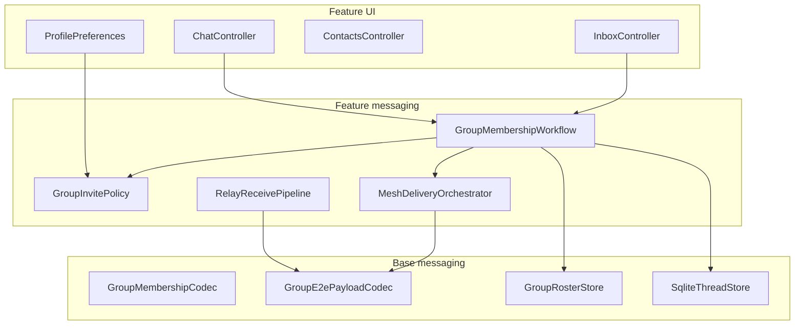

# Group chat — design specification

Maturity tags: unmarked items ship in the first group slice; **`[later]`** next; **`[future]`** deferred.

Cross-project: [chat-storage D076/D089/D095](../chat-storage-and-memory/DECISIONS.md), [e2e E022/E024](../e2e-message-crypto/DECISIONS.md), [WIRE_SCHEMAS](../../docs/contracts/WIRE_SCHEMAS.md).

---

## Resolved product decisions

| # | Topic | First-slice behavior | Extensibility |
|---|--------|-------------|---------------|
| 1 | Invite authority | Owner-only invite/remove/rename | `MemberRole`, `PermissionFlags`, `group_policy.invite_policy` |
| 2 | Fork history | Fresh start (empty transcript) | `history_mode`, `source_group_id`, `fork_message_id`, `ExportMessagesUpTo` |
| 3 | New member history | Full backfill on accept | `history_visibility`: `full` \| `since_join` |
| 4 | Group identity | Local `group:<uuid>` | — |
| 5 | Offline invitee | Outbox queue + retry | — |

---

## Architecture overview



**Two authority domains:**

| Domain | Mechanism |
|--------|-----------|
| Membership / roster | Owner-signed events; monotonic `roster_epoch` |
| Message ordering | Per-sender `sender_seq` in `(group_id, session_epoch)`; relaxed ingest (D046) |

---

## Roles and permissions

> **Accepted 2026-11-05, not built:** open groups replace this section — roles and two presets in [G017](DECISIONS.md#g017--open-groups-roles-and-two-presets), wire in [§ Open groups](#open-groups-g017g023) below. Until they ship, the tables here describe the code.

### MemberRole

| Value | First slice | Notes |
|-------|---------|-------|
| `owner` | yes | One per group |
| `admin` | schema only | v1.1 |
| `member` | yes | Default for non-owner |

### PermissionFlags (bitmask)

| Flag | Owner | Member (v1) |
|------|-------|---------------|
| `send` | yes | yes |
| `invite` | yes | no |
| `remove` | yes | no |
| `rename` | yes | no |
| `transfer_owner` | yes | no |
| `fork` | yes | yes |
| `leave` | yes | yes |

Enforcement: signed membership events include `actor_role`; ingest validates permission at event `roster_epoch`.

### group_policy (JSON on roster state)

```json
{
  "invite_policy": "owner_only",
  "history_visibility": "full"
}
```

Future `invite_policy`: `"admins"`, `"any_member"`.

---

## Membership event wire schema

Delivered as **`ChatPayload` system messages** (`content_type=system`) with `control_type` and JSON `detail`, or as **direct-thread invite cards** to the invitee before they join.

### Event types

| control_type | Signer | detail JSON (required fields) |
|--------------|--------|-------------------------------|
| `group_invite` | owner | See InvitePayload |
| `group_invite_accept` | invitee | `{ "invite_nonce", "group_id" }` |
| `group_invite_decline` | invitee | `{ "invite_nonce", "group_id" }` |
| `member_joined` | owner | `{ "group_id", "member_identity", "role", "roster_epoch", "members"? }` — `members`: the roster, `[{ "member_identity", "role", "card"?, "relay_user_id"? }]`; `card` is the member's card as the owner keeps it (the members get the newcomer's, the newcomer everyone's, ~128 KB at most), `relay_user_id` the owner's relay route to them ([ACCOUNT_CARD.md](../../docs/contracts/ACCOUNT_CARD.md#groups)). Receivers keep a card only for its own row once it proves itself, take the route as a contact card's, and store the event without the cards (as does the owner's copy) |
| `member_left` | member | `{ "group_id", "member_identity", "roster_epoch" }` |
| `member_removed` | owner | `{ "group_id", "member_identity", "roster_epoch" }` |
| `owner_transferred` | owner | `{ "group_id", "new_owner_identity", "roster_epoch", "leave_previous"? }` |
| `group_renamed` | owner | `{ "group_id", "title", "roster_epoch", "title_version" }` — the owner bumps `title_version` per rename; receivers apply only a newer one (renames do not move `roster_epoch`) |
| `group_forked` | actor | See ForkPayload |

### InvitePayload

```json
{
  "group_id": "group:550e8400-e29b-41d4-a716-446655440000",
  "group_title": "Weekend hike",
  "inviter_identity": "relay:abc123",
  "invitee_identity": "relay:def456",
  "invite_nonce": "uuid",
  "roster_epoch": 1,
  "expires_at": 1735689600000,
  "actor_role": "owner",
  "context": "call",
  "call_id": "call:…"
}
```

**Delivery :** encrypted direct message to invitee (`route.kind=direct`, `channel=e2e_public`) containing the system payload. Invitee UI renders Accept / Decline / Block.

**Lifecycle:** `pending` → `accepted` | `declined` | `expired` | `blocked`

### ForkPayload

```json
{
  "source_group_id": "group:…",
  "new_group_id": "group:…",
  "new_group_title": "…",
  "selected_identities": ["relay:a", "relay:b"],
  "history_mode": "fresh",
  "fork_message_id": null,
  "actor_identity": "relay:…",
  "roster_epoch": 2
}
```

v1: `history_mode` is always `"fresh"`. v1.1: `"copy_to_fork_point"` with non-null `fork_message_id`.

---

## Invite spam controls

### Profile setting: `group_invite_policy`

| Value | Behavior |
|-------|----------|
| `everyone` | Accept invites from any verified sender |
| `contacts_only` | Reject if inviter not in local contacts (default) |
| `nobody` | Reject all inbound group invites |

Stored in `ProfilePreferences` (profile `prefs.json`).

### Enforcement layers

1. **GroupInvitePolicy::AllowsInboundInvite** — checks policy + `TrustLevel::Blocked`
2. **Rate limit** — max 20 pending invites per 24h (local counter in profile.db)
3. **Per-invite UI** — Decline, Block inviter (sets contact `trust=blocked`)

Separate from 1:1 DM blocking: a contact may DM but not spam group invites.

---

## Group wire envelope (D095)

### Route

```json
{ "kind": "group" }
```

No `channel` field on group routes (sign bytes use `channel=0xFF` per E014), and no `group_id` (G018 item 7): the
relay can read the envelope, so the group id rides inside each copy's ciphertext.

**Group copy plaintext:** `group_copy_version` u8 `1`, `group_id` LenUtf8, the message's ChatPayload LenBytes
(`GroupE2ePayloadCodec::EncodeCopyPlaintext`). Inside the AEAD rather than in its associated data: the receiver
must read the group id without knowing it, and AAD it cannot rebuild would mean trying each group shared with the
sender. The AEAD authenticates it and the signed copy hash covers the ciphertext, so the copy stays bound to its
group. o2 adds `statement_epoch` and `changes_hash` here (G018 item 5).

### Body — N ciphertexts

```json
{
  "e2e": {
    "member_payloads": {
      "relay:alice": "<base64 AEAD blob>",
      "relay:bob": "<base64 AEAD blob>"
    }
  }
}
```

Each blob uses pairwise `ChatTargetKey` with `(peer_identity, e2e_public)` for auto-key bootstrap (E022/E024).

Sent as one envelope per member, keyed by the member's account, each delivered like a direct message
(`DeliveryOutbox`): over a live link to one of the member's devices, else the relay to their `relay:` id
(`recipient_contact_id`). A member with neither is marked unreachable; the row is marked once any copy is out.

Direct tiers continue using `payload_b64` only.

### Stream id

Opaque: `v1:g:` + hex(BLAKE2b-128(LenUtf8 of `pp-browser:group-stream-v1`, group id, lower account, higher
account)) + `:from:{sender_device}` (G018 item 7; [WIRE_SCHEMAS § Group stream id](../../docs/contracts/WIRE_SCHEMAS.md)).
One per member and sending device: the relay stores one row per (sender, stream, index), so copies of one message
to different members must not share a stream (until 2026-10-23 they did, and only the first member's copy was
kept), nor two devices of one sender. Both accounts' devices compute it; the relay cannot, and with the pair in the
hash Alice→Bob and Alice→Carol in one group look unrelated. No epoch, unlike the first sketch of G018 item 7: since
M022 a record carries copies for several device pairs, each at its own epoch, and the stream was already
epoch-free (`v2:group:{group_id}:{member}:from:{device}`, retired). Still visible: that a record is a group copy
(`v1:g:`, and `route.kind`).

---

## Storage

### profile.db additions

**`group_targets`** — seq/epoch per group (parallel to `chat_targets`):

| Column | Notes |
|--------|-------|
| `group_id` | PK |
| `local_thread_id` | FK to threads.id |
| `session_epoch` | default 1 |
| `next_outgoing_seq` | default 1 |

**`group_rosters`** — canonical membership:

| Column | Notes |
|--------|-------|
| `group_id` | PK part |
| `member_identity` | PK part — communicating identity value |
| `contact_id` | local Contact.id (optional) |
| `role` | owner \| admin \| member |
| `joined_at` | unix ms |

**`group_metadata`**:

| Column | Notes |
|--------|-------|
| `group_id` | PK |
| `owner_identity` | current owner communicating identity |
| `title` | Shared group name (owner rename / create). Clients may also keep a local override on `threads.local_title` (not synced). |

### Dual title display

| Priority | Source | Synced? |
|----------|--------|---------|
| 1 | `threads.local_title` | No (device-only nickname) |
| 2 | `group_metadata.title` | Yes (`group_renamed`) |
| 3 | `threads.title` cache / `"Group chat"` | Denormalized |

When a local override is active, UI may show the shared name in the subtitle (`Shared: …`). Owner “Rename for everyone” updates metadata + fans out `group_renamed` DMs; it does not clear peers’ `local_title`.

**`pending_group_invites`**:

| Column | Notes |
|--------|-------|
| `invite_nonce` | PK |
| `group_id`, `inviter_identity`, `invitee_identity` | |
| `status` | pending \| accepted \| … |
| `expires_at`, `created_at` | |

### threads table

Populate `group_id` column when `kind=group`. `Thread.group_id` field in C++ struct.

### sync_state (thread.db)

Group scope: `peer_identity_kind=group`, `peer_identity_value={group_id}` (D076 generalization of 1:1 PK).

---

## Inbound ingest

1. If `route.kind=group`: hard-reject a blocked sender, or one in no group with us (the roster, before reading)
2. Verify signature (sender identity)
3. Decrypt this device's copy; read the group id it names (G018 item 7)
4. Hard-reject unless both the local account and the sender are on that group's roster (same outcomes as when the
   route named the group)
5. Classify seq (relaxed ingest default — D046)
6. Append to group thread; update sync_state

**Invite handshake :** Invite records **pending only** — the invitee is not an encrypt target until commit. Invitee Accept/Decline send `group_invite_accept` / `group_invite_decline` DMs back to the inviter. Owner ingest of accept requires an invite this device issued (pending rows carry their direction), for the group the accept names, which this device owns, not expired; it upserts the member, bumps its own `roster_epoch` by one, then publishes owner-signed `member_joined` to all active members (G006 commit). An accept for an invite already accepted adds no one (a member removed since, or one who left, needs a new invite). An inbound `group_invite` is recorded only when its signed sender is the `inviter_identity` and the local account the `invitee_identity`, and — for a group already known locally — only from that group's owner while we are not a member; a stored invite is never rewritten by another with the same nonce. Group messages are dropped unless both the local account and the (non-blocked) sender are on the local roster. Peers apply `member_joined` (owner + epoch gates) as the roster source of truth. Decline clears pending only. Pending invites store `group_title` / `roster_epoch` so Accept can seed local `group_metadata`. On Accept, the invitee also upserts the inviter as `Owner` and self as `Member` locally so member→owner fan-out works before `member_joined` arrives. Closing a group session dismisses local membership (and clears `group_targets`) so inbound group traffic hard-rejects instead of recreating the thread with an unread. After Accept/Decline/Block, the DM invite card is resolved in-place (actions cleared; status line text).

**Leave / transfer / prune (G009):** Member close fans out `member_left` then deletes the local thread. Owner close with others picks a successor and fans out `owner_transferred` with `leave_previous: true` (one DM applies succession + removes the old owner). An owner may instead dissolve the group for everyone (G016, `group_dissolved`; a solo owner dissolves with nothing to send). Ingest rejects `member_left` from a recorded owner and requires monotonic `roster_epoch`. Send/encrypt failure marks members unreachable; owner may remove via `member_removed` fan-out. Unreachable owner shows a local advisory card (Fork / Message owner / Got it) — no automatic second owner.

**Auto-create:** on accepted invite / first valid `member_joined` for local identity.

---

## UI surfaces

| Surface | Location |
|---------|----------|
| Create group | Contacts or inbox action |
| Group roster | Thread menu / working set |
| Invite card | Direct thread bubble (structured actions) |
| Block invites setting | Me → Security or Messaging prefs |
| Fork group | Thread menu → select members |

---

## Phasing checklist

- [x] Design doc + ADRs (G001–G009)
- [ ] C0: `e2e_public` compose enabled when messaging ready
- [x] C1: Group envelope parse/send, N ciphertexts (scaffold)
- [x] C2: Membership codec + invite/accept/decline + leave/transfer/remove wire (fork peer fan-out still incomplete)
- [x] C3: Roster store + group seq targets (group sync polish remaining)
- [x] C4: Inbox create + invite UI + settings
- [ ] C5: Fork flow (fresh start) — local only today; peer fan-out incomplete

---

## Out of scope (explicit)

- MLS / sender-keys tree
- Relay-side encrypted fan-out
- Multi-device seq coordination (D074)
- End-to-end encrypted roster on relay
- Copy-to-fork-point history (v1.1)

---

## Restore and roster sync (proposed, 2026-10-25)

Status: G010–G013 implemented (2026-10-29; G014 separate); the shipped wire is in [WIRE_SCHEMAS § Owner-signed roster](../../docs/contracts/WIRE_SCHEMAS.md) and the groups an account keeps across devices and restores in [ACCOUNT_LOCKER § State JSON](../../docs/contracts/ACCOUNT_LOCKER.md#state-json) (the local backup named below is retired — multi-device M023); the sketches below are the proposal as accepted. The restore section below is the design being built; docs/ gets the shipped rule. Found on devices 2026-10-25: a device restored from the local account backup, or a member who lost the group and is re-invited, restarts its own group `sender_seq` at 1 in its old epoch (AcceptInvite seeds `group_targets` with 1, 1), so peers silently drop its first messages. Same mechanism as the 1:1 bug fixed in 3cf0a14c8, which covers Direct threads only. The client team (Kenneth) is adding groups to the local backup (backup v3: per-group metadata, roster as identities, own `session_epoch`; no seq, no history) and a group members screen where the owner can add, remove and re-invite. The pieces below need the protocol owner.

### Numbering per pair (G010, G011)

A member only ever receives its own copy, so each copy is a pairwise e2e_public message numbered in the pair: `session_epoch` = the pair's session epoch (its key, too), `sender_seq` = our count for this group in that pair (`group_member_seq(group_id, member_identity, session_epoch, next_seq)`, a new pair epoch starts it at 1; kept when we leave, so a re-join continues it). A device that lost its counts (restore, *Reset chats*) has its pair sessions marked `restart_pending`: the first send to that member — 1:1 or group copy (`StartNextPairEpochIfRestored`) — moves the pair to its next epoch from seq 1 with a fresh session opener, and the peer follows (D014). Receivers tell senders apart per (thread, epoch, sender). A member removal changes no numbering: the removed member simply gets no copy. Linked devices: the pair is a device pair (multi-device M021) — one copy per member device, numbered there.

### roster_statement (G012)

```json
{
  "group_id": "group:…",
  "roster_epoch": 7,
  "members": [{ "identity": "account:abc", "role": "owner", "joined_at": 1735689600000 }],
  "owner_signature": "<base64, over the canonical encoding of the fields above>"
}
```

Sent with every roster event (`member_joined`, `member_left`, `member_removed`, `owner_transferred`) as an added `roster_statement` field in `detail`; members store the latest.

### group_roster_request / group_roster_reply (G013)

```json
{ "control_type": "group_roster_request", "detail": { "group_id": "…", "request_id": "uuid", "roster_epoch": 5 } }
{ "control_type": "group_roster_reply",   "detail": { "group_id": "…", "request_id": "uuid", "roster_statement": { … }, "removed": false } }
```

Request goes to the owner and all members in the backup roster. Reply: any member may send its stored statement; `removed=true` (with the latest statement, if any) when the replier knows we are no longer a member. Both ride the control lane ([WIRE_SCHEMAS § Owner-signed roster](../../docs/contracts/WIRE_SCHEMAS.md)): bookkeeping between two devices, never stored, and an account copy carrying the sender's card, which a restored asker no longer keeps.

### group_invite_refused (G014)

```json
{ "control_type": "group_invite_refused", "detail": { "group_id": "…", "invite_nonce": "uuid", "reason": "group_full" } }
```

Signer: owner. Invitee drops the pending local group and shows the refusal.

### group_dissolved (G016)

```json
{ "control_type": "group_dissolved", "detail": { "group_id": "…", "roster_statement": { …, "roster_epoch": 6, "dissolved": true } } }
```

Signer: owner (account key, tag `pp-browser:group-dissolved-v1`); sent as a DM to each roster member. A receiver in the group, hearing it from the owner it knows, empties the roster, drops the send target, voids pending invites and marks the group `dissolved`; the chat stays, read-only, with the line "{owner} dissolved this group". Repeats and copies for a group it is not in change nothing. The DM is kept out of direct chats; the group's chat gets the one notice.

Owner side, durable: one transaction writes the end (roster emptied, send target dropped, invites voided, `sync_state` `dissolved`, the signed dissolve held) together with a `group_pending_sends` row per member (`group_dissolved`) and per outstanding invitee (`group_invite_refused`, reason `group_dissolved`). The rows are sent through the outbox afterwards and removed once each copy is queued; the rest go again at start and after a failure (30 s, 2 min, 10 min). A dissolved group answers a member check with the dissolve, so a restored member ends too; the owner's other devices are told on the control lane (`group_dissolved_sibling`) and, if off, find the locker's terminal tombstone at their next sync. Authority: the owner we know or its successor, not older than our roster, not handed on by then (A to B to A accepted). [WIRE_SCHEMAS § Group dissolved](../../docs/contracts/WIRE_SCHEMAS.md).

### State machine (per group, restored device)

```
restored (owner or not) --send group_roster_request--> checking   [receive: yes, send: no]
checking --valid owner-signed reply, removed=false--> active   [apply highest roster_epoch]
checking --valid reply, removed=true--> removed                    [read-only, "you were removed"]
any state --valid group_dissolved from the owner--> dissolved      [read-only, roster empty, no check, no reply; terminal]
any state --group message arrives while no check is running--> checking (again)  [its sender is online]
re-invited --> active   (member_joined snapshot is fresh; numbering continues, or the pair restarts)
```

The owner checks too (G013 amendment): a member may hold a newer statement the owner signed after the backup was written. A reply counts only if `request_id` matches an open request; completion does not go through `RequireNewerEpoch`. Unanswered checks stay `checking` and are retried (and restarted by any incoming group message); UI shows "checking members". History is not restored (a later feature, 1:1 and groups alike).

### Tests we will add with the implementation

- G010: restore, send in group; peers hold the message (lab: `restored_device_is_heard` for groups); re-invite after loss, same; epoch never reused.
- G011: restore, 1:1 then group and group then 1:1; both delivered, pair epoch never decreases.
- G012: roster_statement signature verifies; forged or older statement rejected; every roster event stores one.
- G013: stale backup (member removed after backup) leaves no send before sync; unchanged roster completes sync; removed=true gives read-only; owner reply beats a member's.
- G014: 51st invite refused; accept at full yields `group_invite_refused`; pending invites not counted.

Not proposed: dissolve-for-everyone. Kenneth 2026-10-25: owner transfer (G009) stays; a hijacked owner account must not be able to erase a group.

---

## Open groups (G017–G023)

Accepted 2026-11-05, not built. Sketches to settle in each phase ([PHASES § O](PHASES.md#o--open-groups-g017g023)); the shipped wire goes to [WIRE_SCHEMAS](../../docs/contracts/WIRE_SCHEMAS.md). The product is unreleased: each step is a clean cutover.

### The owner's statement (G012, extended by G018)

The statement as built, with these fields added inside what the owner signs. **The engine is built** (o2, not wired: `lib/messaging/GroupRosterStatement.*`); until o2 wires it, the workflow signs these fields empty.

| Field | Meaning |
|---|---|
| `members[].role` | `owner` / `admin` / `member` |
| `members[].added_by` | who brought them (G019): the signer of the `add` the owner folded; empty for the group's first members |
| `preset` | `open` / `managed` (G017) |
| `title`, `title_version` | the group's name and its version (R4); as `group_renamed` today |
| `removed[]` | `{identity, removal, by}`: accounts removed and not re-admitted (G018 R2, G020); `removal` is the id of the `remove` change a re-admit names |
| `links[]` | live links: `{link_id, secret_hash, maker, expires_at, max_uses?}` (G021); `max_uses` omitted (0) means no limit |
| `folded[]` | ids of **every** change the owner has folded, in this statement and earlier ones (carried forward, so a device that missed a statement still drops what it folded) |

JSON omits `added_by`, `title`/`title_version`, `removed`, `links` and `folded` when empty.

**Sign bytes v3** — the account key (ML-DSA-65) signs, every string a u32 BE length then its bytes, every integer u64 BE, every list sorted (members and removed by identity, links by `link_id`, folded by id):

```
"pp-browser:group-roster-statement-v3"   ("pp-browser:group-dissolved-v3" for a dissolve, G016)
group_id, roster_epoch, owner,
member count, then per member: identity, role, joined_at, added_by
preset
title, title_version
removed count, then per entry: identity, removal, by
link count, then per link: link_id, secret_hash, maker, expires_at, max_uses (0: none)
folded count, then each id
```

Verify also refuses a removed account that is also a member, a repeated removed account, link id or folded id. v2 statements no longer verify (clean cutover).

### Change (G018)

`GroupChange` (`lib/messaging/GroupChange.*`; named apart from the store's `GroupRosterChange` notification):

```json
{
  "group_id": "group:…",
  "base_epoch": 7,
  "signer": "account:…",
  "signer_device": "<Peer ID of the signing device>",
  "signer_card": { "…": "the signer's account card, when the receiver may lack it" },
  "at": 1767225600000,
  "change": "add",
  "body": { "member": "account:…", "invite_nonce": "uuid" },
  "signature": "<base64 ML-DSA-65 by the device key over the sign bytes below>"
}
```

- **Keys (G018 item 9):** a change is signed by the signing device's key, which must be on the signer's card (signed by the account key). The owner's statement stays signed by the account key. **Verify:** the card proves itself (`VerifyAccountCard`; its account id derives from its account key) and is the signer's, lists `signer_device`, and that device's signing key verifies the signature. `signer_card` is not signed: it proves itself.
- **Sign bytes:** strings u32 BE length then bytes, integers u64 BE, id lists a u64 BE count then each id sorted:

```
"pp-browser:group-roster-change-v1", group_id, base_epoch, signer, signer_device, at, change,
then the body by change:
  add          member, invite_nonce, link_id, readmits          (absent fields as empty strings)
  leave        adds (list), keeps (list)
  remove       member, adds (list), keeps (list)
  rename       title, title_version
  link_add     link_id, secret_hash, expires_at, max_uses (0: none)
  link_revoke  link_id
```

- **Change id:** lowercase hex of BLAKE2b-256(sign bytes). Two copies of one change (re-signed, or carrying a card) share it; a forged copy shares it too, so a copy whose signature fails is dropped, never held or folded, and a proved copy wins. `base_epoch` (the statement the signer held) and `at` are for display and diagnosis; validity is R1–R6 against the latest statement and the signers' newest cards.
- **`change` / `body`** (a field its kind does not carry must be absent):

| change | body |
|---|---|
| `add` | `member` (not the signer), exactly one of `invite_nonce` / `link_id`; a re-admit also `readmits` (the id of the removal it lifts) |
| `leave` | `adds` (the signer's adds it saw, R1), `keeps` (the signer's own unfolded changes, R3) |
| `remove` | `member` (not the signer), `adds` (the adds of that member it saw), `keeps` (the removed member's unfolded changes the remover holds) |
| `rename` | `title` (1–256 bytes), `title_version` (> 0) |
| `link_add` | `link_id`, `secret_hash`, `expires_at`, `max_uses`? |
| `link_revoke` | `link_id` |

`adds` and `keeps` hold at most 256 distinct ids.

- **Roster** (`ComputeRoster`, `lib/messaging/GroupRosterRules.*`): the latest statement, then every unfolded change by R1–R6. A function of the set: every step walks changes in change-id order, so no order between changes is needed. Changes for another group, already in `folded`, malformed or with a failing signature are dropped; a dissolved statement has no roster. How each rule reads:
  - **R6 / cards:** a change is checked against every card that proves itself for its signer — the one the device holds and any `signer_card` the changes carry; the newest (`issued_at`) is the signer's card. A device on none of them: void, held until a card arrives. A device on an older card but not the newest counts only if folded or kept; a device that keeps only an account's newest card proves such a change only when it carries the older card (`signer_card`), so a relayed change carries the card that lists its device.
  - **R3:** the signer's role is the latest statement's (`member` for anyone an add brought in); the signer must be in the group (left or removed: out) — unless a valid `remove` of the signer lists the change in `keeps` (counts outright), or the signer's own valid `leave` lists it (counts as if the signer were still in, at the role it had; not for a signer someone removed — the remover decides).
  - **R1 / R2:** a remove of X takes X off the statement and undoes the adds of X it names; it voids every add of X signed by a *member* (named or not), while an owner's or admin's add it did not name stands. An add of an account on the statement's `removed` list counts only as an owner's or admin's re-admit whose `readmits` is that entry's `removal`; a `readmits` must otherwise name a valid remove of X. A leave takes its signer off the statement and undoes the adds of itself it names (an add it did not see stands). The owner cannot leave or be removed; an admin removes members only.
  - **R5:** the statement's members that stand, then the adds in change-id order, repeated until nothing more comes in: an add counts once its signer is in and takes a place while fewer than 50 are in.
  - **R4:** among valid renames above the statement's `title_version`: the highest version, then the higher role, then the lower change id.
  - **Links:** a `link_add` (per preset) whose id is not taken; a `link_revoke` by the link's maker, an admin or the owner. A link is live while not revoked, not expired, and its maker is in the group.
- **Fold** (`FoldChanges`, owner side): the next statement (epoch + 1) holds the computed members (with `added_by`), removed, live links and title, and `folded` = the earlier `folded` plus every change the owner held except those that may still come to count (no card, a signer whose add has not arrived, a revoke of an unknown link). Void changes are folded too, so they stay void: a demoted admin's backdated removal must not count again if the owner later reappoints them.

### Carrying the state and syncing

- **Each group copy's plaintext** (inside the AEAD) carries `group_id`, the sender's `statement_epoch` and `changes_hash`: lowercase hex of BLAKE2b-256 over `"pp-browser:group-changes-v1"` (u32 BE length then bytes), the count (u64 BE), then each distinct id (u32 BE length then bytes) in sorted order — of the changes the device holds unfolded (`GroupRosterView::HeldIds`, `group_change::ChangesHash`).
- **The relay sees no group (G018 item 7, built):** the envelope's `route` carries no `group_id` (sign v4), and the copy's relay stream id is `v1:g:` + hex(BLAKE2b-128(`pp-browser:group-stream-v1` ‖ group id ‖ lower account ‖ higher account)) + `:from:{sender_device}` — [§ Stream id](#stream-id).
- **A receiver that differs** sends `group_roster_request {group_id, request_id, statement_epoch, changes_hash}` (G013's control-lane request). The reply carries the latest statement and the changes the asker lacks (bounded; the asker asks again for more).

### Invites (G019)

- **`group_invite`** as today, sent by a member allowed under the preset. It shows the group's name and member count, not the members.
- **`group_invite_accept`** goes to the inviter, whose device signs the `add` and sends it to the members with the newcomer's card. The newcomer gets the statement, the unfolded changes and the members' cards, as `member_joined` carries them today.

### Invite link (G021)

```
pp://join/<base64url(link_id[16] || secret[16] || expires_at[8] || maker account id)>
```

- **Join request:** `group_join_request {link_id, secret, request_id}` goes to the maker, or else an admin, on the control lane.
- **Answer:** `group_join_preview {request_id, group_title, member_count}`, or `group_join_refused {request_id, reason}` with reason `expired` / `revoked` / `used_up` / `removed` / `group_full` / `rate`.
- **Confirm:** `group_join_confirm {request_id}`; the answerer signs `add` with `link_id`.

### Removal (G020)

- **The `remove`** goes to the remaining members first.
- **The removed account** gets the change itself and shows "You were removed by {signer}", the G013 removed state.
- **Bulk actions** are one `remove` per account (or one re-invite each), sent together.

### Make a group during a call (G022)

- **No new message.** The create-group path and `group_invite`, with `context: "call"` and the `call_id` (optional fields, written only on such an invite), so the invitee's device shows the invite as a banner in that call; invitees are named by account (people met in the call need not be contacts). Normative: [WIRE_SCHEMAS § Group made during a call](../../docs/contracts/WIRE_SCHEMAS.md).
- **Consent (amendment, 2026-11-05).** Such an invite passes the invitee's `contacts_only` policy when the invitee is in that live call right now with the inviter (G022 Amended). Messaging asks through a port (`GroupInviteGate::InLiveCallFn`) the product layer fills from the calls (`CallsParticipant::InLiveCallWith`); messaging never names calls.

### Guests in a group's call

- See [calls V062](../p2p-av-calls/DECISIONS.md#v062--guests-in-a-groups-call-labelled-brought-by-members-removed-by-owner-and-admins).
